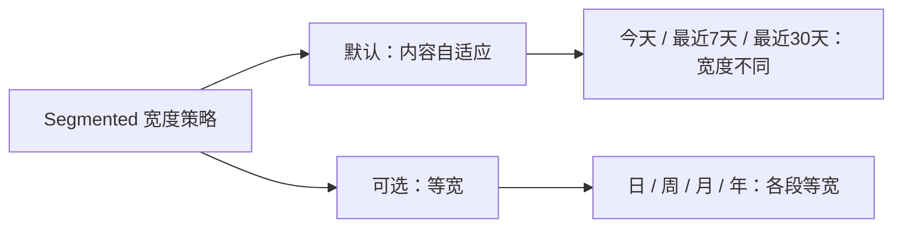

# Segmented 支持等宽选项布局

基础浮块式 Segmented 默认按内容自然分配宽度；有些场景，例如“日 / 周 / 月 / 年”，需要各段均分空间，形成对称布局。本增量在不改变 Headless 选择行为的前提下，提供**可选等宽模式**，而不是用统一宽度替代默认布局。

## 布局能力

内容自适应模式遵循选项 Children 的实际自然尺寸及通用内边距。等宽模式则使本组可见 Option 使用一致的水平占位，具体利用 Bevy `Node` 的常规布局属性实现，不为每种文字长度维护宽度表。整体容器宽度和每项细部尺寸仍可由调用方 BSN Patch 调整。

宽度策略属于 Segmented 的布局配置，不能只把它写成 Gallery 的 Demo Patch 而不提供控件级的可选能力。其具体公开字段名称与承载方式遵循现有 Scene Props 和持久 Runtime Component 边界：若配置仅作用于初始化可由 Props 表达；若支持运行时切换则需要持续存在的配置源。讨论仅确定“提供可选模式”，并未要求动态切换宽度策略的专用 Setter，因此不额外引入运行时变更 API。

无论宽度策略如何，选中项仍由同一 Checked 决定，Group 仍保留一个共同容器与浮块式高亮；选中变化不触发动画，Option 的任意 Children 不受内容类型限制。允许调用方使用 BSN Patch 对最终 Node 尺寸实施有意覆盖，但库自身配置与 Patch 的覆盖优先关系要按 BSN 既有组合规则落实。

## 完成条件

- 对照不同长度文本的默认自然宽度与四个等宽选项的均匀宽度，确认两种模式视觉上确实不同。
- 检查选中项变更、单项 Disabled、组禁用、Theme 更新不改变布局模式，不引入选中项大小抖动或额外业务事件。
- 用非字符串 Children 和 BSN Patch 自定义容器尺寸验证模式不是依赖固定字宽和示例内容；同步控件布局说明。

等宽只规定水平分段的宽度关系，不在此引入 Small/Medium/Large 尺寸档位，也不提前规定竖向模式需要各段等高。
