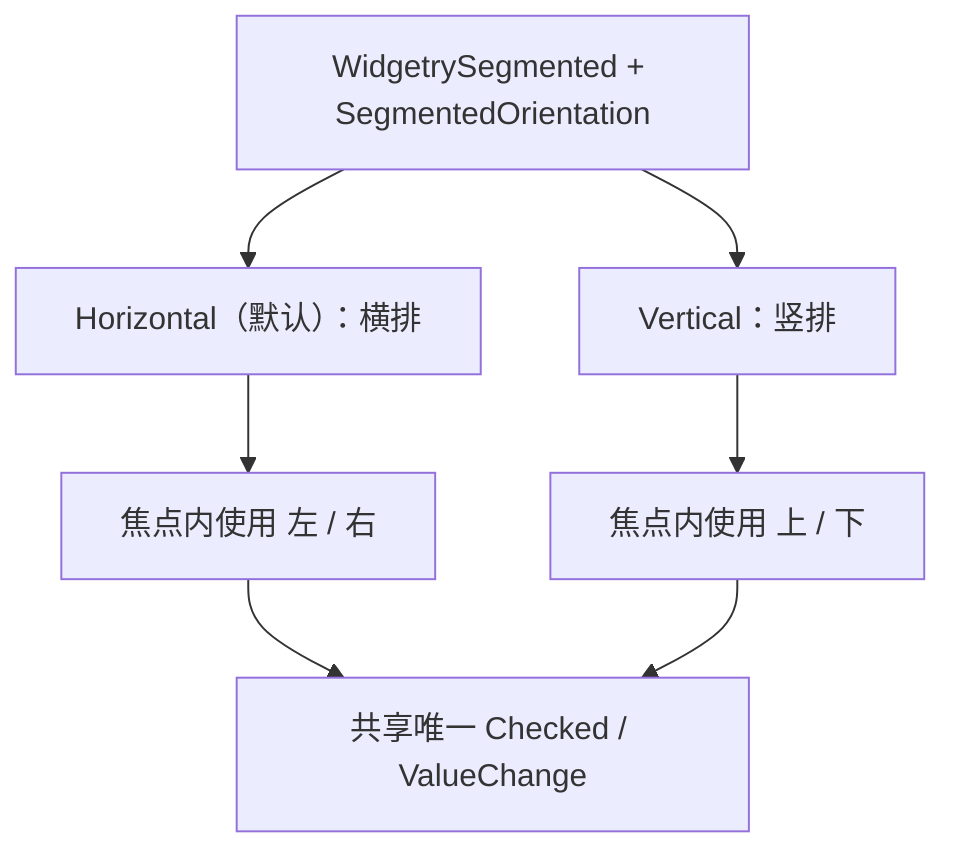

# Segmented 支持竖向分段与键盘方向

横向 Segmented 已经具备严格单选、主题样式、可选等宽策略和焦点内方向键切换。竖向模式只改变选项排列和与方向有关的输入映射，其余交互、事件、选中状态、禁用处理、主题与 BSN 内容组合全部复用，不另建 VerticalSegmented 控件。

## 同一个控件的方向配置

公开 `SegmentedOrientation` 两个取值：`Horizontal` 与 `Vertical`，默认横向。方向是控件配置而非对单个 Option 的单独设置；调用方不需要在两个不同组件之间切换。它同时影响容器主轴布局和有效键盘操作，因此**只用 BSN Patch 把 `FlexDirection::Row` 改成 `Column` 并不等价于切换方向**。

- 横向：选项按 Children 顺序从左到右排列，仅 `←` / `→` 负责向前/后移动。
- 竖向：选项按 Children 顺序从上到下排列，仅 `↑` / `↓` 负责向前/后移动。
- 两种方向均要求 Group 拥有焦点、跳过禁用项、到首尾停止、不循环；无焦点或组整体 Disabled 时不响应方向键。
- 鼠标点击后可以获得焦点，但两种模式都不参与 Tab 导航。

方向改变不增加新业务选择类型、重选事件或第二个 Checked。程序 `set_selected(index)`、结构增删和自动选择邻项都按 Children 顺序执行，而不按屏幕二维坐标或高亮块位置计算。选中项背景即时切换，不引入滑动动画。

## 竖向布局和主题

竖向仍然是一体式共享背景容器，选中的那一段拥有独立中性高亮块。组级焦点边框、选中 Disabled 时保留可识别块、单项 Disabled 的淡化表现、整体 Disabled 与局部 ColorOverrides 均与横向使用同一套 Style 规则。

选项内容仍可为任意 Children，尺寸允许由 BSN Patch 定制；不引入竖向专用尺寸档位。已有等宽模式的讨论只确定了横向各段同宽，没有要求竖向各段等高。两种配置共存时，竖向下宽度策略的精确映射需要尊重 Node 的主轴/交叉轴语义，不能未经约定自动增加“等高”承诺。

本次方向配置仅承诺在 BSN 构造时选取 Horizontal 或 Vertical，不增加运行时方向 Setter，也不承诺调用方在控件存活期间直接修改方向配置即可完成切换。方向配置的存储形式应符合 Scene Props 与运行时 Component 的现有边界：正常使用时布局和键盘输入读取一致的有效方向，不能出现外观竖向却仍响应左右键的分裂状态。

## 完成条件

使用相同 Option 内容分别构造 Horizontal / Vertical，验证渲染顺序、背景块位置、布局自适应、外层焦点边框、主题切换及 Disabled 的一致性。输入测试验证水平时仅左右有效、竖直时仅上下有效，非对应轴按键不改变选择，两方向均跳过 Disabled、首尾不循环且 Tab 不进入。程序选择和删除当前项后的邻项回退在竖向模式下保持与横向相同的身份和索引语义。

该增量独立于 Gallery 示例的开发；Gallery 在后续单独展示两个方向。
