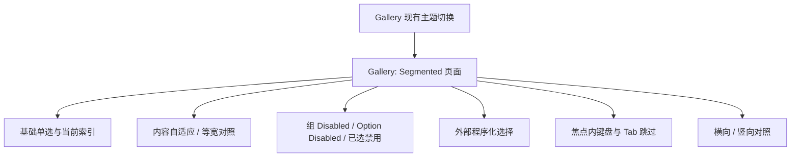

# Gallery 展示并验证 Segmented

Segmented 已经具备横向、竖向、内容自适应、等宽布局、主题与禁用表现。Gallery 作为真实使用者提供独立展示页，直接构造 Widgetry 控件，并让用户能通过鼠标、键盘和外部程序化操作观察其行为；不能用静态图片或在 Gallery 内再实现一套模拟 Segmented 来替代。

## 演示结构

页面接入现有的 GalleryPage 导航、Mount/Unmount 与 BSN Scene 组织方式，不另起独立应用。当前 Gallery 页面通过具体的 DemoPlugin、导航注册及页面生命周期管理展示控件，Segmented 延续同类方式；主题展示使用宿主现有的四套主题切换能力。

### 基础选择与可观察索引

提供少量文本选项，如“日 / 周 / 月 / 年”，切换时展示当前 `ValueChange<usize>` 的索引。当前真正选中的实体应与屏幕高亮一致。再次点击当前选中项不会额外产生用户选择事件；不同组互不影响。

### 布局对照

在同一展示区域分别给出内容自适应与等宽两组控件。前者用“今天 / 最近7天 / 最近30天”等不同长度的内容体现自然宽度，后者用等内容或等视觉占位突出均分宽度。调用方修改尺寸时通过 BSN Patch，而不展示不存在的尺寸枚举。

### 禁用与程序控制

展示普通 Option 禁用、当前已选 Option 禁用、整个 Group 禁用三种状态，确保用户能看出被禁用时依然选中哪项。配置外部按钮调用公开的 `set_selected()`，验证程序化操作可以在 Disabled 条件下合法选择，且不会误发用户事件。禁用只拦截 UI 交互，不改变业务状态。

### 方向与焦点

在页面中展示横向与竖向控件，分别演示焦点内左右和上下切换、首尾不循环、跳过禁用项。点击获得焦点后有效，焦点离开后失效，Tab 不进入 Segmented。容器焦点边框与选中块保持明确区分；两个方向都没有选中块滑动动画。

## 验证与文档同步

- 演示页通过现有 Gallery 页面入口可访问，并在页面退出后按既有生命周期清理组件与 Observer，不留下持续接收输入的实例。
- 使用现有 GUI / BRP 验证机制检查真实点击、方向键、Disabled 输入拦截、程序化变更、当前 Checked、事件通知及主题切换的可观察结果；测试使用真实控件，不依靠截图猜测其 ECS 状态。
- 手动或自动 UI 检查横竖向布局、内容自适应与等宽对照、四套主题及禁用后的高亮可辨性。业务状态应先提交，UI 仅体现最终状态。
- 同步 `docs/gallery.md` 中新增页面的功能和演示范围；必要时接入现有导航本地化与颜色 Showcase 入口，而不是创建与 Gallery 体系并行的展示框架。

## 功能边界

Gallery 只是这些已实现能力的消费者，不在本阶段加入新 Headless 接口、选项排序、重选事件或动画系统。前面增量已完成的单元测试不因增加一个 Demo 页面而整体重做；回归聚焦页面接入和确实受影响的实际输入链路。
