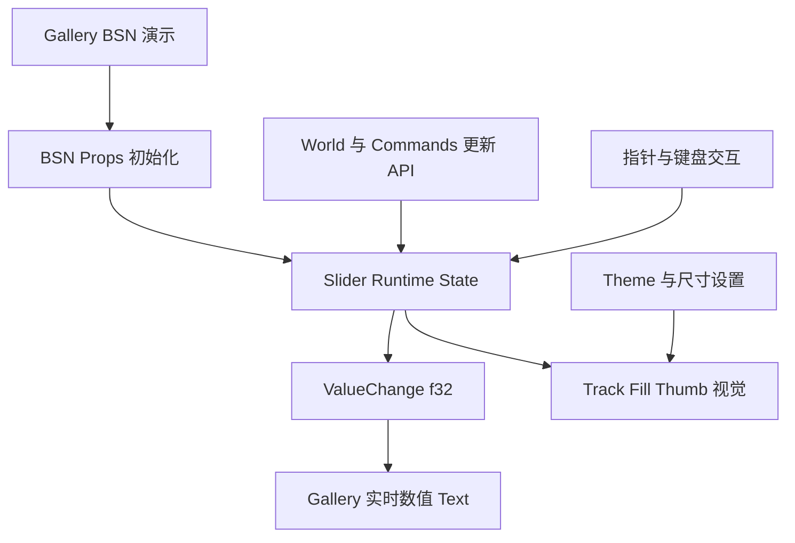

# Slider 控件整体设计

Slider 是单值数值输入控件，基于 Bevy 0.20 的 BSN 场景构造，并沿用 Widgetry 现有的状态访问、变化通知和主题机制。范围限定为水平与垂直 Slider，既允许连续数值，也允许按方向步进；不包含 Range Slider、ProgressBar 或刻度线，控件本体也不附带数值文字。

设计的核心是把数值状态、用户输入、视觉投影和使用示例分清楚。BSN Props 在创建时设置数值域、初始值、方向和视觉尺寸；创建后由持久 Runtime State 负责数值，程序化 API 和用户输入通过受校验的修改路径更新它。Style 根据状态与实际布局绘制 Track、Fill 和 Thumb；Gallery 使用真实控件，并在控件外显示实时数值。

这张图表达功能关系而非软件包之间的全部依赖：State 是值的唯一权威，Style 只展示状态，Gallery 是消费者，不为 Slider 另建一套状态来源或模拟控件。

## 功能增量与顺序

**先建立数值模型，再接入交互，然后补齐可视样式，最后在 Gallery 中组合展示。** 其中数值模型和程序化 API 本身可独立验证；交互增量复用同一个状态更新契约；Style 需要读取数值与方向并适配实际几何；Gallery 依赖前面的可用控件。

1. [Slider 数值状态与程序化 API](01-slider-value-api.md)
2. [Slider 指针与键盘交互](02-slider-input.md)
3. [Slider 外观、尺寸与主题样式](03-slider-style.md)
4. [Slider Gallery 展示](04-slider-gallery.md)

每份方案包含对应的测试和文档同步要求；最终 GUI 行为的验证随可见控件与展示页面完成，不另设只有验收工作的阶段。
