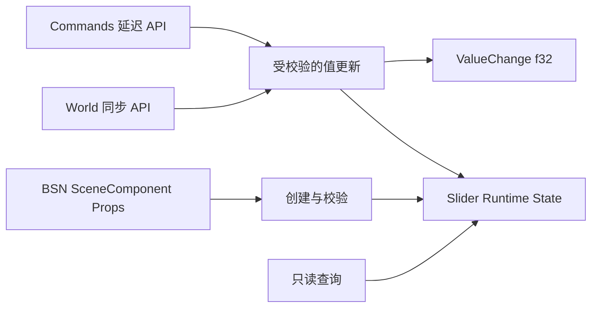

# Slider 数值状态与程序化 API

## 目标与设计思路

首先交付一个**不依赖视觉绘制就可通过 BSN 创建、查询和程序化修改**的单值 Slider 数值模型。该增量建立 Widget 的配置合法性、值域规则、公开访问入口和变化通知，让随后的鼠标与键盘交互使用同一状态提交契约，而不是维护第二套数值。

范围仅涉及单值 Slider 的 Headless 状态、初始化与程序控制；指针键盘输入和可视化 Track / Thumb 分别由后续增量完成。保持 Bevy 0.20 与项目现有 `SceneComponent + Props`、`World` / `Commands` 风格，不设计通用 Binding 或统一 Widget 总线。

工程入口随此增量建立：将 `crates/slider` 纳入 Workspace，按其他控件的习惯提供 Slider Plugin，并在顶层 Facade 中增加可选 Feature 和公共类型重导出。场景初始化不依赖后续的视觉样式。

## BSN 初始化与状态所有权

Slider 的数值类型为 `f32`。构造 Props 提供 `min`、`max`、`step: Option<f32>`、可选初始 `value`、水平或垂直方向。未指定初始值时采用 `min`；指定初始值时遵循相同的合法值规则。方向是控件的既定语义配置，水平表示左小右大，垂直表示下小上大。

`min`、`max` 和 `step` 只在构造时设置，创建后不可修改；`value` 则属于可更新的持久 Runtime State。Props 不在运行时保留同义数值副本，也不允许外部直接替换内部 State Component 绕过公开 API。必要的运行时范围与步进配置应由控件持久配置保存，供校验和后续交互读取。

构造校验要求 `min`、`max` 以及显式指定的数值均为有限值，且 `min < max`、区间跨度可以正常计算。`step = Some(x)` 时，`x` 必须是有限的正数；非法配置明确报错，不通过默认值静默修复。

## 连续模式与步进模式

在 `step = None` 时，任意位于 `[min, max]` 的有限 `f32` 值都合法。

在 `step = Some(step)` 时，两个端点始终有效，步进规则不是固定以 `min` 为原点的唯一网格。方向从任意端点出发，沿既定步距推进，遇到区间边界时允许直接到达边界。因此程序化设置接受从 `min` 或 `max` 任一端以步距可到达的合法值，而非只接受从 `min` 起算的那一组值。

例如 `min = 0, max = 10, step = 3`：

- 从 `min` 增加可经过 `0 → 3 → 6 → 9 → 10`。
- 从 `max` 减少可经过 `10 → 7 → 4 → 1 → 0`。
- 程序化设置 `4` 合法，设置 `4.5` 应返回错误；这两个例子检验的正是双端点可达而非单向固定网格。

浮点比较需照顾 `f32` 运算误差，避免数学上合法的步进值被错误拒绝，但不能以容差为由无条件吸附明显非法的程序化数值。当前方案不承诺十进制小数的精确表示。

## 公开 API 与变化通知

接口沿用现有 Widget 调用风格，提供只读数值查询、同步 `World` 更新和 `Commands` 延迟更新。具体函数名、参数组织参照现有 TextField、RadioGroup 等控件，避免建立独立的通用 setter 抽象。

同步更新在调用时校验、提交并通知；`Commands` 入口只负责排队，必须到命令实际执行时再校验、提交及通知，不能把入队视为数值已经更改。使用 `Result<bool, BevyError>` 的同步写入遵循以下契约：

| 结果 | 含义 |
| --- | --- |
| `Ok(true)` | 合法且实际改变 `value` |
| `Ok(false)` | 合法但设置值与当前值相同 |
| `Err(...)` | 输入、目标实体或前置条件无效，拒绝修改 |

更新成功且值实际变化时，必须先提交 Runtime State，再发出 `ValueChange<f32>`；同值设置不发通知，失败不改变状态也不发通知。程序化 API 允许修改 Disabled Slider 的 `value`，通知行为不因此变化。此处不新增 Origin 字段，也不增设独立的提交确认事件。

## 无效输入与接口边界

无效目标实体、缺少所需 Slider 组件、NaN、无穷值、越界值以及违反步进可达性规则的数值，都应明确报错；不得静默 Clamp、吸附或伪装为成功但未变化。错误处理、命令失败传播和日志遵循现有 Widget API 规则。

**待核对的技术前提：** 与现有 `ValueChange<f32>` 集成时，需要核实 `is_final` 字段的真实含义和使用约束。既定业务语义是每次真实变化实时通知、不需要独立的释放/提交事件；字段兼容性不能成为改变该契约的理由。

## 完成条件与验证

完成 BSN 初始化、状态查询、同步和延迟写入后，使用 Unit Test 与从外部调用的 Integration Test 覆盖：默认及显式初始值；有限性、`min < max`、正常跨度和 `step > 0`；连续模式范围；双端点步进可达性与 `4` / `4.5` 等边界；合法同值；非法实体和无效数值；失败原子性；`Commands` 实际执行时的校验；Disabled 下程序化更新；事件触发数量以及 Observer 读取到已提交值的顺序。

对应的 crate 公共 API 与状态契约应进入该 crate 功能文档，并按工程规范维护测试覆盖模型。后续输入和样式增量复用本方案的数值与通知约束，不再建立新的 State Authority。
