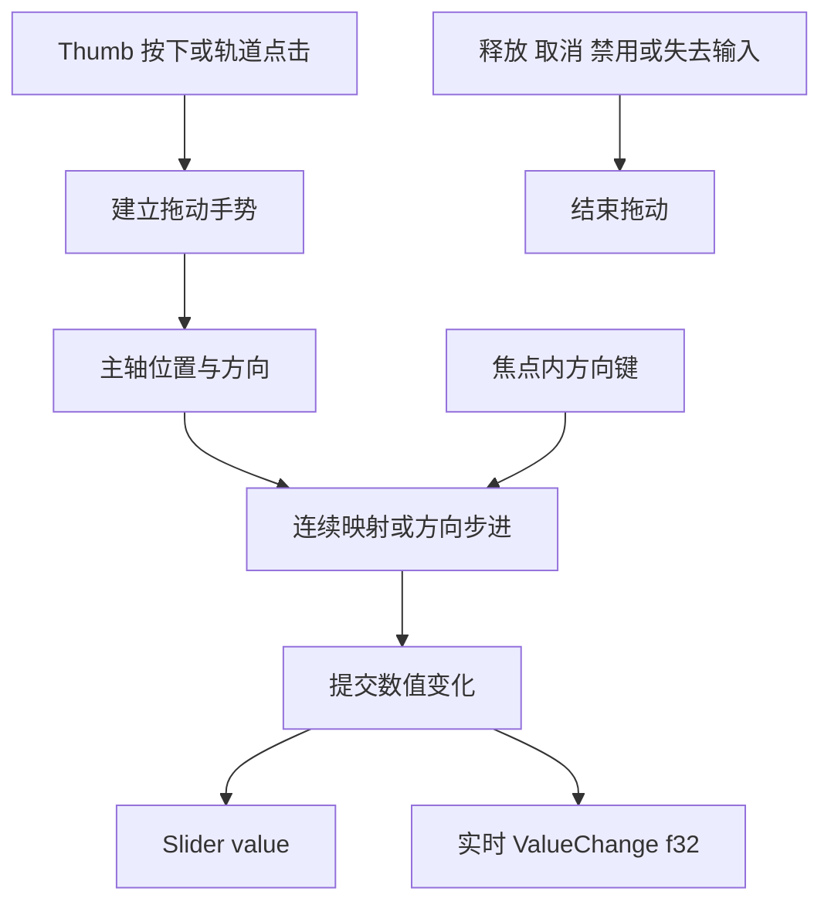

# Slider 指针与键盘交互

## 目标与设计思路

在已有 Slider 数值状态和程序化更新契约上接入用户操作，使连续模式与步进模式都能由鼠标、键盘改变同一个 `value`。本增量完成 Headless 输入语义、拖动生命周期和输入到数值的转换；轨道、填充段、Thumb 的最终视觉绘制属于下一份方案。

交互不把一次鼠标移动事件等同于一次步进。指针的位置、拖动起点和方向共同决定目标值；用户操作仍走受校验的状态更新路径，使变更通知与程序化 API 一致。

## 鼠标与拖动

Thumb 的按下和轨道点击有不同的初始行为：

- **按下 Thumb：**仅开始手势，记录抓取起点及相对偏移，不应因为按在 Thumb 的左侧、右侧或上侧而瞬间改变数值。拖动时根据主轴上的相对移动距离更新值。
- **点击轨道：**立即计算点击位置对应的目标值并更新，同时进入可继续拖动的状态。
- **拖动持续期间：**使用水平 X 轴或垂直 Y 轴的真实几何映射。超出轨道两端的指针位置限制到最邻近端点；拖出控件外仍保持当前拖动，前提是窗口继续提供有效输入。

横向从左到右为增大方向；纵向从下到上为增大方向。手势计算必须使用实际的轨道长度、Thumb 尺寸和抓取偏移，不能假设视觉组件永远使用默认尺寸。具体尺寸与可见节点由 Style 增量配置和呈现。

在 `step = None` 时，主轴位置连续映射到 `[min, max]`。在 `step = Some(step)` 时，数值按当前移动方向递进，以**当前值**作为方向反转后的新步进锚点，而不是始终套用从 `min` 起算的刻度。例如 `0 → 3 → 6 → 9 → 10` 后反向是 `10 → 7 → 4 → 1 → 0`。鼠标输入事件的密度或触发次数不应改变相同指针行程的预期步进结果。

这里需要保持两个约束同时成立：方向步进由当前手势状态决定，端点始终能够抵达；指针/轨道几何转换由实际布局提供，而不是让数值模型依赖 Thumb 的画法。

释放鼠标、Pointer Cancel、拖动取消、应用失去有效焦点或有效指针捕获后，必须结束拖动，防止卡在 Dragging。结束拖动只清理手势状态，**不另发 ValueCommitted，也不补发同一数值的 ValueChange**。

## 焦点内键盘操作

只有获得输入焦点且有效启用的 Slider 响应方向键：

| 方向 | 减少 | 增加 |
| --- | --- | --- |
| 水平 | `←` | `→` |
| 垂直 | `↓` | `↑` |

`step = Some(step)` 时，每次向对应方向前进一个步距，直至边界；`step = None` 时，每次按区间跨度的 **1%** 增减。按住方向键的重复输入继续生效。此版不实现 Home / End 快捷键。

键盘改变值与鼠标改变值遵循同样的先提交后通知原则，实际未变则不通知。焦点处理遵循现有 Bevy / Widgetry 输入方式，不建立 Slider 专属焦点体系。

## Disabled 与输入守卫

采用现有 `InteractionDisabled` 的有效禁用机制。Disabled 时轨道点击、Thumb 拖动和键盘输入均不改变值；拖动中途变为 Disabled 则立即结束手势。程序化修改不受 Disabled 限制，该例外由前一份数值 API 方案负责。

本阶段不能通过自行忽略失败请求来掩盖状态模型错误；合法输入计算产生的变化仍必须经共同的更新逻辑并遵循事件契约。

## 完成条件与验证

重点对行为转换建立确定性 Unit Test / Integration Test：按 Thumb 不跳值、抓取偏移、轨道点击立即更新并继续拖动、拖出轨道 Clamp、释放/取消/失焦后无残留拖动、水平与垂直方向、连续值与步进值、方向反转、事件频率不影响步进、键盘重复及 1% 连续步长、端点、Disabled 中断以及同值无事件。

输入变更与前一份方案的运行时值和 `ValueChange<f32>` 对接，保持程序化与交互一致。`ValueChange<f32>` 中 `is_final` 的兼容性需要在实际接入时核对，不能为此新增松开时的第二次通知。功能行为与受支持输入边界写入对应 crate 文档；最终视觉命中区域的 GUI 验证由随后 Style 增量在真实几何布局下完成。
