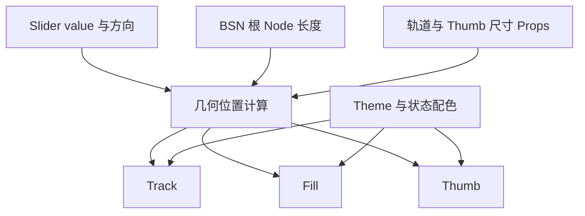

# Slider 外观、尺寸与主题样式

## 目标与设计思路

为已经具备数值状态和交互语义的 Slider 添加真正可见的 Track、Fill、Thumb，并复用项目既有 Theme、状态色和 BSN Props。视觉层只把数值、方向与当前布局投影为外观；不持有第二套数值状态，也不决定步进是否合法。

## 轨道、填充与 Thumb

默认使用细长的胶囊形 Track，Thumb 为直径大于轨道厚度的实心圆形。轨道分为已填充段和未填充段：填充色使用主题强调色，未填充段使用较低对比度的主题颜色。Fill 始终从 `min` 一端延伸到 Thumb 中心。

水平 Slider：左端为 `min`、右端为 `max`，从左向右填充。垂直 Slider：底端为 `min`、顶端为 `max`，从下向上填充。特别注意垂直方向**不能把顶部到 Thumb 的部分绘为已填充段**。

第一版不绘制 Ticks，不内建百分比、当前值、最小值或最大值文字；数值标签属于调用方可自行通过 BSN 组合的外部 UI。

## 默认尺寸与 BSN 自定义

| 项目 | 默认尺寸 |
| --- | --- |
| 轨道厚度 | `6px` |
| Thumb 直径 | `20px` |
| 水平主轴长度 | `200px` |
| 垂直主轴长度 | `200px` |
| 交互区域厚度 | 至少 `28px` |

视觉轨道的厚度不等于指针的实际可命中区域；即使 Track 只有 6px，用户也不必精确点到 6px 的范围内才能操作。

长度通过调用方在 BSN 上修改 Slider 根节点的 `Node` 控制。Track 厚度与 Thumb 直径通过 Slider 的 BSN Props 覆盖默认值；本次不要求直接 Patch 内部 Track / Thumb 的 `Node`，也不为它们引入独立运行时尺寸设置 API。

构造时通过 Props 覆盖默认尺寸，或运行期根节点主轴布局发生变化时，Thumb 位置、有效拖动行程、轨道点击投影与命中区域都必须使用实际布局数值计算，不能把默认 `20px` 写死到交互几何里。Props 仍是一次性构造输入，不是运行时尺寸状态来源；拉长轨道不等于拉伸 Thumb。

## Theme 与交互视觉状态

沿用现有 Theme / Style 配色机制以及局部 Color Overrides，而不是为 Slider 创建与其他控件不同的配色体系。Theme 切换后，正常与禁用态的轨道、填充和 Thumb 应更新为当前主题颜色。

| 状态 | 视觉反馈 |
| --- | --- |
| Normal | 主题默认 Track、Fill 和圆形 Thumb |
| Hovered | Thumb 略微高亮 |
| Pressed / Dragging | Thumb 使用按下态颜色 |
| Focused | Thumb 外侧显示键盘焦点环 |
| Disabled | 整体使用禁用态配色，仍显示当前值对应的 Thumb 位置 |

状态切换不改变布局尺寸，以免悬停或按下时 UI 抖动；此阶段不引入复杂动画。Focus 反馈与交互层的焦点语义对应，而不是仅在鼠标悬停时模拟焦点环。

## 完成条件与验证

Style 功能在真实 Bevy BSN 布局下验证：连续和步进值对 Thumb 位置的投影、两个端点、水平左到右填充与垂直下到上填充；默认 `6/20px` 和 Props 自定义尺寸后的显示与移动范围；根 `Node` 主轴长度变化后的行程；Track 命中区域与 Thumb 抓取偏移；Hovered、Pressed、Focused、Disabled；Theme 切换和局部颜色覆盖。

必要的状态及几何边界测试放入 Slider crate；可观察的 GUI 行为按现有 BRP / GUI 验证规则检查，特别关注 BRP Pointer 与真实 Windows Mouse 的输入差异。样式 API 与行为文档随功能更新。不增加刻度绘制、内建数值文本或对内部节点的公开 Patch 承诺。
