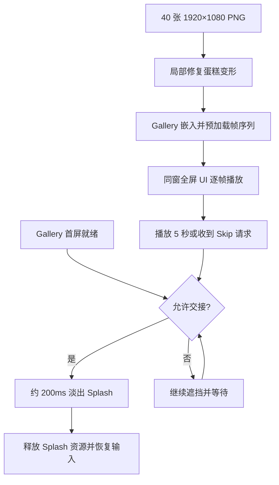

# Gallery 逐帧 Splash 替换设计

Gallery 启动插画改为播放已经生成的千石冠吃草莓蛋糕动画。输入素材是 40 张连续编号、1920×1080 的 RGB PNG；播放速率 8 FPS，名义演出时长 5 秒。动画结束后用约 200ms 的透明度淡出，让此前已经构建并准备好首屏的 Gallery 自然露出；右上角的 `Skip` 提供同一条提前结束路径。

这次是**对现有 Splash 的直接替换**，不是让旧分层角色动画与新帧序列并存。原先的 800ms 探头/挥手/眨眼、独立手臂与丝带图层、离屏合成、圆形波纹揭幕及其手掌锚点不再构成新方案的行为。新的播放画面直接以 UI 图像覆盖 Gallery；窗口、Gallery 页面、主摄像机与已有首屏准备机制保持各自原有职责。

这里有三种不同的责任：素材修复负责让静止蛋糕在局部异常帧中保持稳定；逐帧播放器负责启动、加载、显示与安全交接；Skip 按钮负责把用户的提前结束意图交给播放器，而不是自行绕过 Gallery 就绪判断。Skip 与自然播放完成共用淡出和清理路径。

## 实施顺序

1. [01｜修复 Splash 帧序列中的蛋糕形变](01-修复Splash帧序列中的蛋糕形变.md)
2. [02｜使用 40 帧动画替换现有 Gallery Splash](02-使用40帧动画替换现有GallerySplash.md)
3. [03｜为逐帧 Splash 增加透明 Skip 按钮](03-为逐帧Splash增加透明Skip按钮.md)

第 1 项交付可复用的最终 PNG 资产；第 2 项使用这些资产完成播放和 Gallery 淡出交接；第 3 项在已有交接路径上提供可见、可点击且不打扰画面的跳过入口。每份方案都附带各自功能需要的验证，不再另建纯验收阶段。
