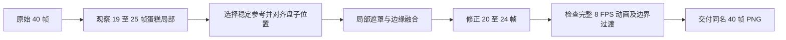

# 修复 Splash 帧序列中的蛋糕形变

## 目标与范围

将现有千石冠 Splash 的 40 张 PNG 帧序列中、以 `frame_020.png`～`frame_024.png` 为主的蛋糕形变修复到连续播放时不明显跳变，保留已经满意的人物动作、表情、猫耳出现和背景风格。此项只交付素材，不承担 Gallery 逐帧播放逻辑。

输入是已经处理为 1920×1080、顺序编号 `frame_000.png`～`frame_039.png` 的 40 张 RGB PNG。当前有一份曾经局部修复的 `splash_frames_fixed.zip`，但仍存在轻微变形；它是候选输入而非已验收成品。原始 `splash_frames.zip` 及最终 H3 视频可用于对照。输出仍是同名、同数量、同尺寸、同色彩模式的帧序列，不改变 8 FPS、5 秒的播放约定。

## 修复思路

这段镜头的相机固定，蛋糕与白盘在画面右侧，按演出设计都不需要运动。H3 的纹理重建导致草莓、奶油、海绵夹层和盘子边缘在局部帧间漂移；如果改动整张图，反而容易破坏人物连续动作。因此只修静物区域，尽量将它视为一块保持造型的平面插画。

重点不是让单张修复图更漂亮，而是让连续帧不出现突然的形状变化。`frame_019.png` 与 `frame_025.png` 是修复段两端的对照锚点：优先观察它们的盘子中心、草莓顶部、奶油轮廓及分层位置。不能假设两张图的蛋糕已经完全相同；需要先确认它们的差异是否足够小，才能决定中间统一使用哪个参考，或是否需要平滑位置调整。

## 局部图像处理机制

### 选择修复对象与遮罩

遮罩以**蛋糕、白色盘子及必要的接触阴影**为对象，尽量避开角色的手、叉子、头发、衣服和较远的背景。已有图像中，蛋糕位于画面右下方；具体裁剪框必须从实际 1920×1080 PNG 观察得到，不把先前交流中估算的像素坐标直接当成固定事实。可通过 Python/Pillow 做区域裁剪、局部透明遮罩及柔和边缘融合；精确对位和修复路径允许选择更合适的局部图像处理办法。

矩形硬粘贴会暴露亮度或背景接缝，因此要使用贴合静物的非矩形遮罩，并在边缘做少量羽化。过宽的羽化会把变形蛋糕残影混入修复结果；羽化范围需靠连续画面对比确定。静物区域也不能与叉子上的独立小口蛋糕混淆：被角色拿起的小块随手运动，盘中主体与白盘不随之发生结构变化。

### 对齐与连续性

静态参考可先取 `frame_019.png`，再用 `frame_025.png` 检查区域两端。需要时以白盘中心和蛋糕底部为对位基准，修正参考区域与目标帧的细微位移，不直接在同一坐标贴矩形。对照的核心特征是：

- 三角切片的外轮廓、大小、朝向和透视关系；
- 顶部红色草莓与奶油形状，不在帧间忽大忽小；
- 正面红色草莓夹层、白色奶油与黄色海绵的边界、厚度、排列；
- 白盘的椭圆外形、投影与桌面接触位置。

如果第 19 帧与第 25 帧之间存在极小位移，应优先使观众看到的**视觉过渡**连续，而不是为了绝对不变而在第 20 帧产生可见跳位。原则上只编辑 `frame_020.png`～`frame_024.png`；如边界仍明显跳变，先记录原因，再仅对消除该跳变所必要的相邻静物区域做最小范围调整。不得为了消除轻微蛋糕差异而重构整段人物动作。

### 输出与可复核性

修复后的 40 帧仍按 `frame_000.png` 至 `frame_039.png` 连续编号。对未修复的图片保持字节不变；对修复帧只变更必要的局部像素。保留原始输入以便回滚和与新旧素材做差异对照；提交时不把临时裁剪图、遮罩预览、接触表或 H3 源视频当作 Gallery 运行时必需资源。

可在处理阶段另导出一段 8 FPS 的 5 秒 MP4 或缩略图接触表用于人工查看，但它们是验收辅助，不进入运行时帧集合。素材修复没有引入新的插帧或二次 H3 生成，也不改变原定播放总时长。

## 完成条件与风险边界

- 输出恰好包含 40 张 RGB PNG，每张为 1920×1080，名称从 `frame_000.png` 连续到 `frame_039.png`；检查没有缺号、错序或尺寸不一致。
- 对 `frame_018`～`frame_026` 逐张观察蛋糕局部，重点比较 19→20 与 24→25；在 8 FPS 连续播放时，看不到明显的新硬贴片接缝、重影或跳位。
- 冠的脸、动作、叉子、发丝、猫耳和背景与选定输入相比保持不变；不产生新的遮挡错误或人物局部损坏。
- 既不为追求单帧绝对一致而损害运动连续性，也不声称局部融合能消除 H3 在全部 40 帧中的所有微小纹理漂移。验收标准是实际观看时局部异常得到明显改善。

此增量的最终产出是**可直接用于 Gallery 的帧序列资产**，下一增量负责加载与播放；两者职责分开。
