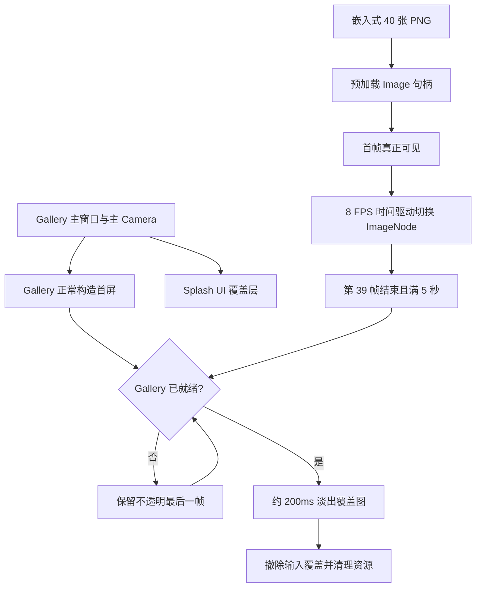
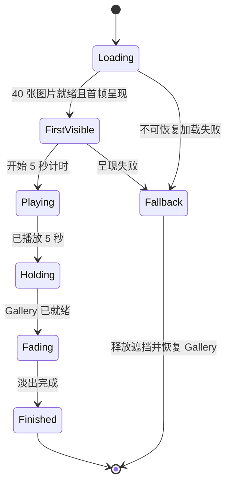

# 使用 40 帧动画替换现有 Gallery Splash

## 独立目标与交付

用 40 张 1920×1080 的千石冠 PNG 帧序列，**直接替换**现有 Gallery 启动 Splash 的分层角色动画，实现单次、8 FPS、5 秒的全屏逐帧播放；正常播放结束时通过约 200ms 的透明度淡出交接至已就绪的 Gallery，然后释放启动动画占用的临时实体与图像句柄。

本增量包含启动资源预加载、画面覆盖、动画计时、正常完成、淡出以及清理。**不保留旧 Splash 模式的兼容开关或双路线切换。** 为保证本增量可独立运行和验收，它不依赖第三份方案中的 Skip 按钮：没有 Skip 时，五秒结束后也能够正常进入 Gallery。Skip 只是在后续为同一生命周期增加提前结束请求。

输入取自素材修复增量的 `frame_000.png`～`frame_039.png`，并维持固定的 1920×1080、RGB PNG、40 帧、8 FPS 约定。不重新生成动画，不做 MP4 解码，不创建 Atlas 或动态视频播放器，不增加通用逐帧动画控件。

## 整体机制

保留现有 Gallery 主窗口、Gallery 主摄像机、原有页面构造与首屏准备机制。逐帧 Splash 采用位于 Gallery 内容上方的 UI 图像覆盖层，显示当前帧，并在切换时更新图像句柄。由于画面本身包含角色、蛋糕和背景，不再需要旧式分层拼装、单独转动手臂或丝带，也无需把离屏角色场景交给 Shader 进行圆形揭幕。



同一窗口内 Gallery 始终在下层绘制，而 Splash 在上层遮挡；**淡出修改的是上层 Splash 的透明度，露出的是真实 Gallery，而不是 Win32 桌面。** 旧圆形波纹与 `SplashRevealMaterial` 不参与新流程。整个生命周期没有额外原生窗口，也不替换窗口透明 DX12 初始化路径。

## 运行时资源与画面

### 40 张 PNG 的嵌入与预加载

在 Gallery 资源入口中注册最终 40 张 PNG，沿用项目当前的嵌入资源机制（`EmbeddedAssetRegistry`、嵌入式 `AssetPath`、`AssetServer`）。保持 `frame_000.png`～`frame_039.png` 的确定顺序；只纳入运行时需要的最终帧，不把接触表、预览 MP4、修复遮罩或历史对照素材混入可执行文件。新资源的目录与常量组织应支持清楚枚举 40 个句柄，避免运行期依赖磁盘路径通配或文件系统排列顺序。

启动时一次性发起 40 张 `Image` 的加载，并在 Splash 会话里保存强句柄，使播放时不会因句柄提前释放而缺图。资源装入 CPU 不等同于已上传 GPU，也不等同于第一帧已经在屏幕上呈现；播放计时必须依赖首帧真实可见的条件，而不是简单从 `Startup`、`AssetServer::load` 或 CPU 加载完成开始。

40 张 1920×1080 的 RGBA8 GPU 纹理约为 316 MiB（40×1920×1080×4 字节），这笔短时占用已被接受，**不为当前实验降到 720p**。退出 Splash 时应撤销保持资产存活的句柄并销毁显示节点，允许未再引用的解码纹理与 GPU 纹理依引擎资产生命周期回收；嵌入在可执行文件内的原始 PNG 数据不等于可回收的运行时 GPU 图像。

### 全屏显示与画幅

UI 中只保留一个主要 `ImageNode` 用于显示整幅插画。画幅以 16:9 的 1920×1080 为设计坐标，实际显示区域覆盖 Gallery 窗口客户区。对于非 16:9 的窗口，采用等比的 **cover** 适配并居中裁剪，而不是独立拉伸宽高比例；这样既避免新增黑边，也不会把冠和蛋糕压扁。窗口尺寸、DPI 或缩放发生变化时，按当前客户区重新计算覆盖位置，不改变 40 张原始图片尺寸。

显示层位于所有正常 Gallery 页面与窗口控件之上，并在播放、等待 Gallery 就绪及淡出期间正确遮挡下层页面。动画可以不添加品牌 Logo、进度条、占位卡片或额外背景文字；已有完整帧序列本身就是视觉内容。初次纹理上传前需要不透明兜底画面，避免短暂闪现 Gallery 或桌面；兜底画面在 Splash 首帧确认呈现后再安全撤除。

## 播放时钟与正常交接

### 8 FPS 的时间规则

播放顺序严格为 `frame_000.png` 至 `frame_039.png`，每帧名义停留 125ms，40 帧总共 5 秒。用真实经过时间决定当前帧：

```text
frame_index = min(floor(elapsed_seconds * 8), 39)
```

例如 `0–0.125s` 显示第 0 帧，`2.5–2.625s` 显示第 20 帧，`4.875–5.0s` 显示第 39 帧。不能把窗口每次重绘直接当成“下一帧”，否则渲染帧率不同会改变动画播放速度。更新调度如果迟到，按当前时间选择正确帧而非补播数张过时帧；观察时保证 5 秒墙钟内的正确顺序和节奏。

沿用现有按需重绘环境时，动画活动期间必须持续请求重绘，使 125ms 的帧切换有机会被呈现；播放与淡出结束后停止额外请求，回归原有 `WinitSettings::desktop_app()` 行为。播放时钟从**首帧已显示、窗口有效可见**后开始。窗口最小化、遮挡或暂时不可见时不应继续消耗播放进度，恢复可见后接着播放，避免用户回来发现动画已经在后台结束。

### Gallery 就绪与 200ms 淡出

五秒达到时不再切换帧，最后一帧保持可见；只有在 Gallery 首屏已就绪时，才开始约 200ms 的淡出。所需就绪条件包括：Gallery 正常主页面已经挂载、现有首屏准备/呈现信号有效，而不是仅以 `Startup` 结束或任意 `LoadState::Loaded` 代替可见画面。

淡出期间，逐帧画面不再变化；上层覆盖图的 alpha 从 1 平滑过渡到 0，下面露出 Gallery 已有 UI。淡出完成后，撤销 Splash 的图像节点、兜底层、生命周期资源、强图像句柄与输入隔离，必要时等待对应的完成呈现条件，避免刚移除实体就产生一帧闪烁。**正常退出与未来 Skip 提前退出共用同一条交接与清理路径**，不依赖旧的圆形揭幕逻辑。

下面的状态图说明正常播放与等待行为的职责，不要求沿用旧 `SplashPhase` 的名称或变体：



## 与现有代码的替换关系

新实现集中在 `gallery/src/splash/` 与 `gallery/src/assets*`，`gallery/src/main.rs` 只保留必要的注册和 Setup 接入。现有 `gallery/src/splash/animation.rs` 中的 800ms 时间轴、探头、手臂旋转、两根丝带摆动、BodyOpen/BodyClosed 切换会被移除或直接重写为逐帧播放。`scene.rs` 不再创建旧角色图层树与离屏 Camera/RenderTarget，而是主 Gallery Camera 下的全屏图像 UI 覆盖；`lifecycle.rs` 改为 5 秒播放加淡出交接。

旧 `material.rs`、`ripple.rs`、`assets/splash/reveal.wesl`、图层几何映射、旧图层 PNG、旧演出预览/测量相关的专用逻辑与引用，在没有其他消费者时应一并删除或重写，以免长期残留无法再进入的分支和资源。旧版 `GALLERY_SPLASH_PREVIEW` 的 0–800ms 参数语义、旧分层素材/Shader 的故障注入入口不需要兼容；受替换影响的基准/预览脚本与测试应同步调整或删除失效部分，不保留旧行为的测试作为新 Splash 的准入门槛。

`gallery/src/gallery.rs`、普通 Page 与控件库不应为这次 Splash 新增专用状态；已有 Gallery 首帧就绪机制可按现状被读取。主窗口、Windows 透明 DX12 渲染初始化、主 Camera、日志与当前 Gallery 的页面构造顺序不能因 Splash 替换而被改写。现有针对波形、文件对话框与页面生命周期的基准入口，不应被这段新的五秒 Splash 干扰。

## 异常与边界

- **加载失败或首帧无法呈现：**必须有有限等待与清晰错误记录；发生不可恢复错误时恢复 Gallery，而不是让不透明兜底层无限占据窗口。旧逻辑的默认 5 秒等待超时不能与正常的 5 秒演出共用同一个计时阈值；资源等待、播放、交接等待应区分。
- **Gallery 尚未就绪：**保持可见的最后一帧并继续隔离输入，不提前淡出到空白内容；如 Gallery 持续失败，应按照现有启动/降级机制有限处理，不人为制造假加载时间。
- **输入隔离：**播放、等待与淡出时底层 Gallery 不能被鼠标、滚轮、键盘 Tab、IME 等误操作。后续 Skip 控件可在覆盖层上接收自己的点击；不能通过全局放开拾取来实现跳过。结束时恢复原本输入行为，不保留悬挂焦点或错误鼠标拦截。
- **窗口与渲染：**只遮盖 Gallery 主窗口，不出现在其他独立窗口；关闭、最小化、DPI 与尺寸变化不能留下无法清理的覆盖节点或永不停止的重绘请求。保持 GPU/首帧呈现检测与不透明兜底之间的合理顺序，避免因为异步渲染滞后一帧而闪屏。

## 本增量的验收

在 Windows x64 的真实 Gallery 中：启动时不会显示空白、透明桌面或提前露出的 Gallery；40 张完整 PNG 以 8 FPS 正确播放 5 秒，人物、蛋糕和画幅无拉伸、无错帧；播放结束若 Gallery 已就绪则约 200ms 自然淡出，未就绪则安全保持最后一帧。结束后 Gallery 第一页、既有窗口交互、输入焦点和光标仍正常，Splash 显示实体与 GPU 纹理引用清理可观察。

验证覆盖正常启动、启动时异步加载、窗口缩放/最小化恢复、Gallery 延迟就绪以及资产失败路径；测试/基准中与这次替换直接相关的代码同时更新，不另设纯回归方案。该增量通过后，即使没有 Skip 按钮，逐帧 Splash 已可作为完整的默认启动演出。
