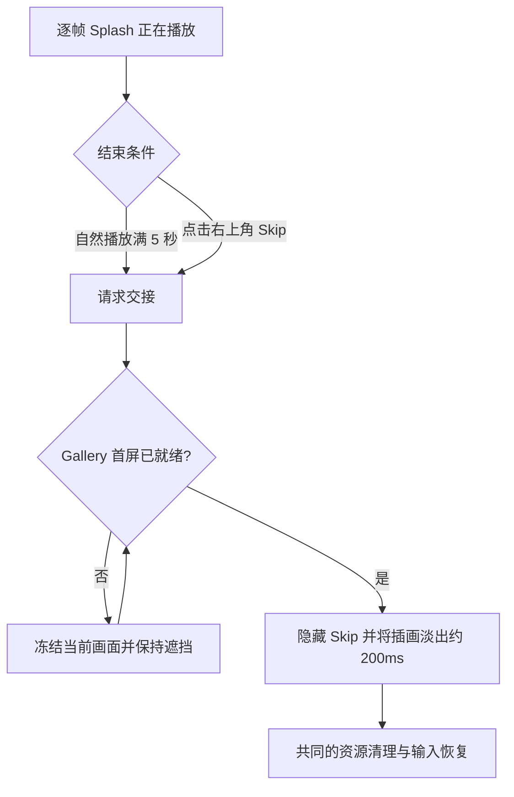

# 为逐帧 Splash 增加透明 Skip 按钮

## 目标与范围

为已经运行的五秒逐帧 Splash 增加右上角 `Skip` 控件，允许用户在动画尚未自然结束时提前进入与正常结束完全一致的 Gallery 淡出与清理流程。默认视觉样式是**完全透明背景、淡色且低对比度的细边框**，避免在安静的奶油/薰衣草色块插画上出现突兀的按钮底色。

本增量只负责跳过交互、按钮呈现和相关输入边界，不重复实现逐帧动画、资源管理或淡出算法；复用前一增量已建立的退出请求与交接机制。不引入通用 Button API，不改 Widgetry 公共按钮组件，也不要求兼容原先的分层动画或波纹预览逻辑。

## 交互思路

Skip 位于主窗口 Splash 覆盖层之内，盖在插画右上角且不会随着逐帧图片内容移动。正常播放满五秒与用户点击 Skip 产生同一种“请求结束动画”的意图；请求不是“立刻拆掉上层遮挡”。只有 Gallery 就绪时才从当前画面启动约 200ms 淡出，否则停住当前帧并保持覆盖，等待安全交接。

这个设计可以防止用户快速点击 Skip 时露出尚未准备好的空 Gallery，也保证跳过路径与正常播放路径有一致的最终视觉效果。

## 视觉与布局

按钮固定在 Gallery 主窗口**客户区右上角**，与窗口边缘保留适当内边距，文字保持小而清楚；不混入第 0～39 张 PNG，也不作为单独一张可随帧改变的图片。它由 Splash 自己的 Bevy UI 层绘制，在缩放、分辨率或 DPI 改变时依照窗口客户区重新布局，并始终处于插画上方。

### 常态

- **背景：**透明，alpha 为 0，不使用实色底板或大片半透明矩形；
- **边框：**细线、淡色、低透明度，让轮廓可辨但不抢眼；可从非常浅的灰紫色或白灰色系选取，具体颜色以真实动画背景下的可读性为准；
- **文字：**`Skip`，对比度足以辨认，但颜色不采用突兀的纯黑或高饱和强调色；
- **形状：**简洁的小圆角矩形，留出稳定的点击区域，不为了视觉小巧压缩到难以点击。

### 悬停与按下

按钮悬停时可以让边框、文本稍微清晰，背景最多出现一层很淡的透明色；按下时提供轻微反馈即可，不添加大面积高亮、弹跳动画或音效。保持与 Splash 的安静演出一致。焦点/键盘辅助视觉如果由现有 UI 机制提供，不应造成背景事件穿透。

这组样式重在约束“背景透明、边框淡、可辨认且可点击”，并未锁死具体 RGBA 数值；在实际 Gallery 窗口查看后可以微调色值与边距，而不改变交互机制。

## 事件与生命周期

### 输入接收边界

原有 Splash 输入隔离要区分 **Skip 控件可交互** 和 **下层 Gallery 不可交互**。覆盖层阻断对 Gallery 的鼠标点击、滚轮与非 Skip 输入，Skip 本身作为上层可拾取按钮接收点击；不能简单将整张覆盖层设为忽略 picking，从而使用户点到被遮住的主页面按钮。

现有 `splash/input.rs` 对窗口级键盘、IME 等消息的隔离思路仍然有效，但不能因此误阻断 Skip 的正常指针事件。若使用 Bevy 原生 UI Button、交互组件与样式系统，可只在 Splash 私有模块完成，不改变 `GalleryPage` 或 Widgetry 公共 Button 行为。

### 跳过的确定性

点击时仅提交一次退出意图，随后进入相同的等待 Gallery 就绪/淡出流程；连续点击、双击和按钮被销毁时晚到的事件不能触发重复清理。在过渡开始时让按钮不再接收交互，可直接隐藏或随整体覆盖层消失，避免它在淡出期间继续可见或可点。显示插画停在哪一帧都能 Skip，不依赖当前帧编号，不重新把计时器启动一次。

如果 Gallery 还没有就绪，Skip 请求应被冻结并被记住，而不是失效；当前画面保持不透明，直到现有 Gallery 就绪条件满足才交接。如果发生同一套启动故障降级，也须复用前一增量的安全清理路径，而不是单独留下一层 Skip 遮挡。

## 完成条件与边界

- 正常播放时右上角出现 **透明背景、淡色边框** 的 Skip；普通窗口尺寸下视觉不突兀，不遮挡冠的脸与蛋糕主体，鼠标可以可靠点击。
- 在第 0 帧、中间帧、接近第 39 帧分别点击，均能在 Gallery 已就绪时提前触发约 200ms 淡出；正常播放五秒自动结束仍有效。
- Gallery 尚未就绪时点击不会露出空白页面，跳过请求最终能正确完成；多次点击不会重复退出、重复释放资源或出现闪烁。
- Splash 存在期间，点击画面其他区域、滚轮、Tab 与 IME 不会误触下层 Gallery；退出后恢复普通鼠标、键盘、页面切换和光标行为。
- Gallery 主窗口缩放和 DPI 变化后，Skip 仍固定在客户区右上角且可点；独立窗口不出现该控件。

只处理本增量涉及的交互与必要验证，不将 Skip 升级成全项目通用控件，也不为了旧 Splash 的预览参数或 Shader 路径保留兼容代码。
