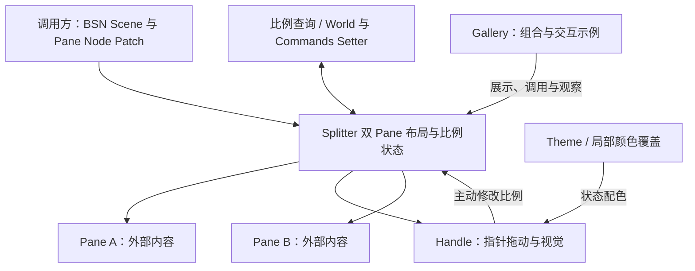

# Splitter 整体设计与实施顺序

Splitter 是独立的双 Pane 布局容器：调用方经 BSN 提供两个 Pane 的 UI Scene，并直接在各 Pane 的布局实体上 Patch 原生 `Node` 最小/最大尺寸；Splitter 管理主轴空间、保存 `split_ratio`、处理 Handle 拖动，外部负责 Pane 内部的 UI、滚动和裁剪。

整个设计采用唯一比例模型。主轴上先扣除 Handle 的布局厚度，再按 `split_ratio` 分配 Pane A 和 Pane B；Pane 本身的尺寸约束由 Bevy `Node` 表达，而非 Splitter 重复定义。Splitter 的有效主轴下限/上限由两侧 Pane 的限制及 Handle 厚度决定。主动拖动和 Setter 按当下可达范围限制目标；被动布局变化不改写保存的比例。

实施顺序是 **Headless 基础双 Pane 布局 → Headless 运行时比例 API → Headless Handle 拖动 → Style → Gallery**。这条顺序不是按文件或函数分组：基础布局可单独构建与验证，运行时 API 可独立程序化操控已存在的布局，拖动是依赖这些能力的用户输入增量；样式为已有交互提供视觉反馈，Gallery 在最后组合并展示完整控件。每个增量的测试、错误处理与必要文档同步随该增量完成，不额外设置纯验收阶段。

## 子方案

1. [Headless：构造双 Pane 并实现约束布局](01-headless-layout.md)
2. [Headless：实现运行时比例 API 与变化通知](02-headless-runtime-api.md)
3. [Headless：实现 Handle 拖动与交互禁用](03-headless-handle-drag.md)
4. [Style：实现 Handle 视觉与主题配色](04-style-handle.md)
5. [Gallery：展示 Splitter 的布局与交互](05-gallery.md)
