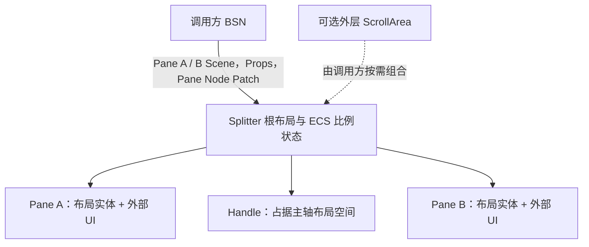

# Headless：构造双 Pane 并实现约束布局

本增量交付一个可以通过 BSN 构造、按初始化比例分割空间、正确遵守两侧尺寸约束的双 Pane Splitter。它在没有外部程序化 Setter、Handle 拖动和主题视觉的情况下，已经能独立展示固定分割布局，并在容器缩放时合理更新实际几何。

Splitter 不是把分隔条塞进调用方任意两个兄弟节点的操作。它必须拥有固定的 Pane 布局实体，才可以明确掌握主轴尺寸分配，不必推断或改写外部兄弟的结构。

## BSN 结构与职责

Splitter 固定组织 Pane A、Handle 和 Pane B 三个内部区域。两个 Pane 的布局实体由 Splitter 创建；调用方以 BSN `Scene` 传入任意 UI 内容，不另设计 Builder 或 Spawn Callback。Pane 内可以放入其它 Widget，包含嵌套 Splitter。Splitter 不接管任何 Pane 子内容的业务布局、滚动和裁剪。

**外部 Scene 的 BSN Patch 必须直接作用在对应 Pane 的布局实体**，而非只能 Patch 其下的另一个子节点。这一组合能力会决定调用方是否真的能在目标 Pane 上设置 `min_width`、`max_width`、`min_height`、`max_height`；需要实际 BSN 组合测试证明，不能仅看外层图形位置推断 Patch 成功。

`orientation` 通过一次性 Props 初始化，创建后不支持切换：

- `Horizontal`：A 左、B 右，Handle 沿水平方向移动；主轴读取宽度。
- `Vertical`：A 上、B 下，Handle 沿垂直方向移动；主轴读取高度。

Splitter 根节点参加外部正常 UI 布局。在页面中占据哪里、交叉轴如何排布，仍交给外部布局；Splitter 只托管两侧 Pane 的主轴分配，不接管交叉轴上的子内容排列。

## 比例状态和实际几何

只采用比例分割，不提供第二种固定像素模式。`split_ratio` 定义为 **Pane A 占扣除 Handle 后的可分配主轴长度的比例**。默认为 `0.5`，由 BSN Props 初始化；Scene 展开后存入 Splitter 自有、持续存在的 ECS Runtime State，不保留另一个 Props 状态副本。

例如水平 Splitter 总宽 1008px、Handle 占 8px，则 Pane 的可分配宽度为 1000px。`split_ratio = 0.3` 对应 A 300px、B 700px。竖向按相同规则计算高度，比例越大，上侧 Pane 越高。

`handle_thickness` 是初始化时配置的布局参数，默认 8px，决定 Handle 沿主轴占据的空间，并为后续指针交互提供命中区域几何。可见线条属于后续 Style 增量；不能把视觉线条厚度误当作布局扣除量。

### Pane 原生约束与根尺寸范围

调用方直接在两个 Pane 的 `Node` 配置各自最小、最大尺寸，不在 Splitter Props 增设 `min_pane_size`、`max_pane_size` 等重复约束。左右分割以 `min_width/max_width` 为准，上下分割以 `min_height/max_height` 为准。

- 外部拥有 Pane 的原生 `min_*` / `max_*` 约束；Splitter 不改写这些约束。
- Splitter 控制 Pane 主轴的尺寸分配字段，结合约束计算可以让 Handle 到达的位置。Bevy UI 布局执行最终的原生尺寸限制。
- Splitter 自身的**有效主轴最小尺寸** = 两侧 Pane 主轴最小尺寸之和 + Handle 厚度。不能因为父容器太小，就强行压破 Pane 最小尺寸。
- 两侧 Pane **都有有限最大尺寸**时，Splitter 的有效主轴最大尺寸 = 两侧最大尺寸之和 + Handle 厚度；只有限制一侧而另一侧仍可增长时，不能由 Pane 约束推导一个有限的根最大尺寸。
- 以上有效范围应用于 Splitter 根的对应主轴，并在相关 Pane 约束变化时重新计算。

比如 A、B 均设置 `max_width: 300px`，Handle 为 8px，则 Splitter 最宽 608px。即使父容器宽 1000px，Splitter 内部也不会留下额外的 392px 空白；父容器如何使用剩余空间由外部布局决定。

反之，两个 Pane 的最小宽度之和已经大于父容器宽度时，Splitter 保留自己的下限。页面需要如何显示溢出、是否裁剪或在外面增加 ScrollArea，都由调用方负责；Splitter 不自动创建 ScrollArea，也不改变 Pane 内已有的滚动逻辑。

### 初始化和被动布局变化

初始化 `split_ratio` 可以早于首次布局尺寸产生：BSN 先接受比例，**首次获得有效布局时**计算当前合法范围，必要时将初值修正到边界，并用于实际布局。初始化修正不是业务上的主动修改，不发送业务比例变化通知。

之后 `split_ratio` 表达最近一次主动设置的目标，而**不要求在受约束的瞬间与屏幕上的实际比例相等**。父容器缩小或 Pane 约束被动变化时，布局可以暂时偏离目标，但不改写保存的 `split_ratio`，不触发比例变化事件；条件恢复后重新尝试达到原比例。

以下例子用于区分目标状态与被动布局结果：

这一规则防止窗口短时收缩时无意抹掉用户最后设置的分割位置。后续比例 API 与指针拖动只改变主动设定的目标；不在本增量引入程序化修改或输入处理。

## 这一增量的完成条件

验证不以构造成功代替真实布局检验：

- 使用 BSN 传入两个 Pane Scene，并分别 Patch 其布局实体的 `Node`；确认 Patch 设置的是 Pane 本体，不是内容子实体。
- `Horizontal` 与 `Vertical` 都按正确的左右/上下顺序分配空间；可在 Pane 内嵌套 Splitter，布局身份和尺寸分配独立。
- 验证 1008px / 8px / `0.3` 的示例分配，以及 `0.5` 默认值；初始化比例超出当前最小/最大布局边界时，首次有效布局后修正且不发送业务通知。
- 两侧 `min_*` 与 `max_*` 同时限制实际分配；Pane 约束变化后根的主轴有效上下限更新。双侧有限最大值时覆盖 300px + 300px + 8px = 608px；仅一侧有限最大值时不错误限制整个根。
- 外部缩放导致最小尺寸超出父容器时，不压破 Pane 限制；用外部 ScrollArea 组合观察溢出、滚动与裁剪均由调用方管理。
- 容器被动变窄使目标 30% 暂时呈现 35%，恢复尺寸后返回 30%，持久 `split_ratio` 不被被动过程改写。

按现有工程约定在独立 Widget crate 内实现布局和自有状态，提供必要的 Plugin 装配；顶层 `bevy_widgetry` Facade 通过现有的独立 Feature 和模块导出方式开放 Splitter，而不承载其行为实现。相关功能文档随本增量说明已经建立的布局能力。后续 Runtime API、Pointer 输入和主题外观仍属于独立的增量。

## 约束与错误边界

`split_ratio` 的初值与尺寸配置必须有效；Pane 自身 `Node` 的最小/最大约束若互相矛盾，应明确识别为不合法布局条件，不能静默绕过限制。无效构造或关键内部布局实体缺失按仓库错误机制反馈。

本增量只托管 Pane 主轴空间及根的有效上下限，不更改调用方 Pane `Node` 的原生约束，也不干涉 Pane 内部控件的布局、焦点、输入与滚动。外部无法满足根尺寸下限时，Splitter 保持约束，展示问题由父级布局处理。
