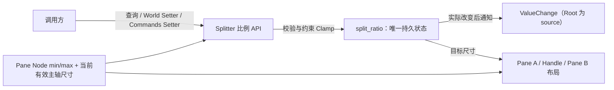

# Headless：实现运行时比例 API 与变化通知

本增量让已存在的双 Pane Splitter 在运行时可以由程序主动调整比例，并让调用方观察已经提交的真实状态变化。基础布局、首次布局修正和被动缩放的规则继续保留；此处只新增可独立验收的公开读写能力与通知，不提前接入鼠标拖动。

## 只有一个运行时比例权威

`split_ratio` 在 BSN 构造时初始化，Scene 展开后由 Splitter 自有 ECS Component 持续保存。对外提供只读查询与明确的 Setter；不支持调用方直接替换或移除内部状态 Component。原生 Pane `Node` 的 min/max 仍归调用方维护，不另存一份等价约束状态。

比例定义不变：Pane A 占 **Splitter 主轴减去 Handle 厚度** 后可用空间的份额，取值属于 `[0, 1]`。横向是左侧份额，纵向是上侧份额；不提供固定像素分配模式。比例状态记录最近一次**主动设定**的目标，而不保证受被动约束时与呈现几何完全相同。

## 主动 Setter 的限制与结果

程序化设置与后续用户拖动采用相同的可达边界：根据当前可用主轴尺寸、Handle 占用和两个 Pane 各自的原生最小/最大限制，先将请求 Clamp 到实际合法比例，再保存这个最终比例。**不得保存一个请求值，同时在屏幕上显示另一个可达值**。

例如可达范围为 `[0.3, 0.8]`：

- 设置 `0.1`，最终保存 `0.3`，布局目标也是 30%。
- 设置 `0.9`，最终保存 `0.8`。
- 查询与通知反映最终提交的 `0.3` / `0.8`，不是调用者输入的越界请求值。

对 Setter 输入先校验：非有限浮点数，或不在比例定义 `[0, 1]` 的请求属于非法操作；范围内的请求才根据当前可达区间做 Clamp。这与“合法比例受 Pane 约束”是两层不同的限制。

**运行时 Setter 需要已有有效布局尺寸。** Splitter 尚未完成首次有效布局，或者当前主轴尺寸不足以计算有效约束时，调用返回错误：不更新状态、不发通知，不为其另建延迟请求队列。BSN 初值属于基础构造流程，可在首次有效布局时自动修正，不受 Setter 前置条件影响。

由父容器 Resize 或 Pane `Node` min/max 更新引起的**被动布局变化**只改变实际几何，不写回保存的 `split_ratio`、也不发比例变化通知；恢复足够空间后重新靠近之前的目标。例如原目标为 30%，父容器缩小导致实际 35% 时状态仍为 30%。与此相对，主动调用 Setter 设置不可达到的 10%，会直接保存最近可达的比例（例如 30%）。

## 查询、提交与通知契约

沿用仓库 Widget API 的两种入口：

- 只读 API 查询当前已保存比例。
- 同步 `World` Setter 在调用时校验、Clamp、提交；可用 `Result<bool, BevyError>`：实际变化 `Ok(true)`，合法请求最终与当前状态相同 `Ok(false)`，不满足前置条件或非法输入 `Err(...)`。
- `Commands` Setter 入队时不保证数值已变化，实际执行命令时才校验、Clamp、提交和通知；执行失败通过宿主 Error Handler 报告。

状态修改先于变化通知。**只有主动操作最终保存的比例真的变化**，才从 Splitter 根 Entity 发出 `ValueChange<f32>`。程序化设置是已完成的一次性更新；初始化、被动布局更新与合法同值 Setter 不产生业务值变化事件。事件表达的是提交的比例，不承诺布局渲染已经在同一时点完成。

通知也不用于驱使调用方再次写回比例；Splitter 自己是状态 authority。后续拖动将复用这套提交与通知规则，在移动过程中实时报告变化，而不建立第二份状态。

## 本增量的完成条件

- `World` 查询返回初始化后保存的比例；同步和排队 Setter 均可以在布局有效后修改两侧 Pane 的目标主轴尺寸。
- 以 `[0.3, 0.8]` 为界验证 `0.1 → 0.3`、`0.9 → 0.8`：查询、布局目标和 `ValueChange<f32>` 值一致；合法同值设置不发事件。
- 验证 `[0,1]` 之外、NaN、无限值、无效根 Entity、内部状态缺失与未产生有效主轴布局尺寸时的错误；同步失败和命令执行失败均不部分提交、不虚发通知。
- 初始化比例越出约束时仍在首次有效布局后修正，初始化不生成事件；父容器 Resize 或 Pane min/max 被动变化不写回目标，恢复后再尝试原来的分割位置。
- 检验从 Root 发出的事件一定在状态提交后可读到最终比例，并区分 `Ok(true)` 与 `Ok(false)`；`Commands` 的效果只能在排队操作执行后观察。

按现有错误报告与 Widget API 规范更新自有 Runtime State 的公共接口及相关功能文档。基础双 Pane 结构不改变；本阶段只交付程序化可控的 Splitter，不增加鼠标手势、Handle 配色或 Gallery 业务。

## 错误与约束边界

非法请求、无效目标或关键内部结构缺失均按仓库统一错误机制报告，失败时保持原状态。需要保护由 Splitter 托管的尺寸分配字段，避免调用方绕过比例 API 破坏“唯一状态与实际分配”契约；调用方依然可以维护 Pane 自身 `Node` 的原生 min/max 约束。无效尺寸条件不是一次正常的同值更新，不能静默当成 `Ok(false)`。
