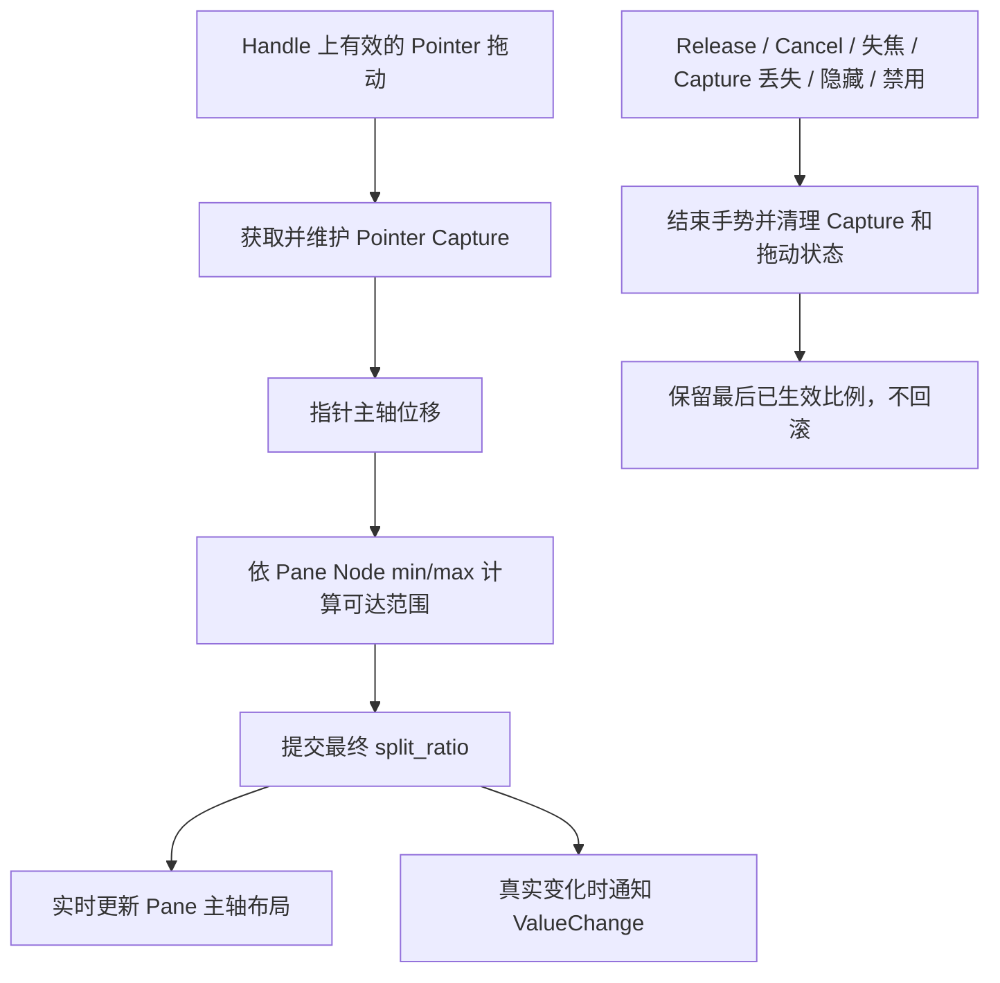

# Headless：实现 Handle 拖动与交互禁用

本增量在已经支持程序化比例调整的 Splitter 上，加入 Handle 指针拖动，使用户可以直接调整两个 Pane 的空间分配。拖动过程复用现有的 `split_ratio` 状态、尺寸约束和 `ValueChange<f32>` 提交通路，不建立另一个拖拽比例来源。

本增量交付的是交互行为而非视觉皮肤。Handle 的布局命中区域已经由基础布局提供；Normal / Hovered / Dragging / Disabled 的线条颜色和鼠标光标由后续 Style 增量处理。

## Handle 拖动与尺寸边界

用户按住 Handle 后，指针移动即实时改变两个 Pane 的主轴大小，不等 Release 才调整。水平分割让 Handle 左右移动，垂直分割让 Handle 上下移动；左右或上下方向上的 Pane A 份额仍按“主轴长度扣除 Handle 厚度”计算。

Handle 的命中区域默认沿移动轴占用 8px，由初始化 `handle_thickness` 定义，跟实际布局扣除长度一致。Pointer Capture 维持拖动，使指针即使移出 Splitter 矩形，只要有效手势未终止就仍能继续输入；指针再返回时可以正常继续调整。

在每次尝试移动时按当前有效主轴长度及双方 `Node` min/max 约束限制 Handle。到边界后指针即使继续移动，Handle 也不得越过；向反方向回移后可立即恢复。输入实际可达的比例才保存为 `split_ratio`，不把边界外的鼠标位置暗存为未来目标。

例如左 Pane `min_width: 200px` 时，向左拖到左 Pane 宽 200px 就停止；继续向左不改变比例，向右移动则继续增大 Pane A。右 Pane 最小尺寸及双方最大尺寸同样可以限定这一段可移动区间。这个规则与程序化 Setter 的 Clamp 一致：**主动操作只提交合法且实际可达到的目标**。

### 主动提交与被动变化的区别

拖动是主动操作：每当实际提交的 `split_ratio` 变化，就先提交状态，再从 Splitter 根实体触发 `ValueChange<f32>`，并实时应用 Pane 布局。没有变化的鼠标 Move、顶在限制上的 Move、按住不移动的手势，都不产生比例变化通知。

父容器 Resize 和 Pane 约束的外部变化则属于被动布局变化，不改写最后一次主动目标、不产生比例事件；空间恢复后自动尝试回到原目标。若拖动过程中约束本身改变，仍按当前可达范围限制下一次主动调整，不允许绕过尺寸限制。

## 手势生命周期

本控件只提供指针拖动，**不提供键盘调整**。Esc、方向键等键盘输入不会修改或中断 Splitter 的比例手势，也不为 Handle 建立另一套键盘交互模型。

正常 Release 结束拖动。Cancel、窗口失焦、Pointer Capture 失效或丢失、控件隐藏、变为不可交互等中断情况，需要终止手势并清理 Pointer Capture 和内部拖动状态；最后已经生效的比例保留，不自动回退到 Press 之前。多个终止来源同时到来不应导致重复保留失效的拖动状态。

手势取消与比例回滚是不同概念：输入的生命周期结束，并不撤销已经实时分配给两个 Pane 的大小。无需为此创建未在原设计中定义的专用撤销历史或额外键盘指令。

## `resizable` 与原生 Disabled 的区别

`resizable` 只表示**用户是否可以用 Handle 拖动**，不表示整个 UI 子树被禁用。设置 `resizable: false` 后，Handle 不启动有效拖动，两个 Pane 中的 Button、TextField 等外部内容仍照常交互；已经进行中的拖动进入不可交互状态时按生命周期规则清理。

**程序化比例 Setter 不受 `resizable: false` 限制**：它仍可以在具有有效布局尺寸且请求合法时调整 `split_ratio`，并按统一规则通知外部。

反过来，在 Splitter 根或祖先上使用原生 `InteractionDisabled`，则保留 Widgetry 已有的有效禁用继承机制：Handle 与两个 Pane 内部的控件都会被禁用。禁用阻止用户拖动，但合法的程序化比例更新仍按 Widget API 正常执行；本增量不为了只禁用 Handle 而破坏祖先 Disabled 的继承语义。

## 本增量的完成条件

- 横向与纵向都可通过真实指针拖动实时改变 Pane A / B 的尺寸及保存的 `split_ratio`，松开后停留在最后位置。
- 验证 Pane A / B 的最小、最大尺寸分别能够钳住 Handle；顶在边界继续移动不越界、不产生同值通知；反向拖动立即恢复。
- 指针移出 Handle 和 Splitter 后，Pointer Capture 持续维持有效拖动，返回后行为正常。
- 正常 Release、Cancel、窗口失焦、Capture 丢失、隐藏、拖动中禁用均能清理活动手势；取消保留最后提交比例，没有比例变化时不通知。
- `resizable: false` 不接受鼠标拖动，但 Pane 内容继续工作；根/祖先原生 `InteractionDisabled` 同时限制 Handle 与 Pane 内内容。
- 分别在 `resizable: false` 和根 Disabled 时调用合法 Setter，验证程序化设置仍按约束提交且真实变化时发送 `ValueChange<f32>`；错误请求不改变布局状态。
- 用户拖动与程序化设置命中相同的 `[0, 1]`、Pane min/max 可达范围，拖动通知携带已经提交的最终值，不产生重复状态 authority。

按现有 Widget 输入、错误处理和必要的测试约定完成 Headless 行为及文档同步；鼠标交互完成后即可独立验证，不等待主题配色或 Gallery 页面。

## 交互边界

内部拖动只操作 Splitter 托管的主轴布局与比例状态，不抢占 Pane 内容自己的 UI、焦点和滚动职责。无效 Entity、缺失必要状态或内部 Handle 结构时按仓库错误契约反馈，不制造虚假的成功与值变化事件。Splitter 不额外创建 ScrollArea，不处理外部父容器无法满足最小尺寸时的裁剪或溢出显示。
