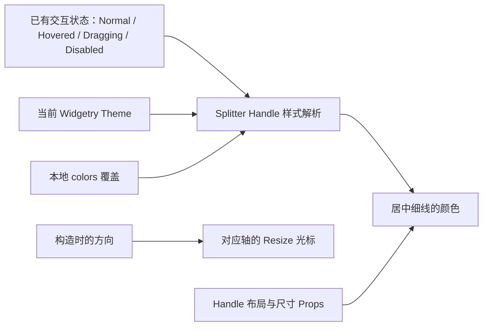

# Style：实现 Handle 视觉与主题配色

本增量为已经具有双 Pane 布局和完整拖动行为的 Splitter 提供可见、可反馈的 Handle 样式。视觉只表达已有的交互状态，不引入第二套布局状态，也不改变两侧 Pane 的内容外观。

默认采用简洁的中置分隔线，不添加 `⋮` 一类的抓手装饰。可见线条与可操作命中区域分离：让分隔线足够轻，拖动区域又不至于过窄。

## 命中区域与可见分隔线

`handle_thickness` 默认 **8px**：由基础 Headless 布局建立，表示 Handle 主轴上的布局占用，同时也是输入命中区域的宽度或高度。它需要从 Splitter 总主轴长度中先行扣除，Pane A、B 才按比例分享剩余空间。

`line_thickness` 默认 **2px**：表示 Handle 内部居中的可见分隔线粗细。两者通过 BSN Props 在构造时一次性配置，创建后不提供改厚度的 Runtime Setter。可见线条不能超过命中区域；配置必须合法。

例如水平分割中，Handle 在两个 Pane 之间占 8px，只有居中的 2px 画成线。垂直分割使用相同的“较大的命中区 + 居中的细线”机制，只旋转主轴方向，不增加抓手标记。

Normal、Hovered、Dragging、Disabled 的状态切换只改变颜色，不改变任何厚度，避免用户移动鼠标时布局跳动或 Pane 尺寸抖动。

## 状态、主题与颜色覆盖

Handle 使用 Widgetry 已有的 Theme 颜色机制，而不创建与全局主题脱节的单独系统。提供 Normal、Hovered、Dragging、Disabled 四个对应状态的颜色表达：

- **Normal**：低对比度的分隔细线，不抢 Pane 内容视觉焦点。
- **Hovered**：线条提亮，提示此区域支持拖动。
- **Dragging**：使用主题强调色，明确指针正在调整分割位置。
- **Disabled**：弱化颜色，表示当前无法通过 Handle 拖动。

配色覆盖遵循仓库现有 Widget Style API 习惯。`colors` Props 只负责初始化当前控件的局部 Override；运行时提供对应颜色覆盖的查询、设置和清除方式，未覆盖部分随当前主题变化，Theme 切换时重新解析与应用。无效颜色、无效目标以及合法同值的处理遵循现有 Style/错误约定。

Splitter 只渲染自己 Handle 的线条和状态反馈，不改写两侧 Pane 内部控件的背景、边框、字体或主题选择。样式状态直接读取 Headless 已建立的可交互状态和有效 Disabled 信息，不维护一个与实际状态冲突的独立 Authority。

## 调整尺寸光标

水平分割时，Handle 指针悬停采用**水平调整尺寸**的光标；垂直分割时采用**垂直调整尺寸**的光标。光标实现遵守现有 Cursor 语义和优先级，包括 Widgetry 已有的光标体系，不额外接管窗口全局 Cursor。

`resizable: false` 或有效 Disabled 时，Handle 不应视觉暗示仍可拖动；外部 Pane 内容的各自 Hover、焦点和光标仍由其自身控件负责。这里的 `resizable` 只管理 Handle 输入与样式，区别于在根或祖先上设置会向整个子树继承的 `InteractionDisabled`。

## 本增量的完成条件

- 默认 8px 命中区域内居中绘制 2px 线条；自定义 `handle_thickness` 与 `line_thickness` 后，实际命中区域、主轴扣除长度、线条居中与厚度保持一致。
- Normal、Hovered、Dragging、Disabled 视觉状态可切换且不改变几何尺寸；没有多余抓手标记。
- 水平/垂直两种 Splitter 的 Resize 光标方向正确，离开 Handle 后不覆盖外部 Pane 控件的正常光标。
- 验证 Widgetry 全部四套 Theme 的 Handle 配色和主题运行时切换；`colors` 局部覆盖、运行时 set/get/clear、局部缺省字段回退当前主题及非法覆盖处理正确。
- `resizable: false`、根/祖先有效 `InteractionDisabled`、指针 Hover 和拖动中断之间的样式优先级正确，实际不可拖动时不会错误显示 Dragging 样式。
- 在不同 Scale Factor 下检查分隔线与命中位置对应，尺寸不因 Hover / Dragging 改变；Pane 内外部内容自身的视觉不被 Splitter 重写。

样式完成后同步本控件的外观与主题 API 文档；运行时比例 Setter、输入与通知不在此重新实现，只验证样式与它们的连接。

## 边界

尺寸及颜色输入必须满足已有 Widget 配置校验；`line_thickness` 不能大于命中区尺寸。主题仅决定视觉表现，不改写 `split_ratio`、Pane min/max 约束、手势生命周期或内部布局结构。无效尺寸与颜色按仓库错误约定反馈，不以“忽略样式更新”替代错误处理。
