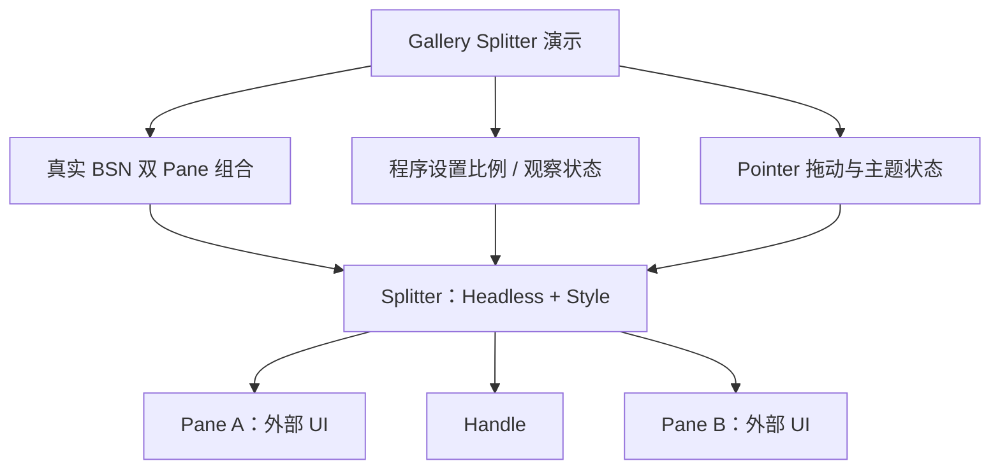

# Gallery：展示 Splitter 的布局与交互

本增量将已经具备 Headless 布局、运行时比例操作、Pointer 拖动和主题外观的 Splitter 接入 Gallery。交付目标是一个使用**真实 Splitter 公共 API 与 BSN Scene 组合**的可操作展示页面，而不是另一套模拟分割布局。

Gallery 应用内的场景和控件本体相互独立：Splitter 仍只管理双 Pane 主轴分配与 Handle，Gallery 负责演示内容、按钮、状态读数和外部容器，使最终使用者能够直观看到原设计的不同输入路径和布局边界。

## 展示布局和组合边界

页面同时展示 `Horizontal` 和 `Vertical`：水平的 A 位于左侧、垂直的 A 位于上方，两者 `split_ratio` 均表示 Pane A 在扣除 Handle 厚度后占据的份额。默认比例 0.5，另展示明确的非均分初值；当总宽 1008px、Handle 8px 且比例为 0.3 时，A/B 的空间对应 300px / 700px。

Pane 内容直接通过 BSN `Scene` 组合；至少有一个演示直接 Patch **Pane 布局实体**的原生 `Node` min/max 限制，而不是只能更改内容节点。可以在 Pane 内放入其他 Widget，并演示嵌套 Splitter，使固定双 Pane 结构与外部可组合内容之间的职责清楚可见。

此外需要展示父容器尺寸变动、Pane 的原生尺寸约束、以及由调用方**在 Splitter 外层组合 ScrollArea** 的情形。Splitter 不自动创造滚动容器，不决定内部 Pane 内容如何滚动或裁剪；该行为应从真实组合结构中表现出来。

## 程序设置、拖动与状态观察

Gallery 使用 Splitter 根上的公开查询与 `World` / `Commands` 比例 Setter，而不是直接替换内部 ECS 比例组件。状态显示可以观察提交后的 `split_ratio`、从 Splitter 根发出的 `ValueChange<f32>` 和实际分割位置之间的关系。

演示主动设置和指针拖动都按当前 Pane `Node` min/max 边界 Clamp：当可达范围为 `[0.3, 0.8]` 时，设置 `0.1` 后读回 `0.3`；拖动到边界也不能越过，并能反向恢复。验证程序操作时，须先确保 Splitter 获得有效主轴布局尺寸；未完成首次有效布局前的运行时 Setter 应错误返回，而 BSN 初始化仍由首次有效布局修正。

与主动操作对照，父容器被动缩小使实际位置从目标 30% 暂时偏移为 35% 时，目标应仍为 30%，空间恢复后实际位置重返 30%，且不因这段被动过程额外通知。这可以防止将“最近主动设定比例”误认成“任何时刻的实际像素份额”。

在用户交互场景中，拖动期间应实时改变布局并通知；Pointer 离开 Splitter 后通过 Capture 继续拖动，遇到 Pane min/max 边界停止。正常 Release、取消、失焦、Capture 丢失、隐藏或禁用中断后，保留最后已提交的位置，不回滚。没有改变比例的手势和合法同值 Setter 不应该增加数值变化计数；键盘的 Esc 与方向键不控制 Splitter。

## 禁用、样式与主轴尺寸上下限

页面分别展示 `resizable: false` 和原生根/祖先 `InteractionDisabled`，让差异可观察：前者只禁用 Handle 拖动，Pane 内容正常交互且合法 Setter 仍有效；后者使 Handle 及 Pane 内控件继承禁用状态，但程序化 Setter 仍按正常比例校验处理。

Handle 默认 8px 命中区域、2px 居中细线，没有多余抓手；可用自定义厚度对照检验布局占用与可见线条互相独立。Normal、Hovered、Dragging、Disabled 配色与横/纵向调整光标在真实 GUI 中能够观察；主题跟随 Widgetry 四套 Theme，局部 `colors` Override 可以体现默认配色与自定义配色的区别。Scale Factor 变化时复验命中与视觉位置对应，而不是只检查静态截图。

边界场景需要同时覆盖 Splitter 根的主轴**最小及最大范围**。例如两侧均 `max_width: 300px`、Handle 8px，则根有效最大宽度为 608px；即使父容器有 1000px，也不能在 Splitter 内部额外填入 392px。两侧最小尺寸之和加 Handle 构成整体最小宽度；父级不足时由外部布局、可选 ScrollArea 与裁剪策略处理。

## 本增量的完成条件

- Gallery 能通过实际 BSN 构造两种方向、含外部内容及嵌套实例的 Splitter，并用 Pane 本体 Node Patch 显示真实 min/max 限制。
- 可以观察初始比例、运行时 Setter、实时鼠标拖动与根上的 `ValueChange<f32>`；验证合法同值、非法值、主动 Clamp 及被动 Resize 不改目标的区别。
- 用户能够操作正常 Handle、`resizable: false`、根/祖先 Disabled，并在指针超出区域或被动约束变化时看到符合 Headless 契约的结果；输入中断不残留 Dragging 或 Capture 状态。
- 展示有限最大尺寸 300px + 300px + 8px = 608px、最小尺寸溢出及可选外层 ScrollArea，确认空余空间留在父容器而非 Pane 内部。
- 默认及自定义 Handle 厚度、四套 Theme、主题切换、局部颜色覆盖、Hover/Dragging/Disabled、不同 Scale Factor 下的命中与尺寸对应均有真实 UI 对照。
- Gallery 的使用方式、页面说明及对应功能文档按现有管理方式同步；必要的 GUI/BRP 或真实鼠标观察随展示功能交付进行，不另设纯测试阶段。

## 页面职责边界

Gallery 只承担控件使用示范及可观察结果的展示，不复制 Headless 状态和约束计算，不通过修改内部托管 Component 来模拟 Setter，也不为 Splitter 的 Pane 内容实现新的滚动策略。GUI 中暴露的问题回到其对应的布局、运行时 API、拖动或样式增量范围修复，而不是用 Gallery 里的特殊规则掩盖控件行为。
