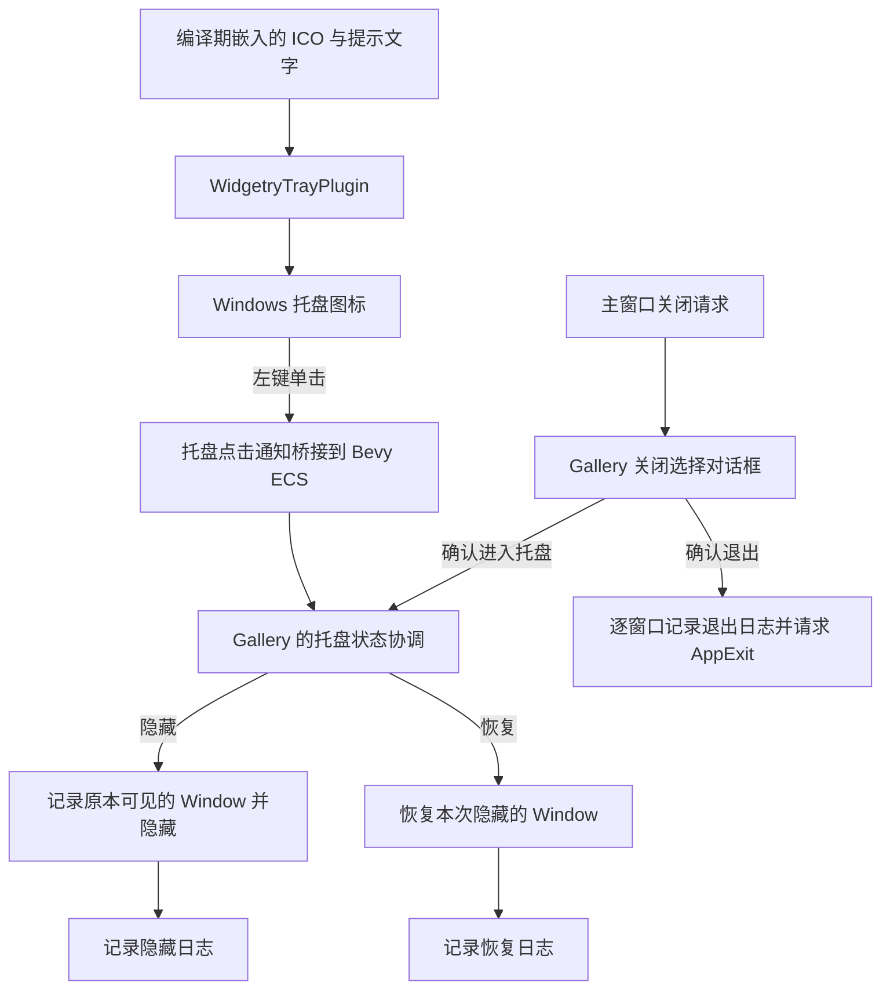

# Windows 托盘集成与 Gallery 退出流程

本设计分清两种职责：Widgetry 托盘能力是一个可按需启用的 Windows 集成组件；Gallery 则决定什么时候退出程序、隐藏窗口或恢复窗口。托盘组件不管理应用窗口，也不替应用决定关闭策略。这个边界使库能被其他桌面应用复用，同时让 Gallery 的多窗口行为保持可控。

托盘图标常驻于应用运行期，窗口的可见性改变不触发托盘图标增删。图标来源与 EXE 图标独立：应用可传入自己的 `.ico` 编译期嵌入数据，初始化之后既不从磁盘读取，也不在运行期间更换。提示文字在鼠标悬停时由 Windows 托盘展示。

单击由托盘库接收，再以 Bevy 可消费的消息／事件暴露给宿主。Bevy 使用省电的反应式 winit 事件循环，因此桥接要负责唤醒循环，不能指望被隐藏的窗口继续产生输入。Windows 事件和 Gallery 的窗口行为没有直接依赖：只有 Gallery 响应点击后，才读取自身保存的隐藏窗口集合并恢复。

Gallery 使用既有 `WidgetryWindow`、模态窗口、`WidgetryRadioGroup` 和 `WidgetryButton` 组合关闭确认界面；不修改通用 `WidgetryMessageBox` 的按钮接口。普通独立窗口（包括 Window 演示与颜色展示产生的窗口）与 `MessageBox`、`FileDialog` 的关闭职责必须分清。确认退出时，记录仍存活窗口的退出前日志，然后发送 `AppExit::Success` 结束整个应用；确认进入托盘时，只隐藏并记录原本可见的窗口，恢复时仅恢复这一集合，不改变最小化状态。

整体约束是 Windows 64 位、Bevy 0.20、现有 BSN 界面构造与日志规范。实现和直接相关的验证归入各自增量；Library 行为使用适当的长期自动化测试，Gallery 的可见 GUI 行为做针对性 BRP 验证，托盘和任务栏等原生 Windows 行为另以真实 OS 操作确认，不把 BRP 的虚拟鼠标当成原生托盘点击。

## 实施顺序

1. [创建常驻 Windows 托盘图标](01-创建常驻-Windows-托盘图标.md)
2. [将托盘单击接入 Bevy](02-将托盘单击接入-Bevy.md)
3. [完成 Gallery 多窗口退出与托盘恢复流程](03-完成-Gallery-多窗口退出与托盘恢复流程.md)

第二项依赖第一项持有的托盘实例；第三项依赖第二项提供的点击通知。该顺序同时给出了每一步可以独立观察、独立验收的交付结果。
