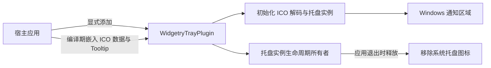

# 创建常驻 Windows 托盘图标

这一增量让应用在 Windows 通知区域拥有一个静态托盘图标，并能在鼠标悬停时显示指定提示文字。即使没有任何点击处理逻辑，它也已经是一项可独立观察、可独立验收的能力。后续单击通知与 Gallery 窗口恢复都建立在这个常驻图标之上，但不进入本增量。

## 整体结构

托盘是非 UI 功能，不应被做成 BSN 控件或绑定在任何一个窗口 Entity 上。Windows 通知区域的图标由操作系统维护；Widgetry 只持有其创建的托盘实例。窗口隐藏、最小化、显示以及独立窗口数量都不影响托盘图标是否存在。应用运行时始终存在，应用退出后释放。

`WidgetryTrayPlugin` 是独立、按需加载的插件，而不是所有 Widgetry 程序默认开启的能力。宿主决定是否安装插件、展示什么图标及什么提示文字；托盘层不需要知道“主窗口”是什么。

## 模块与公开配置

采用既有项目的 crate 命名和 Facade 组织方式：

- 实现目录：`crates/tray`；Cargo Package：`bevy_widgetry_tray`。
- 对外插件类型：`WidgetryTrayPlugin`。
- Facade 可选 Feature：`tray`；公开导出路径：`bevy_widgetry::tray`。
- `tray` 不列入 Facade 默认 Feature，只有显式启用时引入。
- 独立 crate 负责托盘平台调用和自身资源生命周期，Facade 只聚合导出；不反向依赖 Facade 或 Gallery。

调用方能为每个应用独立指定 `.ico` 图标和 Tooltip，不强制复用 EXE 图标。二者在创建时确定，当前没有运行时换图标、更新 Tooltip 或增删图标的需求。配置入口的具体 Rust 方法签名可以随实际 `tray-icon` 类型约束确定，但必须明确表达**一份嵌入的 ICO 数据 + 一段提示文字**，而不是只接收运行时文件路径。

Gallery 自己的托盘图标属于应用素材，应由 Gallery 管理；不得仅因托盘插件使用它，就把 Gallery 的图片迁入 Widgetry 的通用 `asset` 内建资源。已有 `taskbar_icon!` 提供的 PNG 窗口／任务栏图标和 EXE 图标设置各有自己的用途，不能被默认为托盘图标源，也不需要因此调整它们。

## ICO 与初始化

图标唯一输入格式为 Windows `.ico`。由应用使用 `include_bytes!` 或等效编译期嵌入方式提供数据，运行时不读取文件、不查找工作目录，也不提供 PNG、SVG 或 BMP 输入接口。

选用成熟的第三方 `tray-icon` 库完成 Windows 托盘创建、Tooltip 设置和实例释放，不自行维护完整 Win32 Shell 消息处理。该库的通用 `Icon` 使用 RGBA 像素数据，而不是直接接收 ICO 文件原始字节。因此在初始化时必须将嵌入的 `.ico` 解码成合适的 RGBA 图像，再构造托盘图标。多尺寸 ICO 中选取哪一层、以及使用哪个轻量解码依赖，由实际 API 和 Windows 显示效果决定；不为此增加运行时动态渲染能力。

Windows 实现需要在拥有可运行 Win32 消息循环的线程上创建托盘实例。现有 Bevy 应用由 `bevy_winit` 管理事件循环；初始化必须与这一线程及启动时序相容，不可只在普通后台线程上随意创建图标。托盘实例应由符合线程与资源约束的所有者保活，不能创建后立即丢弃，也不能依附于主窗口的可见状态。

正常生命周期为：宿主注册插件并给出配置；Bevy／winit 进入合适的初始化阶段后创建图标；图标在应用运行期保持；应用正常退出时释放最后一个实例引用，系统移除图标。此阶段不向 Bevy 发送点击消息，也不响应任何菜单操作。

## 验证与交付结果

交付后，Windows 64 位 Gallery 或最小验证宿主能显式安装 `WidgetryTrayPlugin`，提供编译期 ICO 与提示文字，在通知区域看见图标，悬停可看见 Tooltip，隐藏或最小化主窗口不会移除图标，结束整个应用后托盘实例被释放。未启用 `tray` Feature 或未安装插件时，不应意外出现图标。

验证应覆盖：

- 公开配置到插件初始化的有效路径，静态图标创建和 Tooltip 显示；配置不要求运行时文件存在。
- 初始化错误路径：无效或不可解码 ICO、创建原生托盘图标失败时，返回真实错误，提供必要 Widgetry 诊断信息，不用 `panic`、`unwrap`、`expect` 偷偷退出，也不留下半初始化图标。
- 图标实例在主窗口状态改变后继续存活，应用退出后释放；不能只通过构造 Rust 类型的单元测试代替 Windows 实际显示检查。
- 针对本插件的本地契约测试与必要集成测试；存在 Integration Test 时维护相应 `tests/COVERAGE.md`，不重复测试第三方图标渲染内部实现。

项目仅支持 Windows 64 位（目标 `x86_64-pc-windows-msvc`），各新 crate 的入口包含项目约定的平台检查。采用现有 Workspace 依赖管理、`unsafe_code = "forbid"`、统一错误传播与 `widgetry_*` 日志规范；`WidgetryTrayPlugin` 在 `build()` 完成时记录一次插件注册日志。新增 Workspace 成员和可选 Facade Feature 时同步维护对应架构与 crate 功能文档。原生 Windows 通知区域的图标存在性和提示文字需在真实 Windows 环境验证，自动化测试不声称替代 OS 级可视检查。

## 范围边界

不提供托盘右键菜单、气泡通知、动态换图标、动态换提示文字、双击通知、跨平台托盘或额外的图像格式。托盘的点击事件属于后续增量；窗口隐藏、恢复、关闭对话框和 Gallery 日志也不由本插件承担。上述排除项不要求预留复杂扩展结构。
