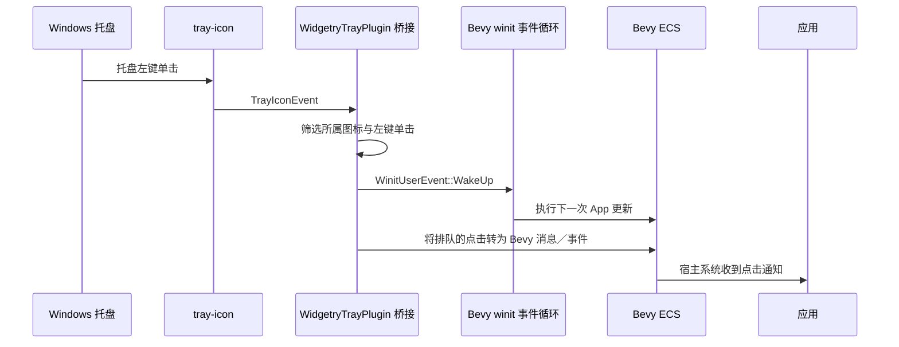

# 将托盘单击接入 Bevy

在常驻图标已经能够独立创建和销毁的基础上，这一增量增加唯一的交互能力：将 Windows 系统托盘图标上的鼠标左键单击，可靠地转换为宿主 Bevy ECS 能够接收的通知。它可以在没有 Gallery 的情况下独立验证；窗口显示与恢复仍由使用该插件的应用实现。

## 事件从 Windows 到 ECS 的路径

`tray-icon` 的事件处理不能直接操作 Gallery 或其他宿主的 Window Entity。回调与 ECS 世界之间使用安全的跨边界传递机制保存点击通知；Bevy 更新阶段再将它转交给公开的 ECS 消息／事件。这样插件只公布“托盘被点击”，而应用是否恢复窗口、记录业务日志或忽略点击，完全由应用自行决定。

这一事件桥接尤其需要配合 Bevy 0.20 的反应式 `WinitSettings::desktop_app()`。在全部窗口被隐藏、没有窗口输入时，单靠固定更新频率读取托盘接收队列，会产生长时间响应延迟或无意义唤醒。`bevy_winit::EventLoopProxyWrapper` 可用于向现有事件循环发送 `WinitUserEvent::WakeUp`，但它只负责唤醒，不携带自定义业务事件；点击数据必须另存入队列／通道，由后续 ECS 系统消费。不能把单独发送 `WakeUp` 当成已向 ECS 发送了点击事件。

## 交互语义与职责

- 只向宿主暴露本插件实例的**鼠标左键单击**。右键、悬停、拖动和其他状态不产生这个点击通知。
- 只提供单击通知，不新增单独的双击事件或双击恢复行为；来自第三方库的双击事件本身不作为额外事件转发。
- 对同一次有效单击不重复投递；需要按 `tray-icon` 实际 `MouseButton`、`MouseButtonState` 和事件种类筛选，避免在按下、抬起两个阶段各产生一次通知。
- 无论应用当前窗口正常显示、最小化还是隐藏，插件都保持独立的点击通知语义。点击后是否改变窗口可见性不是库的职责。
- 不采用周期性忙轮询或单独的常驻任务作为唤醒来源；第三方回调只有在实际收到相关托盘事件时才把通知传入系统。

公开通知应具有明确的 Widgetry 命名，能被宿主通过普通 Bevy System 或相应事件机制消费；具体 API 类型与 `Message`／`Event` 的选择遵守 Bevy 0.20 现有语义，并与 crate 其他公开接口保持一致。除已经定下的 `WidgetryTrayPlugin` 外，不需要为名字增加额外的 `System` 前缀。

## 事件桥接与生命周期

托盘图标仍由 `WidgetryTrayPlugin` 所属资源保活。事件回调的注册、有效状态以及与该图标实例的关系由托盘模块维护。应用退出、图标释放时不应留下可再次操作旧应用或旧发送通道的全局回调；若 `tray-icon` 事件处理器是进程级注册，则需保证移除／失效处理与真实生命周期一致。

Bevy 的 `App` 更新应仅执行已排队的有效事件转发。宿主没有订阅点击通知时也不影响托盘图标存在。重复点击时不能让无界积压、状态混乱或跨应用实例的旧事件转发成为常态；具体排队策略依赖第三方接口提供的保证，实施时按真实事件行为收敛，不自行引入第二套事件循环。

初始化和回调错误必须按现有 Widgetry 错误传播规则记录并处理，不能因跨线程／事件循环边界而静默吞掉异常。保留事件原有来源标识用于过滤即可，无须把鼠标位置、托盘矩形或未要求的其他平台信息公开成通用交互 API。

## 验证与交付结果

交付后，独立 Bevy 宿主能安装托盘插件、订阅公开点击通知、在真实 Windows 通知区域单击图标并在 ECS 更新中观察到通知，即使所有应用窗口当前不可见也能收到。插件不会自动使任何窗口可见。

应验证以下直接契约：

- 左键点击有效通知与同一次点击不重复；右键、普通悬停和第三方 `DoubleClick` 事件不作为额外的单击事件发布。
- 事件桥接的排队、消费及顺序能够通过确定性测试验证；禁用点击订阅不会破坏静态托盘生命周期。
- `WinitSettings::desktop_app()` 下，窗口全部隐藏时，真实托盘单击仍可唤醒并进入下一次 Bevy 更新。仅依靠 headless ECS 测试不足以证明 Windows 事件循环唤醒正常。
- 托盘实例释放或应用正常退出后，事件回调不会保留可访问旧 World 或悬空资源的通路。
- 添加本能力后，既有静态图标与 Tooltip 行为不回归，并同步更新公开 API、crate 功能文档及相关测试覆盖模型。

此处原生托盘鼠标点击必须在 Windows 实际操作验证。BRP Custom Pointer 是 Bevy 内部自定义输入，不是 Windows 通知区域的原生鼠标，不能用它替代这一项 OS 级交互验收。

## 范围边界

本增量不提供右键菜单、双击处理、系统通知、窗口操作、鼠标位置 API 或应用关闭策略。没有 Gallery 参与也应工作；Gallery 的退出确认、多窗口记录及恢复流程属于后续独立交付。
