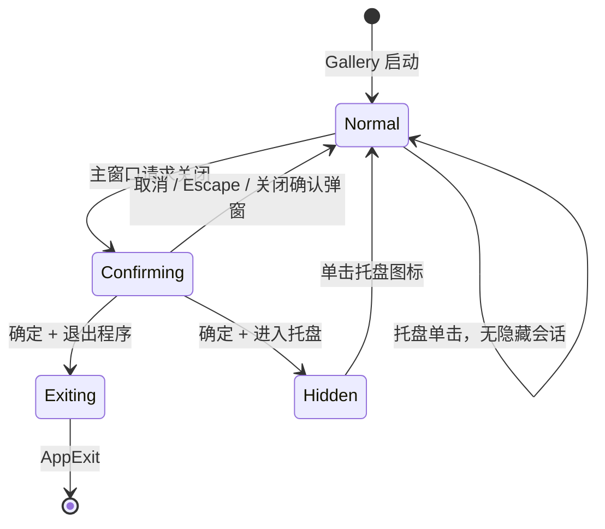

# 完成 Gallery 多窗口退出与托盘恢复流程

这一增量把已具备显示与点击通知能力的 `WidgetryTrayPlugin` 接入 Gallery，形成完整的桌面应用交互：点击主窗口右上角关闭按钮时让用户选择退出程序或进入托盘；进入托盘后隐藏当时显示的全部 Gallery 窗口；单击托盘图标恢复本次隐藏的窗口；每项操作都有符合实际发生阶段的日志。该流程作为一个整体交付，避免出现对话框已给出“进入托盘”选项，却还不能正确处理多窗口的中间状态。

## 总体控制权与状态

Gallery 决定具体窗口行为。托盘插件仍只显示图标、提供 Tooltip、转发左键点击；没有“自动恢复主窗口”这种库内隐式功能。托盘图标从启动到退出始终存在，与 Gallery 的 `Normal`／`Hidden` 状态无关。

Gallery 为本次托盘隐藏会话保留一份窗口 Entity 集合，例如 `GalleryTrayState { hidden_windows: Vec<Entity> }`。该集合保存**这一次因进入托盘而由可见变成隐藏的窗口**，不是所有已经隐藏的窗口，也不是当前应用中所有窗口的永久注册表。它决定下一次托盘单击的恢复范围；恢复完成后清空。窗口未进入托盘隐藏会话时点击图标不触发显示或最小化操作。

## 主窗口关闭确认

主窗口使用现有自定义标题栏。其关闭按钮现在通过 `WindowCloseRequested` 表达请求；Gallery 需要先拦截主窗口的该请求，弹出专用确认对话框，而不是直接删除主窗口。

确认对话框使用已有 `WidgetryWindow`、`WidgetryModalWindow`、`WidgetryRadioGroup`、`WidgetryButton` 通过 BSN 在 Gallery 中组合，不修改通用 `WidgetryMessageBox` 的按钮集合。对话框有两个互斥选项，顺序固定为：

1. **退出程序**。
2. **隐藏窗口，进入系统托盘**。

底部提供 **确定** 和 **取消** 两个按钮。**RadioGroup 默认选中第二项“隐藏窗口，进入系统托盘”**，避免用户仅确认默认选项时误退出程序。点击取消、按 **Escape**，或通过确认弹窗自身的关闭入口（包括可用的标题栏关闭操作、对应的系统关闭请求）结束对话框，都等价于**取消**：只关闭确认对话框，主窗口及独立窗口保持原状，不退出程序，也不进入托盘。点击确定时才执行当前选项；选择“退出程序”后也必须显式点击确定才允许退出。主窗口在确认对话框未关闭期间收到重复关闭请求，不应生成重复确认窗口或执行多次操作。

Gallery 的现有全局 Theme 与中英双语切换继续适用于新对话框；不为这个流程另造一个窗口控件或通用 Dialog 框架。确认弹窗首次显示即体现上述托盘默认选项；无论通过按钮、键盘还是窗口关闭请求取消，都遵循同一取消语义，不能绕过确认而直接退出。

## 原有窗口关闭请求不能被破坏

Bevy 0.20 的 `WindowPlugin.close_when_requested` 默认会响应全部 `WindowCloseRequested` 并关闭相应窗口。如果要让主窗口等待确认，Gallery 必须关闭这条默认的统一关闭路径（`close_when_requested = false`），并自己处理应用负责的普通窗口关闭请求。

但当前代码不仅在 `gallery/src/pages/window/independent.rs` 创建独立 `owned_widgetry_window`，`gallery/src/color_showcase/windows.rs` 也能创建此类窗口。它们不在主窗口 Entity 的子树里，不能只处理 Window 页的窗口。Gallery 应识别自己创建的**普通独立窗口**及其 Native Window，收到关闭请求后继续执行正常关闭与 Owned Resource 回收，不因为主窗口的新确认弹窗而统一弹出“退出程序”。具体可用 Gallery 自有的窗口身份标记和现有公开 `widgetry_window_target` 映射完成区分，标记实施细节无需泄漏到 Widgetry 库 API。

`WidgetryMessageBox` 与 `WidgetryFileDialog` 当前已经各自消费 `WindowCloseRequested` 以完成取消与清理。因此 Gallery 不能再对这些库管理的弹窗执行普通窗口关闭分支，否则会与它们的生命周期处理相撞。确认弹窗自身也是一个独立 Native Window，必须有明确的关闭与销毁路径。主窗口、Gallery 普通独立窗口、库管理对话框三者应分别路由，再依赖现有 `WidgetryWindow` 对 `WindowClosed`／Owned Window 的清理约定，避免遗留 Native Window 或 Camera。

关闭请求的处理顺序与识别必须覆盖鼠标点击自绘关闭按钮以及操作系统发出的关闭请求，不能只拦截一个按钮回调。处理主窗口关闭请求时，正常的 Gallery 独立窗口关闭行为依然有效。

## 确认进入托盘：记录并隐藏窗口

当用户选择“进入系统托盘”并确认后，先关闭确认对话框，再决定哪些业务窗口需要隐藏。这个先后关系很重要：确认对话框本身是 Native Window，如果在它仍然存在时不加区分地枚举 `Window`，可能把确认弹窗也隐藏起来而不销毁，导致下一次恢复出现一个已经作废的弹窗。实现应确保销毁和窗口收集之间的 Deferred Commands／ECS Flush 顺序正确，或使用等效方式明确排除正在结束的对话框。

随后遍历属于本 Gallery 的 Native `Window`，仅选择本次操作前 `visible == true` 的窗口：包括主窗口、Window 演示创建的普通独立窗口、颜色展示创建的独立窗口，以及当时仍可见的其他 Gallery 对话框。把这些窗口的 Entity 记入隐藏会话集合，再设置其 `Window.visible = false`。原本已经不可见的窗口不应被重新登记或改变。

Bevy 的 `Window.visible = false` 表示完全隐藏，Windows 任务栏也不显示该窗口；它不同于最小化，且不会自动改变窗口的最小化状态。因此如果某个窗口本来就最小化，进入托盘或恢复托盘时不得主动调用 `set_minimized(false)`。本次可见性变更可以暂时隐藏它，并在恢复时还原可见性，但它原有的最小化状态仍保持。

对每个实际提交隐藏变更的窗口记录 `info!` 日志（窗口标题、Entity ID），再记录本次隐藏窗口数及 Gallery 进入托盘会话这一离散结果。日志应描述已提交的可见性变更，而不能在 Windows 尚未同步前声称已经得到原生窗口的成功确认。托盘图标不需重新创建，也不因隐藏窗口而改变。

### 隐藏会话例子

进入托盘前，主窗口与独立窗口 A 可见；独立窗口 B 原本已隐藏，独立窗口 C 原本最小化。进入托盘后，主窗口、A，以及原先 `visible == true` 的 C 被记入本次隐藏集合并设置为不可见；B 不加入集合。恢复时主窗口与 A 重新显示，C 恢复可见但仍是最小化，B 仍隐藏。这个例子说明为何不能在恢复时简单地把全部 `Window.visible` 设置为 `true`。

## 托盘单击：只恢复本次隐藏的窗口

Gallery 订阅上一增量提供的托盘左键点击通知。只有 Gallery 处于托盘隐藏会话时，点击才会触发恢复；主窗口正常显示或只是普通最小化、Gallery 未进入托盘状态时，点击不作任何窗口操作。

恢复时遍历 `hidden_windows`，只对仍存在且属于该会话的 Native Window 设置 `visible = true`，并清空保存的集合。窗口可能在隐藏期间被其他合法业务流程关闭，遇到已经消失的 Entity 应跳过，不根据旧 ID 创建新窗口，也不能让无关新窗口被恢复。原本隐藏而没有被本次记录的窗口保持隐藏。

恢复所有受影响窗口后，Gallery 请求让主窗口获得焦点；这不是对最小化窗口执行还原。存在仍有效的模态对话框时，需要遵守现有 Widgetry Modal 的焦点和输入 Scope 约束，不能因机械设置主窗口 Focus 而使模态子窗口的输入被错误绕过。恢复程序状态也不重新创建 Gallery 页面、独立窗口或其业务内容。

每个实际提交恢复变更的窗口用 `info!` 记录标题与 Entity；随后记录恢复窗口数和 Gallery 已结束托盘隐藏会话。无隐藏会话的单击、无目标的合法 No-op 不伪造“恢复了窗口”的业务日志。需要区分“请求聚焦主窗口”和操作系统实际授予 Focus 的结果。

## 退出整个 Gallery 与退出前日志

用户选择“退出程序”并确认后，Gallery 应结束**整个 Bevy App**，而不是只关闭主窗口。当前存在的普通独立窗口、颜色展示窗口、`MessageBox`／`FileDialog` 等独立对话框，以及隐藏或最小化的窗口，都会随整个应用退出而结束。不需要逐个发出 `WindowCloseRequested` 去模拟点击每个关闭按钮：那样可能再次弹出主窗口确认框，或误触发各个 Dialog 自己的取消业务逻辑。

发送 `AppExit::Success` 之前，查询仍存在的 Native `Window`，对每个窗口记录一次退出前 `info!`，包括 `title`、`entity` 和当前可见状态；再记录涉及窗口总数、用户确认退出 Gallery。日志措辞应为“即将关闭／应用即将退出”，不把尚未收到 OS 关闭完成通知的窗口记为“已关闭”。窗口即使处于隐藏或最小化状态，也属于这次退出范围。

现有 Gallery 已安装 `AppLogging`，使用普通 Bevy `info!`／`warn!`／`error!`，日志中文叙述、动态字段使用英文命名，宿主现有日志 Guard 保留至 `app.run()` 返回。不在 Widgetry 托盘库里重复记录 Gallery 的退出／隐藏／恢复业务日志，也不引入第二套日志系统。

## 覆盖场景与交付结果

该增量完成后，Gallery 启动即显式安装 `WidgetryTrayPlugin` 并提供应用专属编译期 `.ico` 与 Tooltip；托盘图标全程常驻。主窗口的关闭请求会进入确认对话框，退出与托盘两个选项、确定与取消行为正确，且没有默认的直接关闭主窗口路径。

直接相关的验收场景包括：

- **关闭选择**：右上角关闭按钮和 OS 主窗口关闭请求能进入确认；RadioGroup 初始默认选中第二项“隐藏窗口，进入系统托盘”，且只允许选中一项；点击取消、按 Escape、通过弹窗自身关闭入口取消时均保持全部窗口，且不退出、不隐藏；默认选项也必须点击确定才生效；重复关闭请求不会产生多个确认框。
- **独立窗口关闭**：Gallery Window 演示和颜色展示的普通独立窗口仍能单独关闭，且没有把关闭升级为“退出程序”；现有 MessageBox、FileDialog 关闭／取消流程未受全局关闭策略修改破坏。
- **进入托盘**：确认对话框先收尾；主窗口与已显示的多个独立窗口一起隐藏；图标仍在；原本不可见的窗口不被误记为本次隐藏，原本最小化的窗口不被取消最小化。
- **恢复**：真实 Windows 托盘左键单击能唤醒 Bevy，恢复本次实际隐藏的窗口和对应内容；原本隐藏的窗口不突然出现；会话外的托盘单击不改变普通窗口和最小化状态；反复“隐藏→恢复”不留下旧记录。
- **退出**：存在多个普通独立窗口、对话框、隐藏／最小化窗口时，确认退出让整个 App 停止且托盘图标被移除；逐窗口退出前日志与窗口数记录在 `AppExit` 之前。
- **日志**：逐个隐藏／恢复窗口的结构化日志，以及本次操作汇总记录齐全；取消、No-op 不记成已发生隐藏、恢复或退出；异常路径根据实际结果使用相应 Level。
- **GUI 与窗口生命周期**：窗口可见性、模态输入和焦点不破坏既有 Gallery 页面、MessageBox／FileDialog、窗口控件及自定义标题栏。检查必要的瞬态和最终 UI 状态，不仅检查应用未崩溃。

Gallery 修改按项目规则完成编译和直接相关的 BRP GUI 验证；它不强制为每个演示行为额外写单元测试。BRP Custom Pointer 可以验证 Gallery 内 RadioGroup 和按钮，但无法等价验证 Windows 系统托盘点击、原生标题栏行为或 OS 级 Focus，因此这些场景要用实际 Windows 操作单独核实，不能用虚拟 Pointer 结果冒充已覆盖。新增的可观察 Gallery 行为及适用限制同步更新 `docs/gallery.md`，不将尚未实现的规划描述成现状。

## 防御性边界与平台验证

Gallery 的关闭请求接管只服务于本次退出／托盘体验，不把通用 `WidgetryWindow` 改造成应用级窗口管理器。不得因为图标与 Gallery 生命周期有关，就让 `WidgetryTrayPlugin` 依赖 Gallery 的窗口组件、页面状态或日志。窗口可见性变化与托盘状态相互协调，但不改变窗口最小化状态、页面数据、Theme 或 Language。

Windows 原生事件同步及多模态窗口同时存在时的最终 Focus 细节，应在真实 Windows 环境中以不破坏已有 Modal 交互为约束验证。这属于平台行为验证，不改变已确定的默认选项和取消语义。
