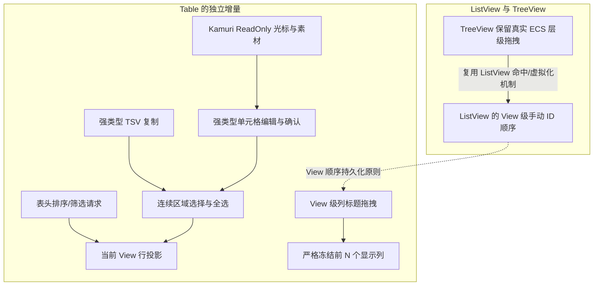

# ListView 拖拽改造与 Table 能力扩展：整体设计

这一组增量围绕一个共同的边界展开：**业务 Model 保留原始数据与稳定身份，View 决定自己的展示顺序与交互状态，只有明确表示真实业务变更的操作才写回 Model。** 普通 ListView 与 Table 列拖拽只改变各自 View 的顺序，明确重置或更换绑定的 Model 才使相应手动顺序整体失效；TreeView 的节点拖拽则继续修改真实 ECS 父子关系；Table 的业务排序、筛选和编辑由应用控制，控件提供交互意图、投影及受控确认流程。

这些目标不是在所有控件上引入统一的拖拽模式枚举。普通 ListView 和 TreeView 对外均采用简单的 `draggable: bool`，但各自语义固定：普通 ListView 的拖拽是 View 排列，TreeView 的拖拽是真实层级移动。Table 本次**不增加行拖拽与列隐藏**。交互显示与真实业务数据分离，也不意味着 TreeView 要维护一份与 `ChildOf`/`Children` 相悖的虚拟层级。

图中实线表示实际功能机制或实施约束的关联，虚线仅表示设计原则被两处独立实现共享，不表示 ListView 被 Table 调用。Table 行投影是后续排序/过滤请求以及投影范围选择的基础。编辑与复制共同依赖稳定身份和完整逻辑选区，但编辑负责发出修改请求并等待应用回执，复制只负责数据序列化，且必须完整成功后才一次写入剪贴板。Kamuri ReadOnly 光标是可独立验证的公共 Cursor 语义，随后被 Table 编辑态消费。冻结列先建立固定/滚动区及严格 N 行为，再由列拖拽改变两区之间的列归属。

Gallery 是各增量的组成部分，不另设 Gallery 收尾阶段。每份小方案都包含相关 Gallery 页面、必要 `gallery/src/i18n` 的中英文文案、程序示例、库测试与文档同步；涉及多个能力的 Table 综合回归归入最后一个有实际功能交付的增量。Cursor 相关增量除 Markdown 外附有 `assets/kamuri-readonly-concept.png`，作为已讨论的临时美术概念参考，正式可用图集精灵的制作与集成属于相应 Cursor 增量。

## 实施顺序

1. [ListView 视图级拖拽排序与 TreeView 真实层级拖拽适配](01-listview-reorder-treeview-adapter.md)
2. [Table 行投影与统一 View 状态更新](02-table-row-projection.md)
3. [Table 表头排序与筛选请求入口](03-table-sort-filter.md)
4. [Table 连续区域选择、拖选与全选](04-table-selection.md)
5. [Kamuri ReadOnly 光标语义、静态素材与 Gallery](05-kamuri-readonly-cursor.md)
6. [Table 强类型单元格编辑、确认回执与 ReadOnly 状态](06-table-typed-editing.md)
7. [Table 强类型格式化与完整 View TSV 复制](07-table-tsv-copy.md)
8. [Table 严格冻结当前 View 前 N 个显示列](08-table-frozen-columns.md)
9. [Table 列标题拖拽与 View 级列顺序持久化](09-table-column-reorder.md)

所有步骤按此单线顺序排列。部分相邻目标（如 TSV 复制与冻结列）没有直接的技术依赖，顺序只是整体实施安排；同一步中必要的 UI、API、测试、Gallery 和文档同步属于该步交付，不另拆函数级任务或纯验收步骤。
