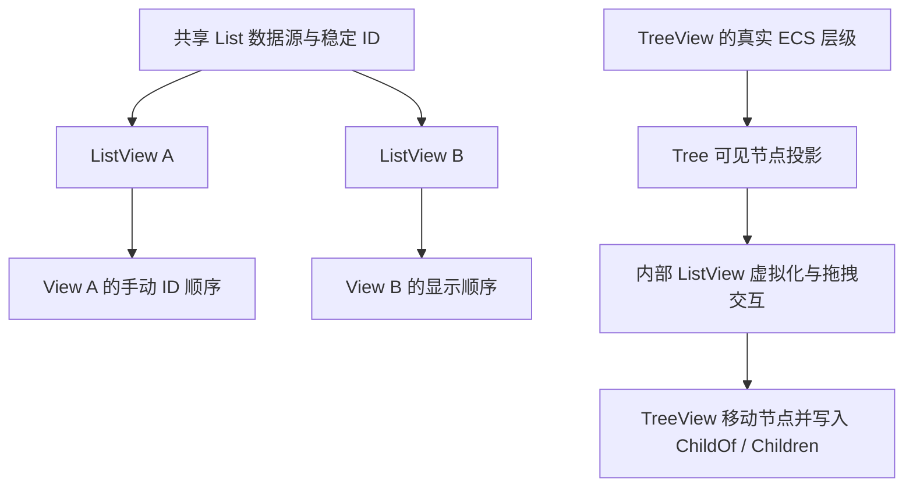

# ListView 视图级拖拽排序与 TreeView 真实层级拖拽适配

ListView 的普通拖拽应当调整“这个 View 如何排列条目”，而不再重排共享业务 Model。当前内置拖拽通过 `WidgetryListModel::move_item` 提交，因此两个 ListView 共享 Model 时，一侧拖拽会影响另一侧；`WidgetryListProjection` 又会在 Source 更新时重新生成 ID 顺序，单纯改动它的 `ordered_ids` 不能持久保存手动排序。新方案把手动顺序的所有权交给每个 View，同时保证 TreeView 继续把拖拽解释为真实的 ECS 层级变更。

本方案以 ListView 拖拽语义迁移为一个完整增量，连同 TreeView 的必要适配一起交付，避免中间版本让树误用普通列表的展示排序。Table 的行拖拽已从本次范围移除；Table 列拖拽在后续独立增量中实现。此处不改变 ListView 已有的选择、焦点和虚拟化模型，也不为 TreeView 创造虚拟父子关系。

## 普通 ListView 的公开行为

- 对外统一使用 `draggable: bool`，默认 `false`，提供运行时读取、开启和关闭 API；替换现有 `reorderable` 配置。**不引入公开的拖拽模式枚举**。
- 对普通 ListView，`draggable = true` 唯一含义是当前 View 的 `ViewReorder`：移动起始拖动的一个稳定 ID，不调用原始 Model 的 `move_item`，不改变其他共享 View 的显示顺序。
- 拖拽前后多选集合、选择锚点、Active 等仍以稳定 ID 保持；选中多项也只移动实际按下的那一项。原有上下半区 `Before/After` 放置反馈、取消/禁用/同位置 no-op、失效命中实体重校验与鼠标捕获清理继续有效。
- `draggable` 从 `true` 改为 `false` 只禁止新拖拽并结束在途会话，**不清除**此前的手动顺序。另提供显式 `reset_view_order()`（具体 Rust 接口形式沿用项目的 `_in_world` / Commands 习惯），让调用方恢复当前投影策略的输出；重新打开拖拽继续沿用既存手动顺序。

## View 的手动顺序与投影关系

View 需要在临时 `WidgetryListProjection<K>` 以外保存持久的手动 ID 顺序，并能够根据该顺序建立当前显示 ID→显示索引映射。此状态按 View 隔离，稳定 ID 是顺序的唯一身份依据，不能使用屏幕行下标或虚拟化 Row Entity 作为身份。

**首次拖拽之前**，View 仍按数据源提供的 ID 和已有 `WidgetryListProjectionPolicy<K>` 的过滤/排序结果显示。**首次拖拽之后**，手动顺序对当前可显示的项目有显示次序的优先权；投影策略仍决定哪些 ID 有资格显示，数据刷新不能偷偷把手动顺序覆盖回原始次序。每次生成给虚拟化与键盘导航消费的最终投影时，只投影当前具备资格的稳定 ID，并使用这份最终的显示索引。

以下规则共同决定状态生命周期：

- Model 行内容或元数据改变、修订号推进、View 滚动和虚拟化重建都不清除手动顺序。
- 原始数据源新增 ID 时，若已处于手动排序状态，则新 ID **追加到完整 View 手动顺序的末尾**；多项新增时保留数据源返回的新增项相对次序。尚未手动排序的 View 继续遵守默认数据源/投影顺序。
- 真正从数据源移除的 ID 从手动顺序中清理，其他 ID 的相对顺序不变；再次创建的另一个新身份不会继承已删除项的位置。
- **暂时被投影过滤掉**的 ID 仍存在于原始数据源，因此保留完整顺序中的位置；再次满足相同策略后回到先前位置，不能按新增项处理。
- 调用方**主动调用投影设置 API 更新/替换 `WidgetryListProjectionPolicy`**，包括设置新的策略或清除策略时，清空手动顺序，重新按新策略生成显示顺序。不要把“同一策略因数据变化被重新求值”误当作主动更换策略。
- View 重新绑定另一 `source` 时，即使碰巧存在数值相同的 ID，也清空此前手动顺序，从新 Source 和当前策略重新开始。
- 关闭拖拽不会重置顺序；只有明确的重置动作、主动更换投影策略、切换 Source 或 View 销毁才使手动排序失效。

### 过滤状态下的相对移动

即使当前只有部分项目可见，拖拽也被允许。移动操作发生在包含仍存活但暂时过滤的 ID 的**完整 View 顺序**中，而不是在渲染中的可见 Row Vec 上挪动实体。

例如完整手动顺序是 `D → A → B → C`，策略当前只显示 `A → C`。将 C 拖到 A 前面，完整顺序变为 `D → C → A → B`；被过滤的 D、B 未随拖拽一起移动。等 D、B 再满足条件时，显示的仍是这份完整顺序。对“Before/After”的插入位置以当前目标 ID 为锚点操作完整顺序，保留其他隐藏 ID 的相对位置。

## TreeView 保持真实层级移动

TreeView 内部使用 `WidgetryListView<WidgetryTreeVisibleItem, Entity>` 呈现通过深度优先遍历得到的可见节点，但其真实关系属于 ECS 的 `ChildOf`/`Children`，不能让普通 `ViewReorder` 对树的扁平可见行独立排序，否则父节点与后代可能被拆散，显示深度也会和真实层级冲突。

TreeView 对外继续只提供 `draggable: bool`（默认关闭）、查询和程序化启停 API；启用时固定使用数据源的结构移动行为，不允许配置普通 ListView 的 View 级手动重排。内部 ListView 可复用鼠标命中、拖拽生命周期和放置反馈，但提交由 TreeView 的专用移动路径接管。普通 ListView 的 `draggable = true` 不能触发数据源提交，普通调用方也不能通过公开枚举自由切换到 Tree `SourceMove`；旧的通用拖放注册 API 可做不兼容重构，跨 crate 的内部桥接需要设计出明确的封装边界。

树的上/中/下三段落点继续对应 `Before`、`Inside`、`After`。`WidgetryTreeView::move_node` / `queue_move_node` 仍重新读取实时父子关系并执行 `insert_child()`，一个拖动节点连同子树移动，原多选不跟着移动。对自身或后代形成环、无效节点/异树、已禁用节点或业务祖先、懒加载 `Unknown`/`Loading` 下的 `Inside` 等情况继续拒绝；提交前再次检查 `Loaded` 状态。移动成功后按既有 `NodeMoved` 事件语义，先修改真实层级再通知；共享同一树的 View 依据各自展开状态重新投影。

树的真实兄弟顺序随真实 `Children` 改变，而不是被内部 ListView 的手动顺序缓存覆盖。Tree 展开/折叠导致的可见投影变化，不得被 ListView 重排逻辑破坏。Tree 的已有懒加载、选中隐藏后代、虚拟化、焦点、不同 View 的配色归属继续保持。

## Gallery、文档与完成条件

在 `gallery/src/pages/list_view.rs` 的共享 Model 双 View 示例中，拖拽一侧必须只改变该侧显示顺序；另一侧仍展示原 Model 次序。保留原始顺序与显示顺序并排的状态栏，增加/复用新增、删除、手动重置、拖拽开关、过滤前后项目恢复的可观察操作。当前 Gallery 文案把拖拽描述为“重排共享 Model”，中英文 `gallery/src/i18n/{key.rs,zh_cn.rs,en_us.rs}` 必须改成 View 独立排序，并同步由 `reorderable` 改为 `draggable` 的构造示例。

`gallery/src/pages/tree.rs` 保留双 TreeView、独立展开/选择和拖拽开关，继续展示三段落点、跨层级子树移动、懒加载拒绝与共享真实层级变更；Tree Gallery 不能依赖普通 ListView 的手动排序。必要的 GUI/BRP 人工观察与现有离页资源清理检查归入本增量。

`crates/list_view/tests/drag.rs`、`projection.rs`、`behavior.rs` 及 `tests/COVERAGE.md` 改为保护以下结果：两 View 独立显示但共享真实 Model；Model 的 `move_item` 没有被 View 拖拽调用；新增末尾、删除清理、过滤隐藏再出现、过滤状态下 Before/After 的完整顺序效果、主动投影变更与 Source 变更重置、禁用/取消/失效目标/虚拟行复用/鼠标 DPI 与 UiScale、一次拖动仅一个 ID、选中集合及锚点不变。`crates/tree/tests/drag.rs`、`movement.rs`、`view_state.rs` 继续保护 `ChildOf/Children` 的真实写入和三段落点、懒加载状态重新验证、非法循环原子拒绝、共享视图与深度更新；既有层级移动 API 不应因为 ListView 重排迁移而丧失功能。

同步 `docs/crates/list_view.md` 与 `docs/crates/tree.md`：前者改成 View 级拖拽与新 reset 语义，后者明确内部共享的仅是交互/渲染机制，树的移动仍写 ECS。`ComboBox` 等使用 ListView 的组合控件不应因为新字段或内部桥接而获得未请求的拖拽行为；原来默认关闭的场景继续关闭。

## 保护边界

新方案允许公开 API 的不兼容修改，不保留 `reorderable` / 旧通用写入适配能力作为调用方自由切换语义的入口。真正的树结构修改必须由 TreeView 的专用提交路径完成。不能为了把普通 ListView 迁移成 View 级排序而改写 Tree Model 的业务数据，或将虚拟化 Row Entity 误当持久身份。
