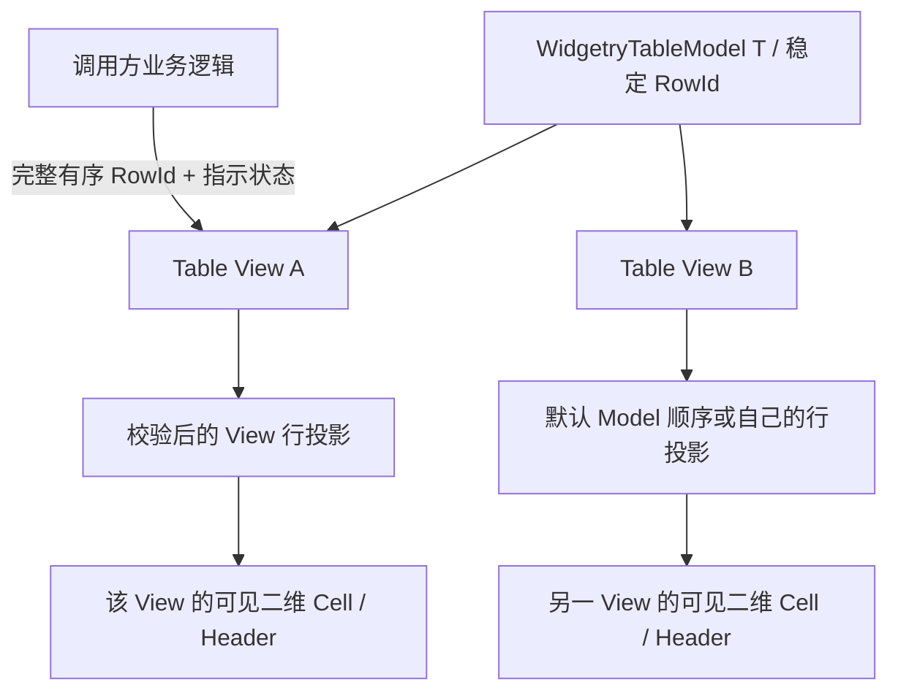

# Table 行投影与统一 View 状态更新

Table 现有的 Model 保存 `RowId`、`ColumnId`、强类型 Row / Column 定义和 Revision；`projection.rs` 目前仍用 Model 的 `row_count()`、`row_id(index)` 和原始索引完成二维虚拟化。要让同一 Model 同时服务于不同排序、筛选配置的 Table，首先必须把“原始行顺序”与“当前 View 的显示顺序”分开。这是后续表头排序/筛选、范围选择、全选和 TSV 复制的共同前提。

## 行投影的权威性与默认模式

每个 Table View 独立保存**当前显示的稳定 RowId 有序序列**，并建立 `RowId → display_index` 映射；未指定投影时，按共享 Model 原有行次序展示全部行。投影只是展示映射，不复制 `T`，不修改 Model 的原始顺序。过滤过的 RowId 不在当前 View 的显示序列中，但仍可能存在 Model；虚拟化未生成实体的行也在完整的 View 投影序列中。

与 ListView 的内置手动重排不同，Table 的行排序和过滤都由**调用方**拥有。Table 不自行比较字段、不执行强类型业务过滤，也不维护一份独立的手动行拖拽顺序；行拖拽本次明确取消。调用方必须在 Model 变化引起业务结果变化时重新计算并提交投影，Table 不能擅自把新增行附加到已过滤的 View 中，因为这会绕过过滤条件。

## 原子更新与验证

调用方为某个 View 提交一次完整结果时，将**有序 RowId 序列、当前唯一排序列及升/降/无方向、活跃过滤列集合**作为同一次 View 更新处理，并在接受前统一校验。这样数据和表头状态不会在两个独立更新间短暂不一致。验证至少覆盖：RowId 必须属于当前绑定的 Model、不允许重复，排序列与所有过滤标记必须是仍存在的 `ColumnId`；不存在的 RowId 或列 ID 应明确失败，不写入半份投影。

一个 View 可以同时显示多个列的活跃过滤状态，但各列条件如何做与/或等逻辑组合完全属于应用。排序只允许一个列指标激活；无排序时默认 Model 行次序，除非调用方提供的筛选投影仍限定行集合。排序、过滤请求属于意图，投影结果属于应用确认的事实，两者不能混成控件自行执行的业务计算。

如果源 Model 有列或行增删、排序/过滤用到的业务值更新，由应用负责重算并提交完整有效结果；如果当前模型与旧 View 投影不再一致，不能使用过期 ID 访问数据，也不得生成错误 Cell。无新投影时如何展示由 View 的默认状态契约决定，而非静默吞入旧 Model 索引。

## 行显示索引贯穿布局与交互

`projection.rs`、`viewport.rs`、`interaction.rs` 和依赖行下标的 API 应区分 `model_index` 与 `display_index`。垂直虚拟化窗口按**投影长度与 display_index**求出可见行，再按每个 RowId 回到 Model 取得 Cell Value、Revision 与强类型内容；行号区域展示当前 View 的显示序号，焦点 Reveal、键盘上下导航、滚动定位及 Row Header 复用也按最终投影顺序工作。

现有二维虚拟化以 `(RowId, ColumnId)` 作为 Cell 身份，复用逻辑应保留，不因行换位错误地复用内容或将旧 Row Entity 的输入作用于新 RowId。RowId 只在所属 Model 内有效；共享 Model 的不同 View 可显示不同 RowId 子集和顺序，但不能共享投影缓存和焦点/选择状态。

本增量不引入新的列 Schema、列隐藏或行拖拽。列宽、列头、布局、渲染器注册仍按既有机制；列显示顺序的 View 级状态在后续列拖拽增量中建设。

## Gallery、文档与完成条件

在 `gallery/src/pages/table.rs` 的共享 Model 双 View 场景中展示同源不同投影：一个 View 提交自定义顺序和过滤后的 RowId，另一个仍为原始顺序；对共享 Model 进行插入、删除、移动和内容更新后，确认投影数据重新提交、离屏行及行号都正确。Gallery 新增必要控制项和 `gallery/src/i18n/{key.rs,zh_cn.rs,en_us.rs}` 的双语说明，避免沿用“所有 View 仅跟随 Model 顺序”的旧描述。

`crates/table/tests/view.rs`、`virtualization.rs`、`interaction.rs` 验证默认顺序、双 View 隔离、排序投影/过滤子集、越界和重复 ID 的原子拒绝、零行/空投影、RowId 删除后安全修复、更新/滚动时实体复用、显示索引的导航和 Reveal，以及旧渲染 Revision 与内容不串位。同步 `docs/crates/table.md` 和 `crates/table/tests/COVERAGE.md`，把显示索引与 Model 索引的区分、应用更新责任写清楚。
