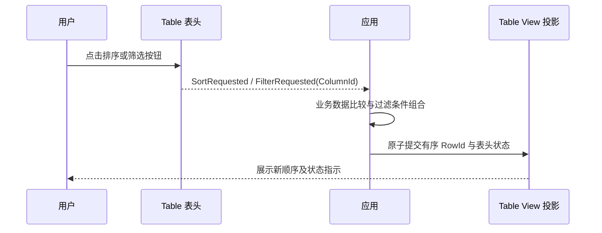

# Table 表头排序与筛选请求入口

Table 的表头只表达用户想对哪一列排序或筛选，业务比较、过滤条件、组合方式由调用方完成。请求必须与 View 行投影分离：Table 在收到点击时只发出明确事件，调用方计算结果，再用前一增量的统一 View 更新提交行 ID 顺序和当前状态。

## 表头区域与意图事件

排序入口、筛选入口均为**可选的独立按钮**。列标题主体区域仍承担整列选择，右侧列宽 Resize Handle 仍承担宽度调整；点击按钮不能误触发整列选择、拖拽或改列宽，点击标题主体也不能意外排序。表头虚拟化重建后，按钮和列 ID 的对应关系必须保持正确。

排序采用每个 View 的**单列状态**：同一列循环 `无排序 → 升序 → 降序 → 无排序`。选择另一列排序时只保留该列排序指标，Table 不执行多列排序。表头发出类似 `SortRequested(ColumnId, direction)` 的请求，表达下一次期望状态；只有应用确认并提交的 View 更新才改变最终展示指示和 RowId 顺序。未激活排序时，应用默认维持 Model 原始行次序（过滤仍可存在）。

点击筛选按钮只发出 `FilterRequested(ColumnId)`；具体过滤器 UI、输入类型、强类型比较函数、过滤表达式和多个过滤条件如何组合均由应用负责，不在 Table 内引入通用过滤表达式。Table 根据应用提交的活跃 `ColumnId` 集合在多个列头展示筛选标记；多列过滤可同时激活。

## 生命周期与失败边界

排序/过滤的输入命中以稳定 `ColumnId` 为身份。Model 删除列或列头在虚拟化过程中消失时，失效请求不能使用旧实体索引；应用提交的无效排序/过滤标记由 View 更新统一拒绝，旧有效状态不能被部分覆盖。控件不因为发出请求就假定业务排序成功，也不悄悄排序 Model。

## Gallery、文档与完成条件

`gallery/src/pages/table.rs` 增加至少一个可现场点击的排序/筛选示例，演示排序四态循环、单列切换、两列过滤状态同时亮起、筛选后只显示符合条件行和共享 Model 的两个 View 相互独立；演示中的业务过滤和排序在 Gallery 应用代码中实现，不放入 Table 核心。与新按钮有关的说明、状态显示及 `TableKey` 双语文本放入 `gallery/src/i18n/{key.rs,zh_cn.rs,en_us.rs}`。

针对 `crates/table/tests/interaction.rs`、`view.rs` 与新增必要测试验证：按钮点击事件及目标 `ColumnId`、排序方向循环、不同列单列排他、活跃过滤集合、无监听器/未回填时不改变行数据、失败回填不改变旧投影、列删除与虚拟化恢复后按钮区域仍正确；列标题主体的选中和原 Resize 行为回归不受影响。同步 `docs/crates/table.md` 和 `tests/COVERAGE.md`。
