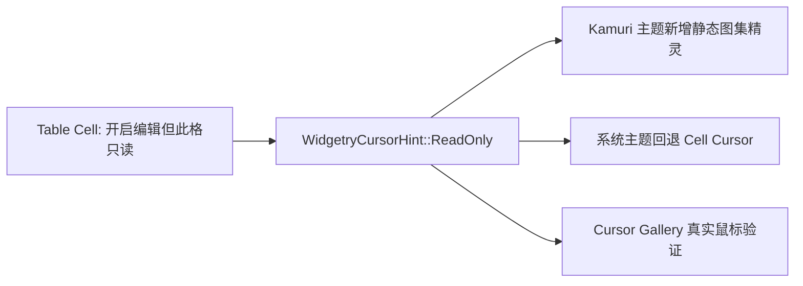

# Kamuri ReadOnly 光标语义、静态素材与 Gallery

新增 `WidgetryCursorHint::ReadOnly`，为“可选中、可复制，但不可编辑”的 Table 单元格提供独立提示。它必须与 `InteractionDisabled` 区分：ReadOnly 只阻止编辑行为，不阻止选择、复制或焦点；Disabled 保持既有禁用语义。该光标能力可以独立于 Table 编辑器交付，之后由编辑增量接入。

## 语义与主题规则

`ReadOnly` 是新增 Hint，而不是借用 `NotAllowed`、`Disabled` 或一般输入禁止光标。系统主题及 Kamuri 素材缺失时，回退为 `SystemCursorIcon::Cell`，而不是禁止符号。只有 Table 的编辑功能启用、且该 Cell 不符合可编辑条件（例如没有可用编辑器或应用标记只读）时，才把 ReadOnly 提示用于对应可命中区域；普通 Table 全局未开启编辑时不应把所有单元格渲染成只读状态。编辑器内的鼠标语义由编辑器本身拥有。

Kamuri 新静态图必须沿用项目**真实现有**角色辨识元素，而不是采用通用猫耳动漫人物替代：头顶两条丝带、略困倦或无所谓的表情、整体配色和辨识轮廓，搭配小号**蓝白色挂锁**；挂锁表达不可编辑，同时角色形态不能与禁止/错误状态混淆。此前的概念展示只作为**临时视觉参考**，制作正式 Atlas Sprite 时需要对照真实 Kamuri 静态光标外观校正五官、丝带、轮廓、尺寸和锚点。

## 现有图集的具体集成点

当前 `crates/cursor/src/theme.rs` 的 `WidgetryCursorHint` 有 10 个附加 Hint，`CursorIntent::static_index` 占用 `0..43` 共 44 个条目；其中 Kamuri 静态图集在 `crates/asset/src/assets/cursors/kamuri/static_atlas_96.png` 使用 **8 列 × 6 行、96px 网格**，留有 48 个位置，`BuiltinCursorImage::KamuriStaticAtlas.atlas_layout()` 目前把 `textures` 截断到 **44**。新增一个 Hint 可使用后续空闲槽位，但必须保持既有条目索引和热点原值不发生错位。

与新增图片**同步**调整以下耦合结构：

- `crates/cursor/src/theme.rs` 的枚举、系统回退和静态索引映射。
- `crates/asset/src/assets/cursors/kamuri/static_atlas_96.png` 中的新精灵，以及 `crates/asset/src/lib.rs` 的图集有效图块数量/尺寸逻辑；仍使用现有 96px 网格与其它 48px 静态图块一致的可见尺寸约束。
- `crates/cursor/src/presentation.rs` 中与静态索引严格对齐的 `STATIC_HOTSPOTS` 长度和新精灵实际有效点击热点。已有 Pointer、Wait 动画帧数、时间及对应静态位置不能被错改。
- `gallery/src/pages/cursor.rs` 的扩展 Hint 展示、主题切换和鼠标 Hover 验证；`gallery/src/i18n/{key.rs,zh_cn.rs,en_us.rs}` 中新增提示文案，纠正“34 种系统语义与 10 种 Hint”“42 个静态光标”等随数量变化的展示文本与文档计数。

给 Gallery 里的 ReadOnly 样例同时展示 System/Kamuri 主题，确保 Hover 离开、Disabled 上层遮挡、原生窗口 Cursor 所有权和 Custom Cursor 优先级行为仍遵守当前 Cursor 子系统。Table 接入时还需要在 `gallery/src/pages/table.rs` 的只读/可编辑 Cell 对照中演示实际鼠标样式；该具体应用演示归入 Table 编辑增量。

## 测试与交付资产

`crates/cursor/tests/coordination.rs` 中扩展 Hint fallback、最近声明、Capture/Native/Disabled、Kamuri 图块索引与热点不越界、素材缺失回退、恢复后的表现等测试；检查 Gallery `Cursor` 页在双主题下显示正确并且真实 Windows 鼠标可观察。同步 `docs/crates/cursor.md` 与 `crates/cursor/tests/COVERAGE.md`，保留当前静态性能和动画行为约束。

交付压缩包的 `assets/kamuri-readonly-concept.png` 是此前讨论中认可的**暂用概念参考图**，并非经过裁切、透明背景处理、与现有 Kamuri 样式逐项对齐的可直接嵌入 `static_atlas_96.png` 的最终 Sprite。精灵制作、Atlas 像素位置、热点需要在本增量实现时完成；不把参考大图当作新的图集文件直接替换。
