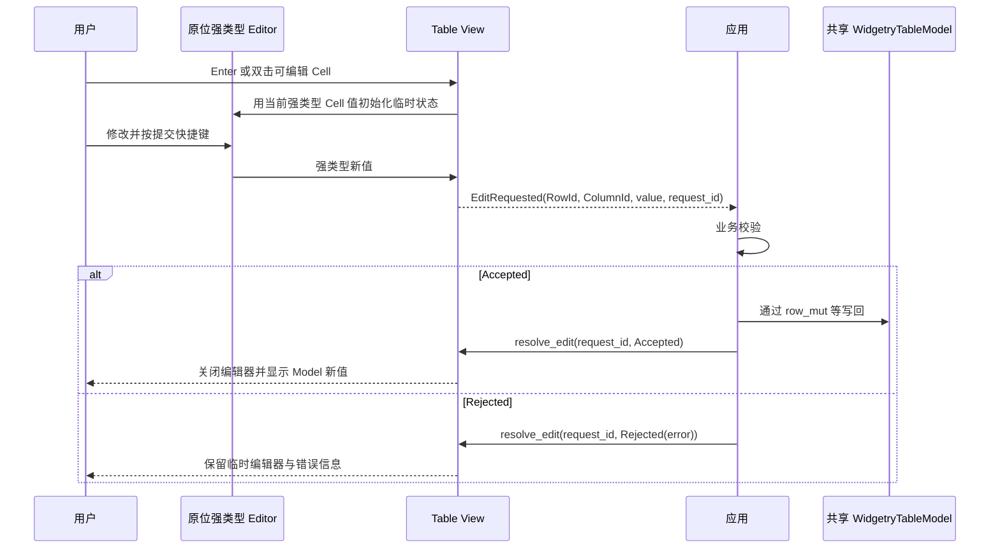

# Table 强类型单元格编辑、确认回执与 ReadOnly 状态

Table 的 Cell Value 已支持任意强类型业务数据和逐类型 Renderer，但显示内容不意味着可以直接由 Table 修改 `T`。本增量给 Table 增加默认关闭的可选编辑模式，让应用决定业务可编辑性、接收强类型修改请求并回写共享 Model；Table 则负责编辑器的生命周期、临时输入、错误显示及焦点交互。ReadOnly 使用前一增量新增的 Kamuri Hint。

## 编辑资格与注册机制

编辑默认关闭；开启后由 **Table 编辑开关 + 应用针对当前 Cell 的可编辑判断 + 有匹配的 Editor 注册** 三个条件共同决定是否可编辑。可编辑性按单元格决定，不能将应用“只读”混同于 `InteractionDisabled`。没有匹配 Editor 的强类型值即使有 Renderer，也仍为 ReadOnly；它可以聚焦、选中、参与范围复制，只在编辑操作上不允许进入编辑器。

Editor 注册类比 `crates/table/src/registration.rs` 的 `WidgetryTableCellRenderer<V>` 类型注册模式，但与渲染器分离。支持 **值类型默认 Editor**，以及 **逐 `ColumnId` 的 Editor 覆盖**，解析优先级为“列覆盖 → 值类型默认 → 无 Editor 即只读”；同一种 Rust 类型的不同列可以用不同 UI，无须要求调用方为了编辑控件不同而创建额外 wrapper 类型。Editor 用于生成原位编辑界面并维护临时强类型状态；原位编辑时替换该 Cell 的正常 Renderer，而不是把已渲染 Text 当编辑输入控件。输入格式、基础类型解析及合法输入控件行为属于强类型 Editor，跨字段/跨行等业务验证属于应用。

## 编辑启动、提交与取消

焦点落在可编辑 Cell 时按 `Enter`，或用鼠标**双击**该 Cell，进入原位编辑。此前总规划出现过的 `F2` **本次明确不使用**。进入编辑模式时保持 `RowId + ColumnId` 的稳定身份，原位编辑内容跨虚拟化刷新时不能被误认为另一个 Cell；具体恢复/取消需确保旧实体销毁后不把未提交结果写入 Model。

- 单行编辑器按 `Enter` 提交；多行编辑器按 `Ctrl+Enter` 提交。编辑器拥有内部键盘快捷键，不得让 Table 的导航或 `Ctrl+C` 抢走文本选区操作。
- `Esc` 永远取消仍未提交的编辑，丢弃临时草稿；点击**编辑器 UI 以外**，包括 Table 外部，等同取消，原本的鼠标点击继续交由其目标处理。编辑器内部或它锚定的 Select 弹出层点击不取消。
- 提交后发出的请求是**已经发生的应用意图**，不能被等待确认期间的一次外部点击当作“撤销提交”。提交后到应用回执前至少应阻止重复请求，但不必因此锁死整个 Table；等待样式的细节可通过 Gallery 验证完善。

## 强类型请求与应用回执

Table 在编辑器提交时触发 `EditRequested(RowId, ColumnId, typed new value, request_id)` 意图事件；不能先假设成功，更不能直接更新共享 Model。`request_id` 用来匹配应用异步或排队校验的本次提交。调用方接收新值、完成业务验证，若接受则通过 Model 的 `row_mut()` 等安全 API 写入真实 `T`（`row_mut` 自动增加行 Revision），再显式确认 `Accepted`；若拒绝则确认 `Rejected(error)`。建议的 API 形态如 `resolve_edit(view_entity, request_id, EditResult)`，最终命名遵守现有公开接口风格。

`Accepted` 后关闭编辑器，从 Model 重投影内容；`Rejected` 后留在编辑器并展示错误，允许修改和重新提交。**不能以 Model Revision 变化替代应用确认**：业务允许无值变化提交，也可能在确认前收到别的 Model 更新，Revision 无法无歧义判定这次请求是否成功。请求若指向已删除的 RowId/ColumnId、错误的 View、失效 `request_id`，必须安全拒绝，不误改其他 Cell。

编辑器构造、解析失败与应用业务错误应归属不同环节：Editor 阻止无效基础类型提交，应用校验业务不变量。当前 `crates/table/src/projection.rs` 的 `ContentVersion` 比较 Row Revision/Column Revision/Renderer Generation；成功写回后，其它共享 Model 的 Table View 也需在正确帧内按 Revision 刷新，但彼此保留独立编辑/选择/滚动状态，不额外要求修改 Model 发布一套编辑通知。

## ReadOnly 与 Disabled 的可见区别

仅在 Table 编辑已启用时，对只读 Cell 做**轻微背景强调**，不降低文本亮度、不采用 Disabled 的禁用视觉；鼠标 Hover 使用 `WidgetryCursorHint::ReadOnly`，系统回退 `SystemCursorIcon::Cell`。ReadOnly 仍允许聚焦、选择和 Ctrl+C，真正 Disabled 沿用现有输入屏蔽机制。可编辑 Cell 正常显示 Editor 的文本/选择光标；进入、退出编辑后 Hover Cursor 恢复正确。

## Gallery、文档与完成条件

`gallery/src/pages/table.rs` 展示不同强类型值使用对应 Editor、同一类型不同列覆盖、单行/多行提交差异、只读无 Editor 的 Cell、编辑开关和 Disabled 区别、应用拒绝并显示错误、应用接受后两个共享 View 同步数据，以及 `Enter`/双击进入、`Esc`/外部点击取消和等待回执。Gallery 示例应用必须真实处理 `EditRequested` 和回执，而不是直接在 UI 中偷写 Model。补充 `TableKey` 中英文翻译与状态提示，并验证编辑弹出层实际命中。

`crates/table/tests/interaction.rs`、`renderers.rs`、`view.rs` 和必要新测试覆盖编辑资格、类型与列优先级、原位编辑 Renderer 替换、Enter/双击、Esc/外部点击/内部 Select popup、Ctrl+Enter、多次重复提交阻止、Accepted/Rejected、无值变化成功、无效请求安全拒绝、Model 行 Revision 与共享 View 更新、虚拟化内容销毁时的事务状态，以及 Hover `ReadOnly`/禁用区别。同步 `docs/crates/table.md` 和 `tests/COVERAGE.md`。

## 仍需在实现接口时确定的点

讨论已确定编辑器“返回强类型结果”和 `request_id` 的语义，但没有规定 Rust trait/object-erasure 的最终类型签名，也未固定每个 Cell 可编辑判断的函数注册形式。实现接口必须满足上述按类型/按列覆盖、强类型结果和应用确认约束，不应自行退化成全局 `String` 编辑接口。错误反馈文案和 Pending 视觉细节可在 Gallery 中据真实交互确定，不改变请求状态机。
