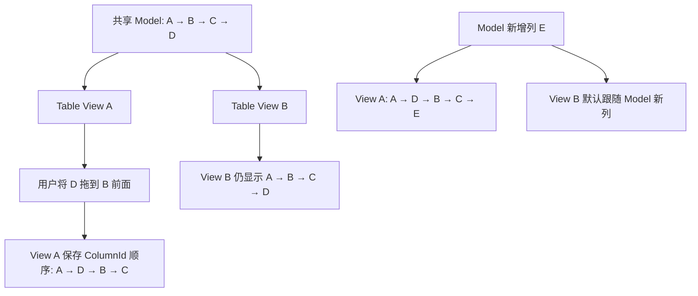

# Table 列标题拖拽与 View 级列顺序持久化

列拖拽属于当前 Table View 的展示偏好，不等同于业务 Model 的 Schema 变更。本增量让用户可在列标题主体拖拽改变当前 View 的列顺序，并保存这一顺序，避免 Model 后续增删列或修改行时重建投影导致拖拽效果消失。其行为与 ListView 的 View 级手动排序理念一致，但列数、列宽与冻结区是 Table 自己的布局契约。

## 列显示顺序的所有权

拖拽是可选能力，默认关闭。当前 View 以稳定 `ColumnId` 保存自定义列顺序及快速索引映射，不能用原始 Model 列下标作为持久身份；拖拽后不调用 `WidgetryTableModel::move_column()`，另一共享 View 和 Model Schema 保持原样。

未发生过 View 列重排时，保持 Model 当前列次序；首次拖拽产生独立的 View 顺序后，后续普通行内容变化、Model 行增删、列 Renderer 替换或 Model 原始列重排都不应覆盖该顺序。**Model 新增列时追加到已手动排序的 View 末尾**，不尝试按 Model 原始插入位置插入旧列之间；Model 删除列时清理其 ColumnId，其它列相对次序不变。新增列按添加时数据源呈现的先后次序追加。当前方案不包含列隐藏功能。

冻结列沿用前一增量的规则：无论拖拽是否跨越冻结边界，都允许落入目标位置；完成后仍严格冻结**当前显示顺序中的前 N 列**，N 不因操作变化。如果拖动第三列到第一列，它就会成为冻结列；被挤到第 N+1 显示位置的列转入水平滚动区域。Model 列数少于 N 时遵守 `min(N, 实际列数)`，不修改配置值。

## 列标题交互划分

- 列标题主体单击选整列；在主体按下并移动超过必要的拖拽阈值时切换为列重排。点击且未进入拖动不改变顺序。
- 标题最右侧的现有 **6px ResizeHandle** 仍仅执行列宽调整，Hover 已有 `SystemCursorIcon::ColResize` 明确提示用途，Resize Pointer Session 不能同时成为列拖拽会话。
- 排序/筛选按钮只发起对应业务意图事件；点击或拖动这些按钮不应误触发主体拖拽或整列选中。
- 拖动时显示**插入位置指示线**；只有合法目标上鼠标释放才提交新的 View 顺序。拖动取消、模型列被删除、Header 被复用、源 View 禁用或释放无效目标都不写入排序状态，并清除暂态指示和光标/指针会话。

当前 `crates/table/src/resize.rs` 已管理指针捕获、目标身份、UiScale 的位移换算与取消，列拖拽必须与它协调而不是创建两个独立响应同一输入的处理器。`projection.rs` 的 Column Header 与 Cell shell 使用 `ColumnId` 而不是 Header Entity 表示身份；拖拽目标按当前 View 列几何求位置，横向虚拟化中的 Header 复用不得将拖动的旧 ColumnId 套用到新实体。最终 `layout.rs` 和 `viewport.rs` 接收 View 显示顺序计算坐标，RowId 投影保持先前增量的独立语义。

## Gallery、文档与完成条件

`gallery/src/pages/table.rs` 中展示普通拖拽、默认关闭与程序启停、列宽拖动和列重排分区、排序/筛选按钮与主体点击的区分、跨冻结 N 边界拖拽、双 View 列顺序隔离、Model 插入/删除/移动列和编辑行后显示顺序保留、调用重置 API 后恢复 Model 列顺序，以及 View 更换 Model 后不继承旧顺序。Gallery 应能同时看到 Model 原始列顺序与当前 View 列顺序，原列宽/冻结数量保持不受拖拽误改；更新 `TableKey` 及中英文说明。

`crates/table/tests/interaction.rs`、`virtualization.rs`、`view.rs` 及现有 Resize 测试覆盖 View 独立顺序、新列追加、删除列修复、Model 原始次序变更、冻结边界、多选下仍只拖动起始列、拖动阈值与单击、嵌套按钮与 Resize Handle 命中、DPI/UiScale、禁用/取消/失效 Row/Header、横向虚拟化与指示线清理、选区/键盘导航/TSV 按最终列顺序取值；同时覆盖显式重置 API 的幂等性、双 View 隔离、重置后再次拖拽、换绑 Model 后完整清理旧列 ID，以及同一 Model 数据更新不触发重置。同步 `docs/crates/table.md` 和 `tests/COVERAGE.md`；将 Table 综合示例的横纵滚动、排序/过滤、矩形选择、原位编辑、TSV、冻结及列拖拽在最后一次真实功能交付中做关联回归，不另建纯验收阶段。

## 显式重置与 Model 更换的状态生命周期

提供 **View 级的公开列顺序重置 API**（建议命名 `reset_column_order`，同步 World 与 Commands 入口沿用现有 API 风格）。调用后清除该 View 的手动列排序记录，当前列顺序立即回到**当前绑定 Model 的原始列顺序**，不会调用 Model 的 `move_column()`，也不影响共享 Model 的其他 View。无手动排序时重复重置应保持幂等；重置后再次拖拽建立新的 View 自定义顺序。

**更换整个 Model 时必须重置手动列顺序。** 当 View 改绑另一个 Model Source / Model 实例时，清除原有 `ColumnId` 顺序缓存及相关投影索引，再按新 Model 的列顺序生成显示结果；旧 Model 中恰好具有相同的列标识或列名，也不能作为继承旧拖拽偏好的理由。这里定义的是换源时的状态契约，不要求为此增量另行发明全新的动态 `source` Setter；凡实际支持换绑 Model 的构造、重建或程序化路径，都应遵守该契约。

务必区分 **Model 更换** 和 **同一个 Model 的正常修改**：修改单元格、增删行、Model 原始列移动都不清除手动顺序；同一 Model 新增列仍追加 View 末尾，删除列仅移除对应 ColumnId。显式重置和 Model 更换才让整个手动顺序失效。
