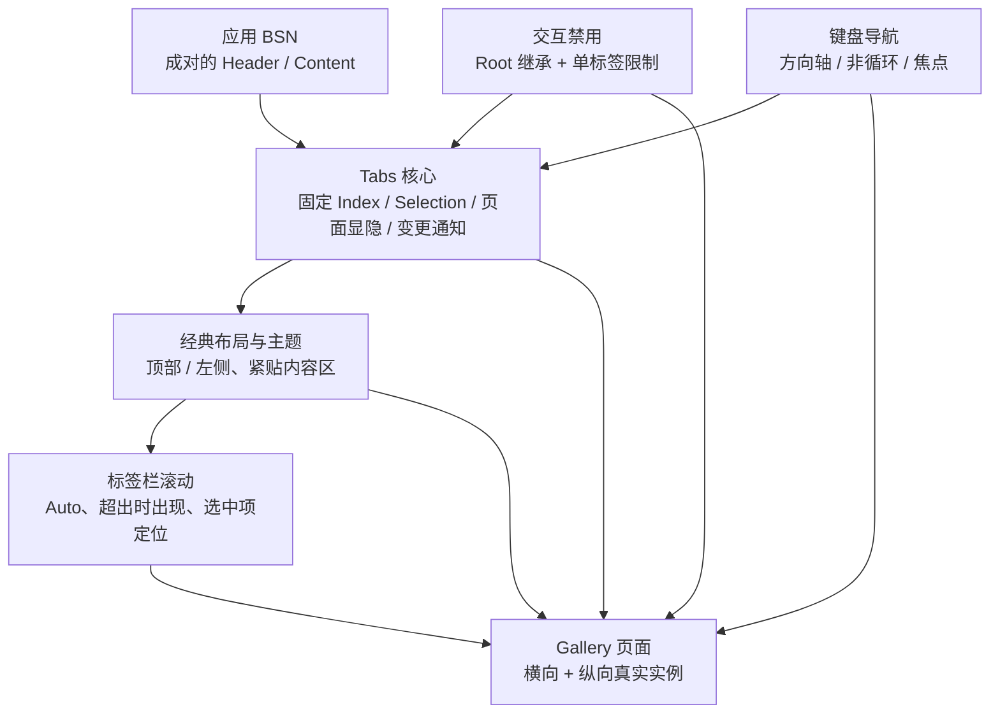

# WidgetryTabs 的功能增量与整体关系

WidgetryTabs 的职责不是仅在一排选项中保持单选，而是把**一个固定的标签集合**与**同样固定的内容页面集合**关联起来。应用用 Bevy BSN 提供 Header 和 Content，Tabs Root 持有唯一的 `usize` Selection，选择改变时先提交状态和页面的 `Display` 显隐，再发出变化通知。所有页面预先创建，页面内部的业务数据、布局和滚动仍归应用所有。

在这条主线之上，用户输入、有效 Disabled 继承、方向键导航、经典外观和独立标签栏滚动逐步加到同一个 Widget 上。Gallery 使用真正的组件展示两种方向及边界交互，不另造一套展示用模拟实现。

核心状态和页面映射是后续行为的基础。Disabled 决定用户能否发起切换，但不阻止合法程序化操作；键盘导航同样使用选择提交入口，不维护自己的第二份状态。外观只读取运行时选择和有效禁用信息；滚动只定位标签栏中的 Header，不接管 Content 页面。各能力依次交付，避免在一次增量中把 Headless、Style、Gallery 混在一起。

所有增量遵循项目统一 BSN 构造、Widget 自有 Runtime State 只经公开 API 更新、状态提交先于通知的规则；使用 Bevy 0.20 和既有输入、焦点、滚动、Tooltip、Theme 基础设施。目标平台为 Windows 64 位，已有的应用入口平台检查和错误处理惯例保持不变。

## 实施顺序

1. [固定标签与内容页面的选择切换](01-固定标签与内容页面的选择切换.md)
2. [Tabs Root 与单标签 Disabled 行为](02-Tabs禁用与继承行为.md)
3. [横纵方向键导航与焦点规则](03-方向键导航与焦点规则.md)
4. [经典标签布局与主题视觉](04-经典布局与主题视觉.md)
5. [标签栏 Auto 滚动与选中项定位](05-标签栏自动滚动与定位.md)
6. [Gallery 横纵 Tabs 交互展示](06-Gallery横纵Tabs展示.md)

这里的顺序是唯一的交付顺序。相邻条目之间的关系以上述真实机制为准；每份方案将其本身的功能、边界和测试闭合，而不再单设“测试/验收阶段”。
