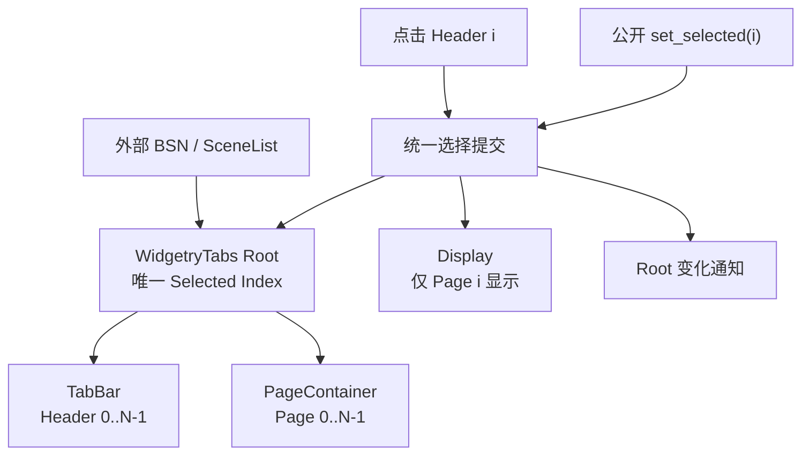

# 固定标签与内容页面的选择切换

这一增量交付一个真正能够工作的 WidgetryTabs：应用可以通过 BSN 声明成对的标签和内容页面，在构造时确定标签数量，用户点击标签或程序设置 Index 即可切换可见内容。它不是只有单选标记的 Header 组件；页面与选择状态由同一个 Root 协调，且切换不会丢失页面内部状态。

## BSN 如何确定标签与页面

每个逻辑 `TabItem` 在声明时把一个 Header Scene 与一个 Content Scene 绑定为同一项。两者始终由同一个 Index 对应，而不是把标签和页面拆成两份独立顺序列表，要求应用自己保证二者对齐。逻辑配对不等于实体父子关系：实际可采用 Root 下的 TabBar、PageContainer 两个区域分别容纳 Header 和 Content，这也为后来单独禁用 Header 而不影响页面保留了正确的层级边界。

调用方可以在 BSN 中逐项声明 TabItem，也可以在调用 BSN 之前从 Rust 集合生成 `Vec<Box<dyn Scene>>` 或其他 `SceneList`，再通过 `Children [{items}]` 一次性展开。构造时标签数量可由运行时变量决定；实例建成后该集合即固定，Index 始终与原始顺序一致。不提供运行时增加、删除、重排标签的公共功能，也不预留复杂的 Stable ID。

使用项目统一 Bevy BSN 组合约定，包括 SceneComponent、Scene Function、Scene / SceneList 和外部 Children；不建立自定义 Builder、Spawn Callback 或非 BSN 入口。需要独立 ECS 身份并保留状态的部分使用仓库惯用组件结构；只用于复用的构造片段使用 Scene Function。具体代码名称参照现有控件，不为命名再引入独立设计。

## 唯一 Selection 与页面生命周期

合法的 Tabs 至少有一个 TabItem，且**始终恰好一个选中 Index**。初始默认选择第一个（0）；BSN Props 可传入初始 `selected_index` 以直接显示其他页面。初始 Index 不能越界，初始化阶段不发运行时 Selection Change 通知。Props 只是构造输入，不是 Runtime 状态副本。

所有 Content 页面在创建时一次性生成 Entity 子树。初始只显示被选中的页面，其他页面以 `Display::None` 隐藏；选择改变后隐藏旧页面、显示新页面。不 Despawn、不重建、不因切换而懒加载。页面中的 TextField 输入、普通控件状态、外部数据以及应用自己布置的 ScrollArea 的滚动位置在切换后仍然保留。

页面内部的布局、数据和滚动由应用 BSN 自主决定。Tabs 不为内容页面自动包一层 ScrollArea，不替应用暂停隐藏页面上仍运行的普通 ECS 业务 System；它只承诺活动页面的显示与 UI 输入隔离。页面内容可以是任意 BSN Scene，不限定为文字页面。

如果当前焦点正位于即将隐藏的页面子树内，切换时必须先清除这一失效焦点，使隐藏的 TextField 不会继续接收输入；不能擅自把焦点转给新页面。原焦点不属于旧页面时保持不变。这个规则同时适用于点击切换和程序化切换。

## 公开选择 API 与提交路径

Selection 统一采用 `usize` Index，由 WidgetryTabs 自己作为唯一状态 Authority 维护。外部读取当前 Index 使用只读接口；修改通过控件公开 API，而不是直接替换内部 Component。实现保留与仓库一致的同步 `World` 和 `Commands` Queue 入口：同步操作在调用时执行，排队操作在真正执行时校验、提交，不把命令入队视为已经切换。

合法设置新 Index 时，先提交 Root Selection，再完成 Header 选中投影和页面 `Display` 的对应变化，最后从 Root 发出已完成的 Selection Change 通知。业务通知沿用现有 `ValueChange<usize>` 风格，鼠标实际改变与程序化实际改变都发同一种通知，不额外区分 Origin。Observer 在通知触发时能够读取新 Index 和新的显隐状态；Bevy 后续 UI Layout / Render 不需要在通知之前完成。

合法同值选择不重写状态、不产生通知；初始化也不发变化通知。已经选中的标签再次点击不被理解为独立的确认或重选事件。未来视觉高亮、主题刷新等派生变化不应反向驱动选择提交。运行时页面显隐只能服从唯一 Selection，不形成独立 Page Active Authority。

例如初始 A（Index 0）、B（Index 1）、C（Index 2）。点击 C 后，通知中的 Index 对应 2，A 与 B 隐藏，C 显示。再次点击 C 是合法无变化；将 Index 设置为 1 后，仅 B 显示，C 的页面 Entity 保持存在，回到 C 时其内部值不被重置。

## 错误与完成条件

空集合、初始越界、失效 Root、运行时越界 Index、缺失或不合法的 Header / Content 配对结构，都属于需要明确报告的错误。无效请求不得悄悄回退、部分提交 Display、修改 Selection 或发送变化通知。按仓库 `BevyError`、`Severity::Error`、Error Handler 和日志契约反馈；`Result<bool, BevyError>` 风格的入口保持 changed / unchanged / invalid 三种结果。不能因一个实例损坏使其他正常 Tabs 无法使用。BSN 延后挂接未完成时的瞬间状态应与构造完成后的真实结构错误区分；稳定结构无需每帧无条件遍历验证。

本增量的测试覆盖：固定配对与变量 SceneList 构造、初始 0 和指定初始项、非空与越界构造错误、唯一选中与唯一显示、点按及程序选择同一提交路径、合法同值不发事件、非法请求原子拒绝、同步与排队命令的执行时机、通知时读取新状态、切页保留 Entity / TextField 值 / 页面自有 ScrollPosition，以及隐藏含当前焦点的页面后不会继续输入且不抢新焦点。应用对页面自己的 ECS System 不因显隐切换而受到额外暂停约束。

后续增量分别接入 Root/单项 Disabled、方向键、视觉与独立标签栏滚动；这些能力复用本阶段的选择入口和 Index → 页面配对，不新增第二份选择权威。
