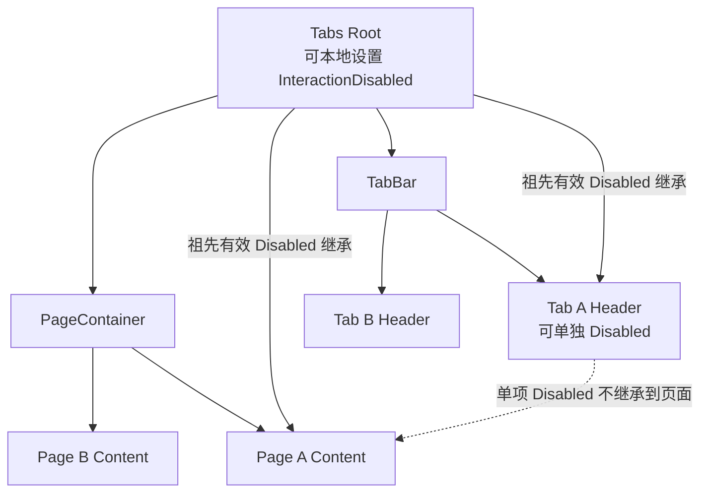

# Tabs Root 与单标签 Disabled 行为

这一增量在已经能够通过点击、公开 API 切换页面的 WidgetryTabs 上补齐两种不同粒度的禁用能力：Root Disabled 表示整个复合控件不能接受用户交互；单个标签 Disabled 只阻止通过该标签发起切换。无论哪一种，都**不阻止应用合法的程序化选择**，也不能破坏始终存在的唯一选中项。

这两种语义不需要发明独立的 `tabs_disabled` 或 `item_disabled` 业务状态。使用项目既有的有效 `InteractionDisabled` 继承机制即可，关键在于 Header 和 Content 实体的层级不能混在一起。

虚线表示**不存在禁用继承关系**：Tab A 的 Header 和 Page A 只是通过 Index 配对，并不构成父子关系。即使 Header A 被独立禁用，只要 Root 和页面自身没有其他禁用理由，Page A 的输入控件也不应受它影响。

## Root Disabled：覆盖整组与内容区

在 Tabs Root 上设置 `InteractionDisabled` 后，其有效禁用状态按项目原有机制沿 ECS 后代传播到 TabBar 和 PageContainer。用户不能点击标签切换；当前显示页面内部的交互控件也因祖先有效 Disabled 而禁用。

如果 Root 已禁用，应用仍可调用公开选择 API 将当前 Page A 切到 Page B。新显示的 Page B 自始至终位于 Root 之下，天然继承同一有效禁用状态，**不需要**在切换时对新页面手动插入 Disabled。这个结构解决了“禁用了 A，程序切换到 B 后 B 却没被禁用”的问题；禁用属于整个容器，而不是某个瞬时活动页面。

Root 被解除禁用时，原有各项本地 Disabled 请求仍按项目已有 OR 规则决定有效状态；祖先取消后不应把单项自己设置的 Disabled 错误地清掉。保持与 `WidgetryEffectiveDisabled` 等现有只读查询机制一致，不增加第二份 Disabled 真值。

## 单个 Tab Disabled：只限制选择入口

单个 Header 允许独立设置 Disabled。鼠标点击这个标签不能使它变成新的选择，随后加入的键盘导航也必须跳过 Disabled 项。但是程序化 API 选择该 Index 是合法的——Disabled 限制用户输入，不限制应用主动管理状态。这点和仓库其他互斥选择控件保持同一原则。

当已选中的标签后来变为 Disabled 时，仍保留它作为唯一选中项，内容页面继续显示，不自动找下一个可用项，也不额外发送 Selection Change。允许用户此时操作页面中那些没有其他 Disabled 理由的控件；单项 Header Disabled 不等于“页面只读”或“整个内容不可交互”。

如果需要单独禁用页面内部的某个 TextField、按钮或某整块内容，仍由应用在该页面的 BSN 中进行本地 Disabled 设置，Tabs 不替应用维护页面业务禁用。

## 与 Selection 提交机制的关系

已有的 `usize` Selection 仍是唯一权威。Disabled 不参与“当前 Index 是否合法”的程序化校验；程序设置被禁用标签或在 Root Disabled 期间切换，都可以执行同一个提交路径：先选中，再切换 Display，实际改变后通知。选中项虽禁用，依旧算有效的已选项。Root/单项 Disabled 的投影变化本身不产生 Selection Change，也不清除页面 Entity。

用户输入路径要判断当前有效 Disabled，而不是简单认为只有显式挂在当前标签实体上的本地组件才生效。Root 祖先传播、本地 Disabled 及内部限制的 OR 规则继续由项目共同基础设施提供。有效禁用投影应在正常输入派发前稳定，不要绕过已有基础设施增加手工同步逻辑。

## 完成条件与后续关系

能分别禁用 Root、普通 Header 和已选中的 Header；点击未禁用项仍可切换、点击禁用项不变；已选项禁用后页面仍显示；程序化可在 Root 或目标 Header 禁用时切换且仅新页面显示；Root Disabled 期间两侧子树仍有效禁用；解除 Root Disabled 不抹掉单项本地请求。错误 Index 仍按基础选择 API 原子拒绝，不因禁用状态返回伪错误。禁用状态变更不会产生业务 Selection Change；真实程序化选择则继续按照既定的提交再通知规则工作。

本增量不独立实现方向键系统，只要求建立正确的有效 Disabled 选择判断，供下一增量的键盘导航复用。视觉淡化与选中禁用状态的颜色表达留给外观增量处理。始终使用同一组件层级和选择权威，不因分阶段交付引入额外 State。
