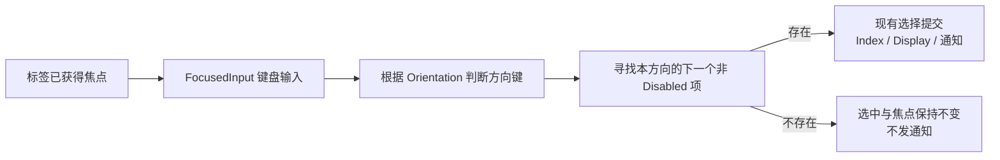

# 横纵方向键导航与焦点规则

这一增量使已有 WidgetryTabs 在获得标签焦点后可以用方向键直接切换页面。它复用 Bevy 底层输入与焦点设施，但不直接挂载官方 `TabList` / `Tab` 的导航策略：官方实现可能循环切换、改写 roving TabIndex、允许无有效选择，而本控件已经要求唯一选择、边界停止和从 Tab / Shift+Tab 顺序遍历中排除标签头。

核心原则是**方向键也只是另一种选择来源**。它找到合法目标 Index 后，调用前序建立的同一个 Selection 提交入口，由这个入口统一更新页面显隐和变化通知；键盘系统不维护独立的页面 Active 或 Selected State。

## 两种方向与自动激活

Horizontal 为默认方向，使用 ← / → 按声明顺序向前/向后移动；Vertical 使用 ↑ / ↓。方向在构造时配置，并同时被标签栏布局和键盘逻辑使用，避免视觉竖排而仍通过左右键切换。运行期间不为 Orientation 新增独立 Setter，按仓库现有 `SegmentedOrientation` 一类控件的配置惯例落地。

键盘采用**自动激活**：焦点处于某个标签头上时，按对应方向键直接选中找到的标签并切换它的内容页面，无须再通过 Enter / Space 确认。它与“方向键只移动焦点、确认键才激活”的手动模式不同，因此不增加手动激活设置项。

所有方向键移动在首尾停止，绝不循环。例如 A、B、C 中焦点位于 C，横向继续按 → 仍停在 C，纵向继续按 ↓ 同理。寻找下一个标签时跳过有效 Disabled 项；若从当前位置到边界没有可用目标，就不改变选中 Index、当前焦点或通知。非配置方向轴的箭头不触发切换。

当焦点在标签上，用户切换到新标签后，焦点也应停留在新的标签上，使方向键可连续操作。用户鼠标点击标签时该标签能够获得焦点；但无标签焦点时不把任意方向键视为全局 Tabs 快捷键，避免干扰页面 TextField 等普通控件。

## 不参与 Tab / Shift+Tab 顺序导航

标签头设置 `TabIndex(-1)`：不作为正常 Tab 或 Shift+Tab 顺序导航的目的地，同时仍允许点击或显式焦点操作让 Header 获得焦点。这里的“跳过”只限制**标签栏本身**，不能把整个 Tabs Root 或页面内容区都排除在 Tab 导航之外。

第一版不实现“按 Tab 进入标签栏，再按 Tab 自动进入活动页面”的导航逻辑，不新增焦点入口/出口追踪、保存旧标签焦点再恢复等机制。内容页面内部的 Button、TextField 等原有键盘导航仍由这些组件自己处理。

页面切换的既有焦点保护仍然有效：如果原焦点实际在将隐藏的页面内，必须将它清除，不能让隐藏文本框继续响应键盘输入，也不自动聚焦新页面。这个问题与标签栏 `TabIndex(-1)` 是两种不同边界；用户通过鼠标或 API 切换页面时同样需要遵守清除旧页面焦点的规则。

## 使用的输入基础设施与状态提交

使用已有 `PointerClick`、`FocusedInput<KeyboardInput>` 和 `InputFocus` 等 Bevy 输入能力，结合 Widgetry 的有效 Disabled 判断，自己实现方向目标查找、非循环规则及选择提交。官方 `TabList` / `Tab` 的 Accessibility 及输入处理方法可供参考，但不能直接依赖其会主动维护 `SelectedTab` 或重写 `TabIndex` 的策略，以免破坏单一选择权威。

从输入路径切换到新 Index 时遵守同一变更通知原则：先设置选中 Index 和页面 Display，再发业务 Selection Change；非法或无变化目标不发。Root Disabled 时阻止用户键盘切换，单项 Disabled 不是合法的用户导航目标；合法程序化选择禁用项的能力仍然存在。多组 Tabs 的焦点和导航互不影响。

## 完成条件

测试覆盖：点击使标签可聚焦、失焦不响应方向键；横向仅左右有效、纵向仅上下有效；方向键无需确认直接改变当前可见页面；首尾不循环；跳过中间和末尾 Disabled；没有可选下一项时焦点、Selection 与通知不变；Root Disabled 不接受输入；负 TabIndex 使顺序 Tab / Shift+Tab 跳过标签但不影响页面内控件；键盘切换后的 Selected Index 和 Display 在事件回调中已更新。切换离开有焦点 TextField 的旧页面仍能清除失效焦点。

前一增量建立的有效 Disabled 和第一增量的选择 API 都是输入判断依赖；下一增量负责将当前 Index、焦点、Hover 和 Disabled 表达为主题外观，而不是再实现一份输入状态。
