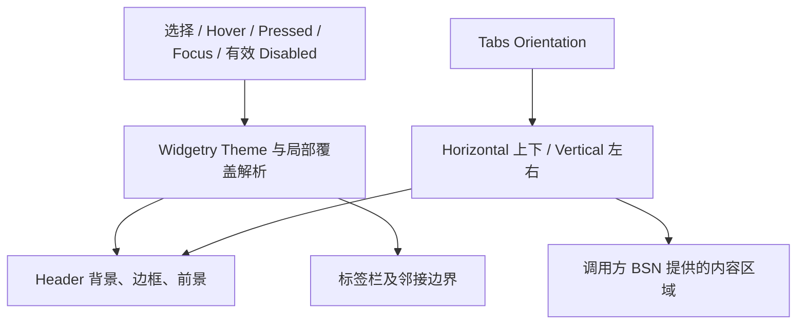

# 经典标签布局与主题视觉

这一增量让 Headless WidgetryTabs 具有项目 Theme 驱动的完整视觉效果：横向是上方标签、下方页面，纵向是左侧标签、右侧页面。它不只是两个区域上下或左右排列，而是要求**标签栏紧贴内容面板**，选中标签与内容区呈现同一组经典桌面 Tab 的视觉关系。

视觉系统读取已经实现的 Selection、焦点和有效 Disabled，不修改这些状态，也不把配色结果作为第二份选择依据。横纵只改变主轴布局，不改变标签与页面的 Index 配对、程序化切换或页面生命周期。

## 横向：顶部标签栏紧贴页面

Horizontal 为默认方向。Header 沿水平方向单行排列，整个 TabBar 位于 PageContainer 上方；标签的尺寸依赖自己的 Header Scene 内容及内边距，**不强制等宽**。标签数量和文本长短不同，可以出现宽窄不同的标签。基本标签高度及内边距随 Widgetry 控件风格设置，不强制把所有标签压成相同宽度。

TabBar 与 Content 之间没有永久留白或外加间隔。选中标签用显著主题色/背景及与页面邻接的边界处理，让视觉上有“这个标签打开了下面的面板”的感觉；未选中标签使用普通背景，Hover、Pressed 有清晰但克制的反馈。横向模式不提供把标签栏移动到页面底部的选项。

## 纵向：左侧等宽标签列紧贴页面

Vertical 将标签沿竖直方向排在左侧，右侧 Content 占其余可用空间。所有标签在标签栏交叉轴方向拉伸，**统一占满左侧栏宽度**；高度采用一致的单行标签高度，不因为文字长短形成高高低低的选项。纵向模式不提供标签栏放到右侧的选项。

左侧标签栏宽度需要保持受控，不能因为某一项标题特别长而侵占大量页面空间。对于文字型 Header，标题在同一行显示，超出可用宽度时用 `…` 截断，而不是软换行把这一项撑高。悬停该标签时可使用现有 Tooltip 显示完整标题。提示内容仍基于外部提供的完整标签文字，而非把截断后的显示内容当作真实标题。

例如标签为“高级渲染和图形设备兼容性设置”，宽度不足时显示类似“高级渲染和图形…”，但一行高度不变。Tooltip 才展示完整名称。Header 和 Content 的内容来源仍是外部 BSN；不引入仅为标题传 String 的替代构造 API。

## 状态与配色的归属

配色复用仓库现有 Theme、颜色覆盖及有效 Disabled 机制，不另建独立样式状态权威。Header 需要区分普通、选中、Hover、Pressed、Disabled 等状态；其中 Disabled 对用户交互的阻断已经由 Headless 实现，Style 只负责呈现。已选 Header 后来被禁用时，其外观需要仍能看出“它是当前选中项”，但应有被禁用的视觉反馈，不因禁用就自动改选其他标签。

Root 整体 Disabled 的颜色变化同时遵守子树有效 Disabled 继承，但 TabBar 的禁用外观不能靠直接修改 Content 页面内部业务节点实现。Theme 改变、局部覆盖改变、焦点或 Hover 变化时，正确更新相关视觉输出；尽量遵循其他 Widgetry 控件已建立的 Owner / Theme / Foreground 传播与事件驱动刷新方式，避免在稳定帧里无条件重新解析所有标签配色。

保持应用自定义 Header 的 BSN 组合能力。已由 Widgetry 负责的默认前景可以沿用既有 WidgetryText / WidgetryIcon 传播规则；调用方自己明确设置的独立视觉属性按项目现有覆盖语义保留。Tab 与 Page 的外观是两个范围：Tab Style 负责标签头和与内容区贴合的过渡，不接管用户页面里面的字体、背景、按钮配色与布局。

## 内容区域与外观边界

Tabs Root 提供可用于布局的内容区域，实际页面仍由应用的 Content Scene 填充。页面多长、要不要滚动、滚动条使用何种样式、要不要有额外背景装饰，都属于应用自己的 BSN 内容。Tabs 不强制为 Content 套滚动层；之前定义的所有页面常驻和隐藏时 `Display::None` 机制不因外观而改变。

视觉组合遵守 BSN 构造与 Node Patch 规则，具体 SceneComponent、颜色值与对外 Override API 名称从现有控件的实现惯例中选择，不要求为样式实现再创建一套独立组件模型。下一增量会在标签栏内部添加溢出 Auto ScrollArea；无溢出时，本阶段的“紧贴而没有空隙”要求仍须成立。

## 完成条件

验证顶部/左侧两种布局、禁用的底部/右侧位置未被额外引入，页面与标签栏无永久缝隙；横向标签自然宽度、不强制等宽；纵向标签拉伸至左栏全宽、保持单行统一高度、长文 `…` 和完整标题 Tooltip；Selected、Hover、Pressed、Disabled、Selected+Disabled 各视觉状态正确；主题切换和局部覆盖更新正确，不修改 Selection、不发送业务 Selection Change；页面外部内容仍自行布局和滚动。保持不同主题及 Window Scale Factor 下的合理布局，不因长文字撑窄内容面板。

这一阶段只交付无标签栏溢出时的完整经典样式与视觉状态，随后在相同的无缝布局上加入 Auto 滚动，不重复另起一套横向或纵向控件。
