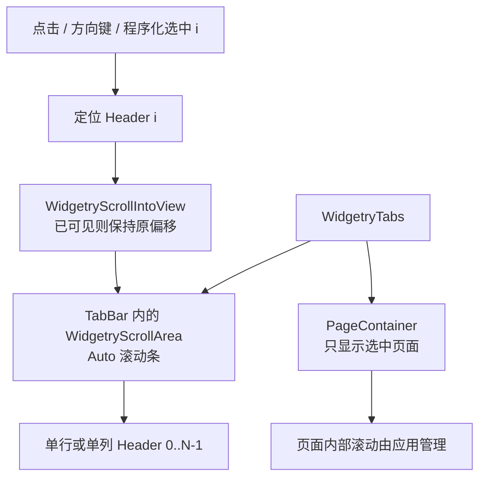

# 标签栏 Auto 滚动与选中项定位

这一增量解决标签数量超过 Tabs 可用空间时的布局与可达性问题。在经典上下/左右布局已经成立的前提下，TabBar 自己成为一个可滚动区域：标签仍然排成一行/一列，页面内容区域不跟随标签一起滚动；对用户和程序化操作都能自动把新的选中标签移入可见范围。

关键取舍是**复用已有 WidgetryScrollArea**，而不是重新实现滚动条。显示策略固定为 `Auto`，只有溢出才出现滚动条，不暴露给外部应用配置；这与内容页面是否使用 ScrollArea 是两回事。

## 溢出和滚动轴

Horizontal 沿 X 轴排列标签，标签可以各自有自然宽度，不因空间不足就一起缩成窄条，也不自动换行成两排。超出可见宽度时启用水平滚动条，位置靠近标签栏下缘，也就是它与下面页面面板相接的区域。内容能放下时不显示滚动条，标签与页面之间仍然贴紧，没有预留一个永远空着的滚动槽。

Vertical 沿 Y 轴将标签单列排列，每一项占满左侧栏宽、文字不换行。超出可见高度时启用竖向滚动条，位置位于左侧标签列靠右的一侧，也就是紧邻右侧页面的边缘。未溢出则隐藏，页面面板不因滚动策略平白留下空隙。

由 ScrollArea 的布局及 Scrollbar Gutter 机制处理滚动条出现与消失时的可见区域变化，而不是应用手工根据标签数推算滚动范围。实际能否滚动以 Bevy 完成布局后得到的几何范围为准；不能把“Scene 已创建”当成“尺寸已测得”。窗口或布局尺寸变化时，滚动偏移仍应限制在合法可视范围内。

## 选中标签自动进入可视范围

每次真实 Selection 改变后检查对应 Header 是否已经完整可见；如果完全可见，保留当前滚动位置，避免反复跳动。如果在可视范围之外或被部分遮挡，通过已有 `WidgetryScrollIntoView` 将其滚入视野。可复用仓库 ScrollArea 对最近 Viewport 的定位规则，使这一动作只作用于标签栏，不会不小心滚动内容页面自己的嵌套 ScrollArea。

鼠标点击、方向键和程序化设置都使用同一选中 Index，所以自动定位也不应该只支持某一种输入来源。即使整个 Root Disabled 或某个 Header Disabled，合法的程序化选中仍允许完成必要的标签栏定位；有效 Disabled 只阻止用户交互，不阻止程序对滚动位置的合法调整。重复选择同一 Index 不需要因为重新提交而反复制造滚动或业务事件。

标签栏滚动偏移不属于 Tabs 的业务 Selection Authority：保持 ScrollArea / Bevy ScrollPosition 本来的状态管理规则即可。用户可以正常通过现有 ScrollArea 的滚轮、滚动条拖动等能力访问不可见标签；滚动本身不改变选中项，只有点击、方向键或程序化设置才会改变 Selection。

## 与页面内容滚动的隔离

标签栏和页面是独立区域。横向标题过多时只滚动顶部 Header；纵向标题过多时只滚动左侧 Header。右侧或下方页面既不被带动，也不被 Tabs 默认加上内部滚动。需要滚动的内容页由应用自行在 Content Scene 内组合 ScrollArea，离开该标签后仍保留原本的 Entity 和偏移，再返回时按原状态显示。

这也避免把“标签栏有滚动条”和“页面有滚动条”混为一套状态。Root Disabled 会按现有机制继承到两边 UI；程序化 Scroll / Selection 仍可合法更新而无须解除 Disabled。

## 完成条件

使用足以溢出的水平与垂直标签集合，以及足够大而不溢出的集合进行测试：Auto 滚动条仅在溢出时可见；水平 Bar 出现在上方标签与页面之间、垂直 Bar 出现在左侧标签与右侧页面之间；无溢出时没有预留空带；超量标签不换行、不被整体压缩；点选/方向键/程序化选中不可见 Header 后自动进入可视区，已完整可见时 ScrollPosition 不无意义改变；Root Disabled 下仍可完成合法程序化切换与可视定位。页面自有滚动区域仍独立保留其偏移，窗口尺度或可用空间变化后不产生越界滚动。

这一增量在上一阶段的经典布局上加入真实的标签栏滚动能力，不另造内容页滚动 API。随后 Gallery 会同时演示两种方向的溢出、自动定位和页面滚动的独立性。
