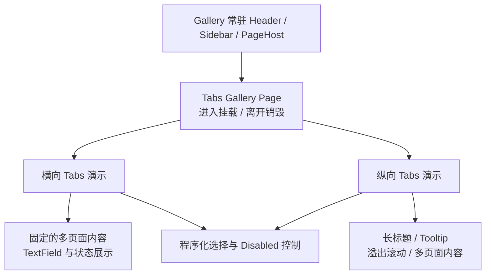

# Gallery 横纵 Tabs 交互展示

这一增量在现有 Widget Gallery 中增加一个可实际操作的 Tabs 页面，同时放置横向与纵向两组 WidgetryTabs。目标不是堆放静态样例，而是让用户直接检验选择提交、内容切换、有效 Disabled、键盘焦点、溢出滚动、长标题与页面状态保留这些已实现的行为。

Gallery 中展示的 Tabs 就是正常 Widgetry UI 组件，使用现有 BSN 组合方式和 Widget 公共选择 API，不实现任何与生产控件分离的演示专用 Tabs 模型。

## 一个页面展示两个独立实例

Gallery 沿用已有 `GalleryPage`、`OnEnter`/`OnExit` 和 `mount_page`/`unmount_page` 机制，将 Tabs 作为一个导航入口。进入 Tabs 展示页时构造两个实例及各自的演示数据，离开时销毁页面演示子树，再次进入重新创建；不把演示临时状态长久放在全局资源中。

两组实例的 Selection、焦点、标签滚动位置和 Content 页面相互独立。横向放在顶部标签 + 下方内容的演示区域，纵向放在左侧标签列 + 右侧内容的演示区域，以用户确认过的经典布局直接呈现。页面中的具体业务内容保持轻量，让焦点和可见性变化容易观察。

特别要区分两层生命周期：**同一 Tabs 内**切换 Header 时 Content 仍常驻，保留 Entity 和输入状态；**Gallery 离开整个 Tabs 演示页时**，宿主会卸载并销毁这两个 Tabs 实例，这是现有 Gallery 的页面管理规则，不能误当作 Tabs 自身在切页时销毁内容。

## 可操作的选择与 Disabled 对照

用户在每个演示区域内可以点击不同标签，并在标签获得焦点后使用适合方向的箭头立即切换页面；第一项之前、最后一项之后不循环，Disabled 标签被跳过。展示当前选中 Index，并能看到真实选择变化通知的结果，而不是只显示不可信的演示本地计数。

通过现有 Button 或其他 Gallery 常用控制入口触发 WidgetryTabs 的程序化选中 API，验证在用户点击与程序化设置两种路径下，业务状态与页面显示一致；重复选中不产生多余通知。程序化目标可以是超出当前标签栏可视范围的合法项，用于和自动 ScrollIntoView 行为联动展示。

分别安排普通禁用项、已选项被禁用、整组 Tabs Root 禁用等场景。Root 禁用时用户不能切换标签，当前页面内部的可交互内容也应继承有效禁用；通过程序仍可选中另一页面，新页面仍保持同一根禁用约束。单个 Header 禁用时，仅阻止用户从该 Header 切换，已选页面仍保留，内容内部不会凭空失去交互能力。显示这些场景时，选择高亮和 Disabled 颜色也应保持可辨识。

## 页面常驻、焦点清除与滚动

至少在两个 Content 页面中放置真正的 WidgetryTextField 或其他有状态控件。先在 A 输入，再切到 B，回到 A 时输入仍然保留；如果焦点位于 A 的输入控件而程序化改选 B，隐藏后的 A 不应继续接收键盘输入，Tabs 也不自动将焦点转移到 B。页面内如有需要滚动的内容，由该 Content Scene 自己组合独立 ScrollArea，标签栏滚动不得牵连它。

横向和纵向演示都应具有足够数量的标签以构成溢出，观察 Auto 模式下滚动条按需出现。选中视野外标签后自动滚动使其可见，已可见时不反复跳动；未溢出的普通演示区域不出现永久滚动槽，标签和内容保持紧贴。横向保持单行自然宽度标签，纵向统一栏宽、高度一致；为纵向长标题演示单行省略号及悬停显示完整标题的 Tooltip。

## Gallery 原有能力的整合

Gallery 的 Theme 切换应更新 Tabs 的选中、普通、Hover、Pressed 和 Disabled 外观，并保留页面输入状态；已展开的 Theme Colors / Override 区域如项目现有控件惯例需要支持，可在同一 Tabs 页按既有方式接入。Language 切换时，已绑定的标签及演示说明文字按现有国际化机制原位更新，不应由于文本变化重建 Tabs 丢失 Selection 和 Content 状态。Scale Factor 切换可用于观察窄空间下横纵布局和滚动条的适应能力。

需要核查运行时状态与层级时沿用 Gallery 的 BRP Runtime、可反射状态和 Screenshot 方式，不添加另一套仅为 Tabs 服务的调试宿主；UI 的创建方式继续使用 BSN。注册 GalleryPage、侧栏导航、本地化文案及演示 Plugin 依照其他页面的现有模式同步完成。

## 完成条件

Gallery 可从侧栏进入单个 Tabs 页面，并同时看到横纵两个实例；可以操作点击、方向键、首尾停止、Disabled 跳过、整体与单项禁用、禁用期间合法程序选择、状态事件展示和页面切换。切换内部标签时 TextField 值保持，隐藏旧页面焦点及时清除；长文字省略与完整 Tooltip 有效；两轴各自演示 Auto 滚动、选中项进入视野和无滚动条时贴合无缝。Theme / Language / Scale Factor 变化使用现有 Gallery 机制，两个实例互不干扰。

离开 Tabs Gallery 页面时实例被销毁，再进入得到新演示，而不是把内部“页面常驻”错误地提升为跨 Gallery 导航常驻。对应行为异常应在 Gallery 及其直接涉及的控件逻辑中闭合，并重新验证受影响场景；无需单设纯截图或最终回归任务。
