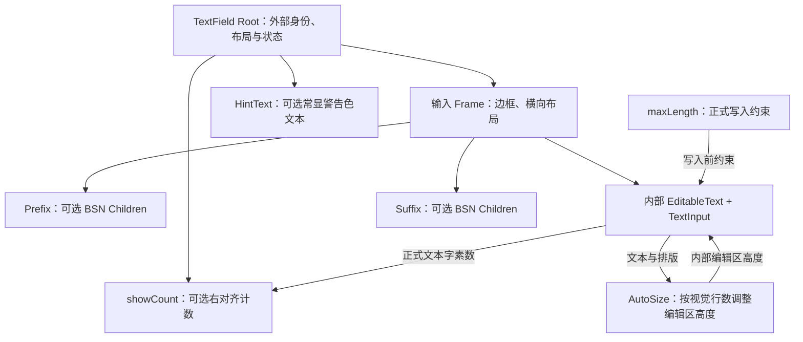

# TextField 功能升级的整体设计

这一组改动面向 `WidgetryTextField` 和 `WidgetryReadOnlyTextField`，分别交付文本最大长度、可组合前后缀、字数展示、多行自动高度、常显提示文本五项能力。它们共同遵循一条核心边界：**Bevy 官方 `EditableText` / Parley 是唯一真实文本状态**；Widgetry 管理复合控件身份、输入约束和外围展示，不再另建文本 Authority，也不替换官方光标、选区、剪贴板或 IME。

为了让外围区域与真实编辑器彼此独立，控件从“根实体本身即 `EditableText`”改为“根实体管理复合布局、内部实体执行文本编辑”。Prefix / Suffix 属于边框内横向布局，字数统计和 HintText 属于边框外纵向布局；AutoSize 只管理内部编辑区域的高度。

### 输入边界与展示边界

`maxLength` 在正式编辑提交前对受控输入进行字素簇限制，涵盖用户键入、粘贴、IME 提交及程序化内容设置；IME 预编辑仍遵循官方流程。`showCount` 从已经提交的同一文本状态计算字素数，因此会与限制后的实际文本保持一致，而不是另存一份内容。

Prefix / Suffix 采用任意 BSN Children，但只由 Widgetry 确定左右位置，不推断用户子控件是否可交互。两侧占据自身宽度，中间编辑区使用剩余宽度。多行 AutoSize 依据实际文本排版后的视觉行数与编辑区可用宽度计算高度，不包含外围显示行。HintText 是 TextField 自带的字符串属性，始终显示在下方并自然换行；警告语义颜色来自四套主题配置，而不是固定色值。

**设计关系与实施顺序并不等价。** `showCount` 即使没有 `maxLength` 也能单独工作；HintText 不依赖 AutoSize，AutoSize 也不依赖 HintText。它们按唯一顺序落地，主要是为了依次稳定内容访问契约、复合实体结构和各自展示位置，而不是将顺序相邻误认为功能上的硬依赖。项目允许破坏性修改，根实体不再直接承载 `EditableText`，对外通过 Widgetry 根实体 API 操作受托管的内部文本；这一托管例外需要同步到 Widget API 规则中。

## 子方案顺序

1. [按 Unicode 字素簇约束 TextField 文本长度](./01-按字素簇约束文本长度.md)
2. [为 TextField 增加可组合的 Prefix / Suffix 内容槽](./02-组合式前后缀内容槽.md)
3. [为 TextField 增加正式文本字数展示](./03-显示字素数量.md)
4. [为多行 TextField 增加按视觉行数自适应高度](./04-多行输入自动高度.md)
5. [为 TextField 增加常显的 HintText 提示文本](./05-常显提示文本.md)
