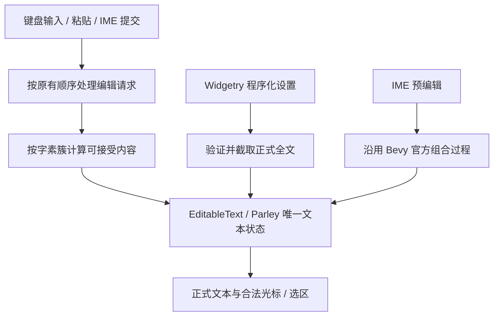
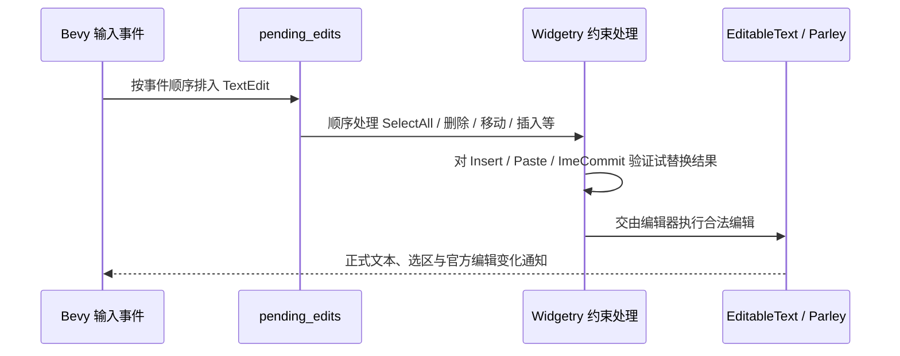

# 按 Unicode 字素簇约束 TextField 文本长度

`WidgetryTextField` 和 `WidgetryReadOnlyTextField` 增加可选的 `maxLength` 约束。交付结果是：正式文本通过用户编辑或 Widgetry 程序化设置进入控件时，都遵循同一套字素簇上限；超长输入只截取可容纳的部分，而不整段拒绝。光标、选区和 IME 仍由 Bevy 官方 `EditableText` / Parley 维护。这个增量包括受约束的内容访问 API，以及使内部托管官方组件合法的 Widget API 规则调整，不单独拆成基础设施或规则阶段。

## 编辑状态与长度约束的分工

`EditableText` / Parley 始终是唯一真实文本状态。`maxLength` 是 Widgetry 对该状态的写入约束，而不是另一份文本模型。这个区分很重要：长度控制需要接管输入提交前的边界检查，但不能因此重新实现一套光标、选择、剪贴板或 IME 编辑器。

不使用 `EditableText.max_characters` 来实现 `maxLength`。Bevy 0.20 中该字段按 Unicode scalar value（`.chars()`）计数；超出上限时会拒绝整次插入或粘贴，并且直接 `set_text` 不受这一限制。因此，受 Widgetry 管理的编辑节点应使 `max_characters = None`，避免两套不一致的约束同时生效。

### 长度语义

- `maxLength` 为可选配置，`None` 表示不限制；上限在创建时确定，不支持在运行期间缩小或改变。
- 计数单位是 **Unicode extended grapheme cluster（扩展字素簇）**，不是 Rust `.chars()` 得到的标量值，也不是 UTF-8 字节数。使用 `unicode-segmentation` 或语义等价的可靠分割实现。
- 汉字、带组合附加符号的字符、肤色 emoji、旗帜和 ZWJ 家庭 emoji 都要按用户感知的字素簇计算。上限可以是零，此时正式文本必须保持空字符串。
- 超限的普通键入、粘贴、IME **提交**及程序化全文设置，都只接受可容纳的**前缀**，不能截断某个字素簇，更不能仅因为输入超限就拒绝整段内容。
- 替换选区时，容量要先计入被替换文本释放的空间；不能把插入当作纯追加。尤其是组合附加符、ZWJ 在插入边界可能与现有文本结合，不能只计算“原字素数 + 新字素数”。应检查**实际试替换后的正式全文**，选择合法的最长插入前缀。

例如已到上限时先 `SelectAll` 再粘贴，粘贴应获得选区释放的容量；队列中先删除再插入，也不能以处理前的长度误判。字素数恰好符合上限的输入应完整保留，超过容量的尾部被截去。

### IME 正式文本与预编辑分离

`ImeSetCompose` 属于预编辑，不在本功能中提前裁剪或终止；输入法候选弹窗也不是 `EditableText::value()` 的正式内容。只有 `ImeCommit` 真正提交时才按容量截取。如果预编辑期间可视组合文字较长，仍以 Bevy 官方 IME 表现为准，不能为实现正式内容上限破坏组合过程。

所有受支持路径必须保证：**正式文本不会出现哪怕一帧已经提交、超过上限的渲染结果**。因此不能先放行官方编辑、等到下一帧再把文本裁短。创建时传入的超长初值也要在首次渲染前规范化。

## 编辑队列中的处理机制

Bevy 0.20 的 `TextInput` 将键盘、粘贴和 IME 消息转换为 `TextEdit`，请求先存入 `EditableText.pending_edits`；随后 `apply_text_edits` 在 `PostUpdate` 的 `EditableTextSystems` 中处理。`EditableText::apply_pending_edits` 会顺序执行整条队列，本身没有针对单条请求的 Widgetry 约束回调。因此，文本长度控制必须在**官方实际提交前**处理，且不能粗略地读取一次静态字符串，批量修改全部请求。

对容量敏感的 `Insert`、`Paste` 和 `ImeCommit`，先取得输入文本或剪贴板内容，再根据**执行到该请求时**的选区、当前文本以及试替换结果选出合法前缀，随后由 Parley/官方编辑能力执行真正编辑。`SelectAll`、移动光标、删除、选择操作等顺序语义必须保持，剪贴板操作不能发生双重消费。当前目标平台仅为 Windows `x86_64-pc-windows-msvc`，原生剪贴板同步读取可作为实现条件；仍须处理读取失败、空粘贴、已有待处理编辑和复制操作。

实现时必须具体证明上述预处理与官方 `apply_text_edits` 的顺序、编辑状态及 `TextEditChange` 通知保持一致。由于官方会一次处理整个待编辑队列，这个拦截与逐条应用机制是**待验证的技术前提**，不能仅以最终字符串被裁剪为证明。其他非 Widgetry 的普通 `EditableText` 继续沿用官方管线，不接受此约束处理。

## Widgetry 内容访问 API 与托管规则

TextField 提供以**控件根实体**为目标的公开取值和设置接口，包含只读访问、同步 `World` 设置和 `Commands` 排队设置。此阶段先建立稳定的根实体使用契约；后续复合布局调整时，外部 API 不应要求调用方重新寻找内部编辑实体。

- 所有 Widgetry 设置入口遵守 `maxLength`，程序化写入同样保证提交后的正式文本合法。ReadOnly 和 Disabled 阻止用户修改的规则不等同禁止程序化赋值。
- 设置全文时优先把光标和选择保持在新文本中的合法位置；无法保留则折叠到文本末尾，并清理不应在新文本上重放的待处理编辑和粘贴。
- `EditableText` 仍保存文本、光标、选择与 IME 状态。Widgetry 不能另存一份长期的文本 Authority，也不替代 Bevy 官方编辑行为。
- 外部直接编辑被托管的 `EditableText` 不属于受支持的 TextField 内容写入方式，不能以此绕过长度保证；这里是 API 契约限制，不意味着 ECS 在技术上无法访问组件。

为了让该管理方式与项目统一规则一致，调整 `rules/widget-api.md` 中的“Bevy 官方 Component”段落，采用以下原则：

> Bevy 官方 Component 默认保持原生使用方式。当官方 Component 是复合 Widget 的内部实现，且直接修改它会破坏 Widget 明确承诺的行为约束时，允许该 Widget 将其声明为内部托管组件，通过该 Widget 的公开 API 提供受约束的读写操作。托管范围及接口必须由具体 Widget 明确声明；不得维护重复的状态 Authority。未被声明为内部托管的官方 Component 继续保持原有使用方式。

TextField 明确托管 `EditableText` 以满足本功能，不把这条例外扩展到 `Checked`、`ScrollPosition` 等无关组件。项目允许直接破坏性修改，不提供历史直接写入模式的兼容层。BSN 仍用于 Scene 声明和构造，不因此引入替代 UI 构建 API。

## 与相邻增量的关系

这是方案链的第一个独立功能目标。后续 Prefix / Suffix 增量会将 `EditableText` 从根实体迁移到内部输入实体，届时必须保留本阶段形成的根实体内容 API 与编辑约束，调整焦点和输入查询而不能让限制失效。字数展示在更后的增量从同一正式文本 Authority 读取长度；此阶段不增加计数行。

## 验证与完成条件

围绕当前功能直接验证：汉字、组合附加符、肤色 emoji、旗帜、ZWJ 家庭 emoji、限制为零、插入边界的字素合并、初值超限、程序化全文设置、普通键入、超长粘贴、替换选区、队列内 `SelectAll → Paste` 与 `Delete → Insert`。读取到的正式文本必须始终符合上限，接受的前缀不得拆断字素簇，光标和选区保持合法。

IME 需要验证预编辑未经截断、正式提交按上限裁剪、候选窗口和中文 Windows 原生输入法正常；系统剪贴板、IME 的真实 OS 行为要在 Windows 真机补足 Headless 无法覆盖的部分，并确认不存在正式超限渲染帧。核对 `TextEditChange` 与实际已提交状态一致，复制/粘贴没有双重消费，普通 `EditableText` 不受影响，原有 ReadOnly / Disabled 编辑阻止与恢复后不重放旧队列的行为继续有效。

本功能的实际改动集中在 `crates/text_field/src/input.rs`、`registration.rs`、`lib.rs` 与相关内容 API、测试和文档，`crates/text_field/Cargo.toml` 按需增加 `unicode-segmentation` 等依赖，并同步更新 `rules/widget-api.md` 的官方组件托管原则。原有说明中允许直接写 `EditableText` 的表述需同步改为受支持的 Widgetry 内容入口，不能留下相互矛盾的契约。
