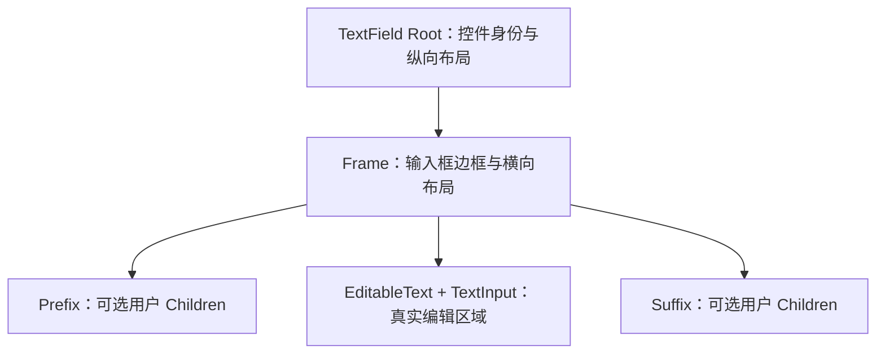

# 为 TextField 增加可组合的 Prefix / Suffix 内容槽

TextField 支持在可编辑文字左、右两侧放置任意 BSN Children，用于图标、文字或交互控件。目标是提供**有确定位置的布局槽**，而不是让 TextField 去判断槽内内容的语义。为了同时容纳外围区域并维持编辑器自身的光标、焦点和选区，需要将现有根实体编辑结构改为复合实体结构；此布局重构属于该可组合内容能力的必要实现，不另拆成纯重构方案。

## 复合实体的职责边界

根实体继续代表 `WidgetryTextField` 或 `WidgetryReadOnlyTextField` 的对外身份，作为 BSN 布局入口，保存创建配置初始化后的持久控件状态；不再携带 `EditableText`。Frame 承担边框、背景与横向排列；中间的编辑实体携带 `EditableText`、`TextInput`，保留 Bevy 官方文本、光标、选区和 IME 管线。其他需要显示在边框外的内容将在后续对应功能增量中加入根实体的纵向布局，不预先实现未启用的附属区域。

这会直接改变原有结构：目前根实体同时包含 `EditableText`、`TextInput`、`Node`、边框样式与焦点监听。项目不要求 API 向后兼容，因此可以替换根结构，不引入旧结构兼容层。但对外必须保留通过根实体读取、设置 TextField 内容的 Widgetry API，已存在的 `maxLength` 长度约束也必须继续作用在迁移后的内部文本状态上。真实文本 Authority 仍只有内部 `EditableText` / Parley 一份。

## 槽的声明与布局

采用 `WidgetryTextFieldPrefix`、`WidgetryTextFieldSuffix` 等标记容器。调用方通过 BSN Children 将任意 UI 节点传入每个容器，容器内部 Children 数量不限，既可全是装饰节点，也可以是带拾取/点击逻辑的按钮等控件。不要针对纯 UI 内容另造 String Field、Builder Callback、Spawn Callback 或代替 BSN 的 UI 构造接口。

每个 TextField 最多拥有一个 Prefix 标记容器和一个 Suffix 标记容器；两类都可缺省。**BSN 声明顺序不决定视觉位置**，布局中 Prefix 固定居左、Suffix 固定居右、编辑区固定居中。重复出现同类标记容器视为无效配置，必须明确报错，不能悄悄选择第一个。Prefix / Suffix 的内容不进入编辑文本，也不进入光标、选区、`maxLength` 和后续字数展示的计算。

两侧内容按其自身尺寸占据宽度，中间编辑区使用剩余空间。即使调用方放入过宽的前后缀，Widgetry 也不替其缩放、隐藏或自动生成复杂降级布局；调用方自己调整子内容或 TextField 总宽度。根实体接受的宽度要正确传入 Frame 和剩余编辑区，作为后续多行自动换行的可用宽度。

## 焦点与交互所有权

槽内容是任意 Children，不能可靠地通过 `Text`、`Button` 或 Observer 类型推断装饰性与交互性。**Widgetry 只负责 Slot 布局，不自动接管 Child 的点击和焦点。**

- 点击真正编辑区域时，沿用 Bevy 官方指针定位光标、双击选词、拖拽选择、键盘编辑和 IME 行为；文本实体是实际的 `InputFocus` 目标。
- 点击 Prefix / Suffix 内的按钮时，交由该 Child 自己处理，不因事件落在子节点上就强制让 TextField 抢焦点。
- 点击普通装饰图标不保证聚焦输入框；如果调用方希望如此，由调用方显式设置拾取穿透或聚焦行为。
- 通过 TextField 根实体请求聚焦时，需要正确映射到内部编辑实体，不能要求调用方发现内部节点。原有 `AcquireFocus`、Tab 导航和已获焦点后的传播保护必须适应新结构。

此外，根或祖先的 Disabled 必须能约束内部编辑和相应交互，不能因为移动 `EditableText` 就让已禁用输入框重新可编辑。ReadOnly 继续允许选择、导航和复制，但要在真正修改文本前过滤修改请求；Disabled 清除旧编辑与待处理粘贴，恢复后不能重放。点击命中对象从根变为内部节点后，指针焦点逻辑不能错误地把其识别成“不是 TextField”。

## 样式、状态与结构映射

主题外观要跟随新的组件分工：`BackgroundColor`、`BorderColor` 等输入框视觉状态投影到 Frame；`TextColor`、选择区域颜色和 `TextCursorStyle` 等编辑表现投影到内部文本实体。根实体仍维护 Widgetry 身份与状态；Focus、Hover、Disabled、ReadOnly 决定其应呈现的主题颜色。主题切换应只刷新相应视觉组件，**不得重置正文、Caret 或 Selection**。

根实体与内部输入实体的身份必须有稳定映射，供内容访问 API、聚焦 API、样式、输入过滤及后续展示功能使用。`WidgetryTextFieldProps` 仅进行构造期初始化，任何创建后仍需更新/查询的状态应由持久 Component 保存，不保留另一份长期 Props State。正常运行时使用 ECS 修改已有组件属于允许的内部操作；外部仍遵循 Widgetry 已声明的托管 API 契约。

## 与相邻增量的关系

本方案在已有 `maxLength` 和根实体内容 API 的基础上调整内部结构，不改变前一功能的字素簇长度含义、预编辑/正式文本边界或无超限帧承诺。后续 `showCount` 将在 Frame 外下方加入右对齐行，`HintText` 还会在其后加入常显文本行；两者在根实体纵向布局中呈现，但不是本方案的实施目标。AutoSize 后续仅作用于内部编辑区，不调整 Prefix/Suffix 自身的内容尺寸。

## 验证与完成条件

使用 BSN 分别声明无槽、仅 Prefix、仅 Suffix、两个槽、槽内多个 Children、不同声明顺序以及重复同类标记；确认位置与数量规则，不合法配置明确失败。检查文本编辑区域确实只占剩余宽度，内容过宽不触发不受约定的自动隐藏/缩放。

覆盖装饰节点、按钮节点、真实编辑区域的指针行为；逐项回归光标定位、双击选词、拖拽选择、Tab、`AcquireFocus`、程序化聚焦和 IME 坐标。键盘、系统剪贴板、ReadOnly / Disabled、根或祖先 Disabled 继承、失焦与恢复行为不能因实体拆分而退化。迁移并重写现有测试中“根实体直接持有 `EditableText`”的断言，包括 `widgetry_text_field.rs`、`pointer.rs`、`read_only.rs`、`disabled.rs` 及覆盖说明；必要时补充真实指针拾取验证。

主题验证需要覆盖正常、Hover、Focus、ReadOnly、Disabled、主题切换，以及样式刷新不重置编辑器状态。`crates/text_field/src/text_field.rs`、`lib.rs` 承载 BSN 结构与身份，`input.rs`、`registration.rs` 调整编辑实体的焦点和过滤，`style.rs`、`colors.rs` 对应新的样式投影。`docs/crates/text_field.md` 和 BSN 使用示例同步说明新的根实体身份、可组合 Slot、对外内容/焦点接口；不保留旧根实体布局假设，也不改造无关普通 `EditableText`。
