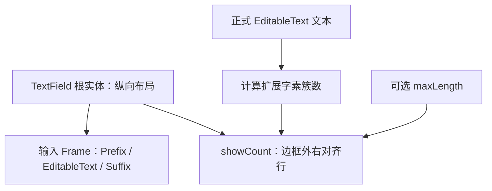

# 为 TextField 增加正式文本字数展示

增加可选的 `showCount`，在输入框边框外右下方显示当前正式文本的 **Unicode 扩展字素簇数量**。它是独立的只读展示能力：不要求启用 `maxLength`，不会修改文本编辑器，也不会改变焦点、光标或选区。交付后，单行、多行、普通及只读 TextField 均可选择显示计数。

## 展示内容的唯一来源

前序长度约束定义了统一的“字符”含义：按用户感知的 extended grapheme cluster 计数，而不是 Rust `.chars()` 或 UTF-8 字节。`showCount` 沿用该语义，从内部 `EditableText` / Parley 中读取**已正式提交的文本**；不能维护第二份字符串或独立的计数 Authority。

- `showCount` 默认 `false`，与是否设置 `maxLength` 完全独立。
- 没有长度限制时显示单个数字，例如 `11`。
- 存在 `maxLength = 100` 时显示 `11 / 100`，上限为零时相应显示 `0 / 0`；数字来自同一套字素簇计数规则。
- IME 预编辑 `ImeSetCompose` 不包含在统计内；只有正式 `ImeCommit` 完成并经过长度约束后，才更新为提交后的字素数。
- ReadOnly 状态依然允许展示计数；统计仅是显示，不参与输入、长度限制或选区。

这里特意不把 `showCount` 绑定为 `maxLength` 的附属选项：有些输入框只希望展示“已输入 11 个字素”，不设置任何上限，仍然是有效的独立用例。

## 展示区域与同步方式

计数行放在 TextField **输入 Frame 边框之外、右下方**。它是根实体纵向布局中的附属显示行，而不是 Prefix/Suffix 槽中的内容，更不是 `EditableText` 的一部分。这样单行和多行输入采用相同位置，两侧自定义 Children 不会与计数争抢编辑区域空间。

同步应发生在用户编辑实际提交的同一帧，或通过 Widgetry 程序化 Setter 更新正式文本之后；计数要对应已提交的真实文本，避免使用编辑之前的排队请求推断数字。聚焦或主题变化时不能把统计重置，也不能从 IME 预编辑阶段取数。

根实体仍是调用方的 Widgetry API 目标，实际编辑状态属于内部输入实体。计数节点只作展示，主题样式按 Widgetry 现有文本及主题机制投影；不夺取点击或焦点，不改变 TextField 的 Disabled/ReadOnly 行为。Root 的整体高度包含计数行，但它不参与 AutoSize **编辑区域**的高度计算。

## 与相邻增量的关系

本增量沿用前两个增量已确定的内容 API、`maxLength` 字素簇算法，以及根实体/内部编辑实体/Frame 的分工。即使限制长度不存在，`showCount` 仍然可独立启用，因而其功能目标可以单独实施和验收。

后续常显 `HintText` 也会占据输入框下方的空间；两者共存时，**计数行位于输入 Frame 下方，HintText 再在计数行之后独立换行显示**。此阶段仅实现计数行，不提前增加 `HintText` 功能。

## 验证与完成条件

验证默认关闭、仅开启展示、只有上限、同时开启展示和上限、`maxLength=None` 的单数字格式，以及 `maxLength=0` 的格式。对汉字、组合附加符、肤色 emoji、旗帜及 ZWJ 家庭 emoji 的计数结果应与长度限制采用相同语义。

分别通过键盘输入、粘贴、选区替换、IME 预编辑/提交、Widgetry 程序化赋值和清空验证数字更新；若输入被 `maxLength` 截断，展示必须是**截断后的正式结果**，而不是尝试插入的原始长度。焦点与主题变化不能重置计数。覆盖 ReadOnly / Disabled、单行与多行、前后缀存在时的右对齐位置以及外围显示不影响真实输入内容。

必要的 TextField 组件、样式同步、集成测试、使用文档与测试覆盖说明更新均归属此增量，不单独设立显示回归阶段。
