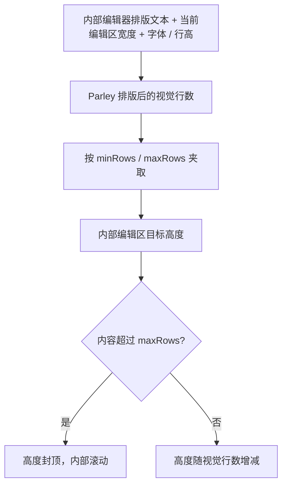

# 为多行 TextField 增加按视觉行数自适应高度

`AutoSize` 为普通与只读多行 TextField 的**编辑区域**提供随内容增减而伸缩的高度，范围由 `minRows`、`maxRows` 控制，达到上限后继续使用内部滚动。它不决定能否输入换行：多行模式与自动高度分开配置。单行、固定高度多行和自动高度多行因此都是明确且可独立理解的使用方式。

## 多行能力与高度策略分离

默认仍是单行输入：`multiline=false`，`auto_size=None`。`multiline=true` 决定输入允许换行，包括 Bevy `EditableText.allow_newlines` 的对应设置；`auto_size` 只决定**高度是否根据文本变化**。多行模式不应隐式强制自动增高，固定高度的多行输入是正常用例。

```rust
multiline: true,
auto_size: Some(AutoSize {
    min_rows: 2,
    max_rows: 6,
}),
```

配置规则如下：

| `multiline` | `auto_size` | 行为 |
| --- | --- | --- |
| `false` | `None` | 普通单行输入框 |
| `true` | `None` | 固定高度的多行输入框 |
| `true` | `Some(...)` | 自动调整高度的多行输入框 |
| `false` | `Some(...)` | 无效配置，明确报错 |

开启 AutoSize 而未指定行数时，`min_rows=2`、`max_rows=6`。调用方可以分别覆盖，但必须满足 `1 <= min_rows <= max_rows`；无效值和单行与 AutoSize 的冲突应明确报错，不能偷偷修正、忽略或自动开启 `multiline`。AutoSize 默认关闭，保证不启用者继续保持普通 TextField 高度语义。

## 由实际排版决定视觉行数

行数按**实际排版后的视觉行数**计算，而不是统计 `\n` 的数量；显式换行与输入框变窄造成的软换行都要反映在高度中。对内容的增长和删除采取双向行为：行数增加时增高，减少时缩回；少于两行仍保持默认最小两行，达到六行后封顶并在内部滚动。



例如一整段文字没有任何 `\n`，但在较窄的输入区域内实际换为三行，就按三行处理，而不是一行。设 `minRows=2`、`maxRows=5` 时，内容不足两行保持两行；增至三行时显示三行；显示需求达到六行及以上时保持五行高度并允许查看超出的内容；删回一行时收缩到两行。

这里的高度仅指 Frame 内的真实输入区域，不包含 Prefix/Suffix，也不包含根实体外部的 `showCount` 或 `HintText` 显示行。Prefix/Suffix 若占用更多横向空间，会减少编辑区可用宽度，从而改变软换行；但 AutoSize 不负责缩放、隐藏调用方提供的子控件。Root 总高度正常包含这些区域的各自高度。

## `Node.height` 的控制权与 Bevy 排版

AutoSize 开启时，Widgetry 管理编辑区高度，调用方应让相应 `Node.height` 保持 `Auto`，不能再用显式固定高度与自动高度竞争。调用方仍可指定 `Node.width`；宽度改变、字体和行高调整或文本变化都应触发实际视觉行数重新计算。需要固定高度时，关闭 AutoSize 即可。

Bevy 0.20 中，`EditableText.visible_lines` 已参与官方 `ContentSize` 的行高测量，可依据 Parley 真实排版的视觉行数算出受上下限约束的 `visible_lines`，再让 Bevy 官方布局确定尺寸，而不必实现自己的文本尺寸 Authority。

这一机制有一个**需要实现阶段验证的布局时序前提**：`sync_editable_text_viewports` 在布局之后更新编辑区宽度，排版缓存和 `ContentSize` 也受各自系统调度约束。如果简单读取旧宽度、更新高度、下一次又读取变化后的宽度，可能引发反馈振荡或延迟错误。应依据实际调度安排测量、尺寸更新与必要的后续布局收敛，并测试宽度改变时最终结果稳定；不能把未证明的排程假设当成已经成立的设计。

## 与相邻增量的关系

该功能需要真实编辑实体及 Frame 的可用宽度，因此排在复合实体结构之后。它不改变先前的 `maxLength` 正式文本约束，也不改变 `showCount` 的统计或位置；即使外部统计行随显示增加 Root 总高度，AutoSize 仍只管理输入区。

后续 `HintText` 是根实体下方的纯显示文本，自然换行并增长自身高度，**不参与本功能的视觉行数测量**；因此两者不会相互驱动尺寸。固定高度多行不受本增量自动调整逻辑影响。

## 验证与完成条件

验证单行默认行为、多行固定高度、多行自动高度以及冲突/无效行数时的明确错误。用显式换行和由宽度造成的软换行分别测试最小行数、区间内增长、达到上限时内部滚动、删除后的收缩；默认 `2..6` 和自定义范围都要覆盖。

调整编辑区宽度、Prefix/Suffix 占宽、字体和行高后，应根据最新实际排版重新计算并最终收敛；重点检查不会在相邻帧持续尺寸振荡。验证 `Node.height=Auto` 的约束与固定高度模式不相互覆盖，光标、选择、滚动仍由 Bevy/Parley 正常管理。Root 外部已有的计数行不改变输入区高度计算；程序化赋值和用户提交后的内容变化都应触发正确的高度调整。

将布局与滚动测试、必要的实体/配置组件、文档示例和覆盖说明更新纳入同一增量；仅对本功能直接影响的编辑与指针行为做回归，不添加独立的最终验证方案。
