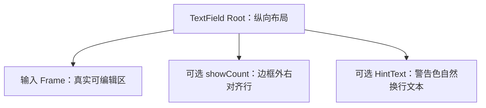

# 为 TextField 增加常显的 HintText 提示文本

TextField 自带可选的 `hint_text: Option<String>` 属性，在输入框边框**下方**显示一段始终可见的说明性文字。该能力取代了原规划中“输入框为空时显示在内部”的 Placeholder，不再实现传统内部占位符。目标是让提示成为独立的纯显示区域：允许自然换行，但不参与编辑内容与输入区域的自动高度计算。

## 自带属性与独立显示区域

调用方通过 TextField 属性提供普通字符串，不必另行声明一个子控件，也不需要设置自动换行、最大提示行数等展示参数：

```rust
WidgetryTextField {
    hint_text: Some("请填写真实姓名，与证件信息保持一致".into()),
}
```

`hint_text` 默认不存在；设置后，Widgetry 在 TextField 的根实体纵向布局中管理一个纯文本提示节点。**API 上它仍是 TextField 的属性，视觉上则是与真实编辑区分离的显示区域**，这两点不矛盾。

提示始终可见，不因输入内容为空或非空、Focus、ReadOnly、Disabled、IME 组合而自动显隐。不支持把它当成任意 UI Children，也不允许提示文案进入 `EditableText`；因此它既不影响光标或选区，也不参与 `maxLength` 和 `showCount` 的字素簇统计。

## 与输入框及字数行的布局关系



HintText 在边框外，位于 `showCount` 之后；若计数关闭，则自然紧随输入框。提示按照 TextField 可用宽度**自动换行**，占据一行或多行，高度随内容自然增长；不额外设置自动换行开关，也不设置最大显示行数。提示文本即使很长，也只是增大整体 Root 的布局高度，不让 AutoSize 把它算成额外的编辑视觉行。

这种空间分离解决了内部 Placeholder 的矛盾：长提示不必迫使空输入框增高，也不至于因为输入区最低两行而只能显示两行。调用方仍需承担自然布局的总空间需求，但不需要关心输入区的文本测量实现。

## 警告语义颜色与主题同步

HintText 固定采用**警告语义的黄色**，而不是弱化灰色或硬编码一个特定 RGB 值。现有四套 `WidgetryTheme`（Light、Dark、PinkDream、KamuriViolet）没有统一可直接使用的 warning 色字段，所以实现本功能时需要为 TextField 的提示外观增加明确的 warning 语义颜色，并在四套主题中分别提供足够清晰、可辨识的值。

主题切换时应更新提示颜色，而不修改提示内容、真实文本、Caret 或 Selection。提示保持纯展示语义，不接管输入焦点；独立区域的 `TextColor` 与编辑区的光标/选区主题投影分别维护。根实体仍是 TextField 对外身份，创建用 Props 仅初始化数据；若运行时需要读取或更新提示，状态以持久 Component 为准，不长期保留一份重复 Props 副本。

## 与相邻增量的关系

本方案在已有复合根实体、输入 Frame 和 `showCount` 可选行之后加入独立提示行；若 `showCount` 为 `false`，提示直接排在 Frame 下方。提示不改变 `maxLength` 写入保证、ReadOnly / Disabled 输入行为、Prefix/Suffix 的内容尺寸和 AutoSize 对**真实编辑视觉行**的计算。

与该显示能力直接相关的主题数据修改、样式同步和文档更新都属于本增量，不另起一个“增加主题 warning 色”方案。

## 验证与完成条件

确认缺省时没有提示、设置纯文本后始终可见，并分别在空文本、已输入文本、Focus 变化、IME 组合、ReadOnly 和 Disabled 状态下保持显示。长提示要在可用宽度内自然换行、高度自然增长，不得引入需要调用方调节的换行参数。

组合启用 Prefix/Suffix、`showCount`、AutoSize 和 `maxLength`，检查输入 Frame → 右对齐计数行 → HintText 的相对顺序；当计数不存在时，HintText 在 Frame 下方。提示的字符不得进入真实文本、编辑选区或字数计算，亦不得影响 AutoSize 输入区测量。切换 Light / Dark / PinkDream / KamuriViolet 四套主题，确认警告黄色正确切换，文字、光标和选区不被主题刷新重置。

此增量包含 `crates/theme/src/text_field.rs` 与四套相关主题色配置、TextField Props/持久显示状态、布局样式、集成测试、`docs/crates/text_field.md`、第三阶段规划与使用示例、测试覆盖说明等必要同步。作为整条方案链的最后一个**实际功能交付**，还应回归五项能力并存时的交互、长度保证、滚动和外围显示关系；不单独生成纯测试、纯验收的尾部方案。系统剪贴板与真实中文 IME 相关、Headless 无法覆盖的行为继续以 Windows 真机检查。
