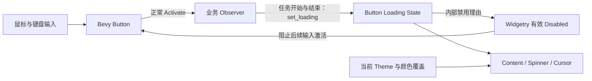
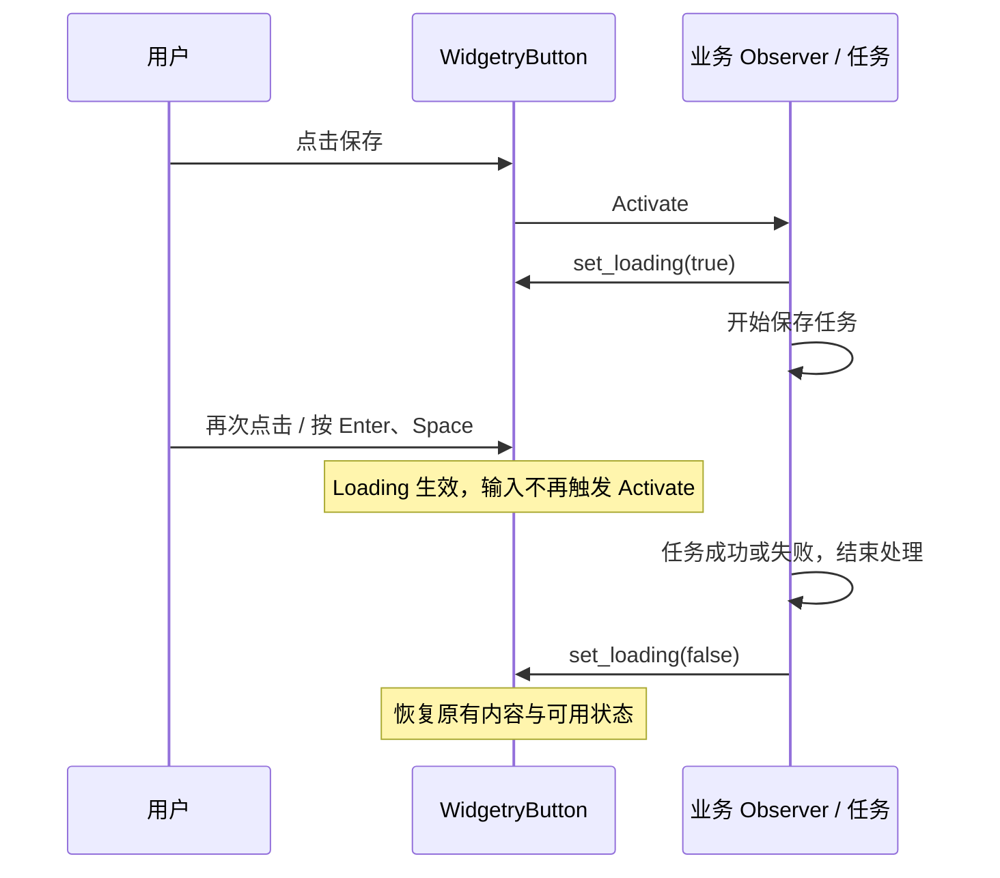
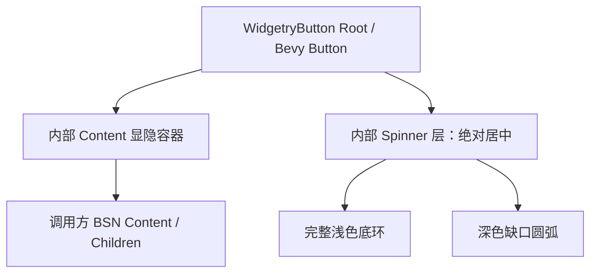

# WidgetryButton Loading 设计

`WidgetryButton` 增加由业务代码显式控制的 Loading 状态，用于表达任务正在执行，并阻止鼠标或键盘无意间重复激活。Button 只管理控件状态、输入约束与视觉效果，不启动、等待或结束业务任务。

这套设计将**任务所有权**留在业务端，同时复用 Bevy 原生 Button 的输入处理和 Widgetry 既有的 Disabled 继承机制，不另造一套鼠标、键盘拦截流程。

## Loading 状态与业务流程

Loading 是 `WidgetryButton` 独立、持久的 Runtime State，默认 `false`；不提供 BSN `@loading` 初始化 Props。即使页面打开后立即需要加载，也由业务代码在 Button 构造后通过公共 API 设置。

对外提供与仓库现有 Runtime State 规范一致的入口：

- `WidgetryButton::is_loading(world, entity) -> Result<bool, BevyError>`：只读查询。
- `WidgetryButton::set_loading_in_world(world, entity, loading) -> Result<bool, BevyError>`：同步提交状态。
- `WidgetryButton::set_loading(commands, entity, loading)`：在 Command 执行时校验并提交状态。

`set_loading_in_world` 对实际改变返回 `Ok(true)`，对合法同值调用返回 `Ok(false)`；无效或失效的 Button Entity 返回 `BevyError`，不部分修改状态。Commands 版本遵循实际执行时才生效的既有契约。

下面的例子说明**谁负责切换状态**，而不是让 Button 自己猜测异步任务何时完成：

任务成功、失败或取消后的收尾均由业务侧调用 `set_loading(false)`；控件不替业务处理任务结果。

## Disabled、焦点和输入行为

Loading 与 Disabled 相互独立，允许同时为 `true`。交互是否可用取决于两者：Loading 为 `true`，或者已有本地、内部、祖先 Disabled 生效时，都不能通过正常用户输入激活。

实现上，Loading 开启时向现有 Widgetry 有效 Disabled 机制设置**内部禁用理由**，让原生 `Button` 的鼠标和键盘入口都受到 `InteractionDisabled` 约束；Loading 关闭时只撤销自身的内部理由，绝不清除用户设置的 Disabled 或祖先继承状态。

视觉优先级则不同：**Loading 高于 Disabled**。即使两个状态同时存在，按钮仍显示 Spinner 和 Loading 外观；Loading 结束后，如果 Disabled 还在，就恢复到 Disabled 外观。Loading 不主动获取、移动、清除焦点，也不更改现有的 `TabIndex(-1)`。

Loading 期间，按钮上的鼠标光标使用 `SystemCursorIcon::Wait` 的语义，由当前 Widgetry Cursor Theme 决定最终外观；Loading 结束后，正常可用按钮恢复 `Pointer`。特别需要同步调整 `crates/cursor` 的解析逻辑：现有 Cursor 实现会把所有处于 `InteractionDisabled` 下的命中实体强制显示成 `NotAllowed`。为满足 Loading 的 Wait 优先规则，应在 Cursor 层引入**仅表达 Loading 忙碌光标优先权的内部标记或等价契约**，由 Button 根据 Loading 状态维护；Cursor 不依赖 Button crate，不改变普通 Disabled 控件显示 `NotAllowed` 的行为。这样 Kamuri Theme 才能正确播放 Wait 动画。

## Spinner 与 BSN 内部结构

Loading 时，按钮原有内容整体不可见，只显示**居中的 Spinner**，不显示“加载中…”文字；按钮尺寸、内容布局占位、原有子实体和子元素的独立 Visibility 状态均保留。Loading 结束后恢复原样。

参照现有 `WidgetryScrollArea` 的 BSN 内容组合方式，调整 `WidgetryButton` 的 Scene 结构：

通过构造阶段的 `@content` / `@children` Scene Props（可参照 ScrollArea 的 `Option<Box<dyn Scene>>`、`Option<Box<dyn SceneList>>`）将用户提供的内容嵌入内部 Content 容器，保留调用方用 BSN 自由组合文字、图标及其他子控件的能力。按钮根节点继续承载 Button 交互、背景边框和外部几何尺寸；内部 Content 承担用户内容的排布。允许直接更新当前 Button 构造约定，不添加旧 Children 结构的兼容分支；现有调用方按新结构统一调整。

显隐只作用于控件自有的 Content 包装层：隐藏时仍保留正常布局占位，不采用 `Display::None`，也不把每一个用户子节点强行改写成 `Visible`。Spinner 使用绝对定位覆盖在按钮中心，不参与布局和命中测试，不截获指针事件。

Spinner 采用两层同心圆环：**底层为完整的 360° 浅色圆环，前景为约 300° 的深色圆弧（留约 60° 缺口）**。默认外观参照确认过的示意：直径约 24px；前景顺时针匀速旋转，约 1.2 秒一圈。底环固定不动。

不使用外部 PNG 或动画素材。可在运行时一次性程序化生成圆环和缺口弧线的透明遮罩 `Image`，通过 Bevy UI 的两个 `ImageNode` 显示，并以 `UiTransform.rotation` 驱动前景圆弧；颜色随当前主题和 Button 颜色解析结果更新，底环较淡、前景弧较实。动画仅对处于 Loading 的 Button 更新；恢复正常后停止旋转并隐藏 Spinner。

## Gallery 演示

在现有 Gallery 的 Button 页面新增 Loading 示例，保持项目已有的主题与语言切换能力。点击演示 Button 触发一次 `Activate`，由演示业务 Observer 设为 Loading；随后点击不会再次激活，也不需要真实异步任务。

提供“结束 Loading”按钮，以及**仅在 Button 页面、演示 Button 正处于 Loading 时有效的 F1 快捷键**。F1 能让鼠标停留在 Loading Button 上，直接观察当前 Cursor Theme 的 `Wait → Pointer` 切换，尤其用于 Kamuri 的 Wait 动画。演示文字纳入现有中英文 i18n；快捷键逻辑仅属于 Gallery，不进入控件公共 API。

## 实现联动与验证

这次允许直接改动 `WidgetryButton` 的内部结构，不为旧 BSN Children 写法维持版本兼容；但必须同步调整仓库内所有受影响的 Button 使用点、颜色示例、相关复合控件、Gallery、文档和既有测试，确保新的 Content 层不改变业务 `Activate` 的目标 Entity，也不破坏前景色传播及根 `Node` 的样式覆写。

重点验证：同步/排队 `set_loading` 与只读查询、同值和错误处理；Loading 和本地/祖先 Disabled 的各类组合及恢复顺序；真实鼠标、Enter、Space 输入下不重复 `Activate`；直接由代码派发 `Activate` 的边界；Content 隐藏前后不改尺寸与用户子元素的状态；Spinner 不抢输入、只在 Loading 动画；四套主题及颜色覆写；焦点和 `TabIndex(-1)` 行为；Wait 光标在 Kamuri 和 System 下的表现，以及 Gallery F1 的页面作用域。

## 行为边界

- `set_loading(true)` 不能代替业务侧真实的任务并发控制；尤其通过 `Commands` 延迟设置时，禁用效果从命令实际执行并完成状态投影后才成立。业务若要求同一事件处理期间即时生效，应使用同步入口或确保命令及时提交。
- 这里阻止的是 Bevy Button **由正常鼠标、键盘输入生成的新 `Activate`**；业务代码直接 `world.trigger(Activate { ... })` 不经过输入禁用检查，不被本机制强制拦截。
- Spinner、Loading 光标和禁用投影都只服务普通 `WidgetryButton` 的 Loading 功能，不改变独立 `WidgetryLinkButton` 的行为或 URL 语义。
