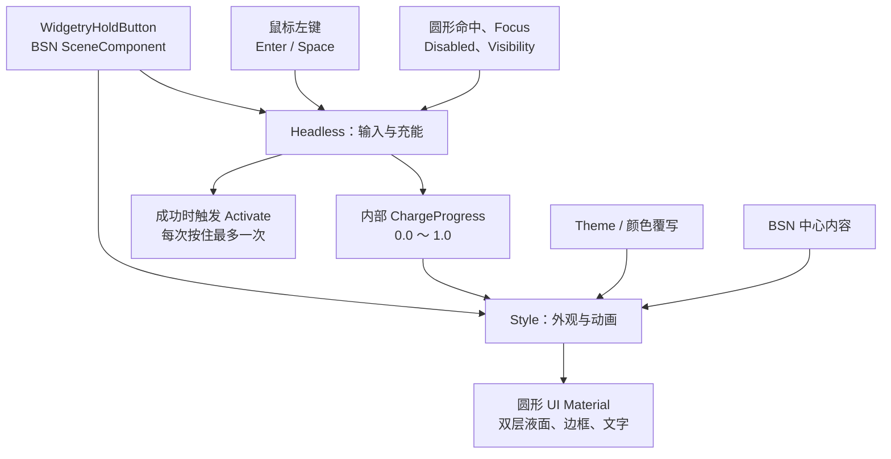

# WidgetryHoldButton 设计方案

## 设计目标与整体思路

`WidgetryHoldButton` 是基于 Bevy 0.20 的长按确认控件，适用于需要用户明确表达操作意图的 GUI 场景。

与普通按钮不同，它不会在短按时激活。用户必须持续按住，待充能进度达到 100% 后，控件才触发一次 Bevy 官方 `Activate` 事件。

视觉上采用简洁的圆形按钮：浅色背景中，深色液体随着充能进度由下向上填充；液面由两层持续流动的柔和波浪组成。整体配色跟随 Widgetry Theme。

控件按职责分为 Headless 与 Style 两部分：

Headless 只负责交互语义和充能状态，不关心波浪的绘制方式。Style 根据当前进度与 Theme 生成视觉效果，不反过来控制 Headless 的计时规则。

## 充能行为

### 进度与计时

充能进度使用 `0.0～1.0` 的连续数值，默认参数如下：

| 参数         | 默认值 | 行为                          |
| ------------ | ------ | ----------------------------- |
| 充满时间     | 3.0 秒 | 从 0% 到 100% 线性增长        |
| 自然衰减时间 | 1.2 秒 | 按固定速率线性下降            |
| 成功阈值     | 1.0    | 首次达到时立即触发 `Activate` |

充能和衰减均采用线性变化，不引入缓动。计时参数可由控件配置，适合使用 `Duration` 表达。

提前松开时，进度从当前值开始衰减，而不是立即清零。如果衰减尚未结束，用户重新有效按下，则从剩余进度继续充能。

例如，进度达到 60% 后松开，等待一段时间降至 30%，此时重新按下，就从 30% 继续增长。

### 成功与重置

进度首次达到 100% 的瞬间，立即触发一次 Bevy 官方 `bevy::ui_widgets::Activate` EntityEvent，不等待松开。

成功后继续保持按住：

- 进度维持在 100%。
- 不重复触发 `Activate`。
- 不启动新的充能周期。

成功后松开，进度立即归零，不执行自然衰减。下一次按住才开始新的充能周期。

短按或未充满时松开，只执行进度衰减，不触发 `Activate`。

## 输入与命中规则

### 输入来源

支持鼠标左键，以及键盘 `Enter`、`Space`。

一次充能尝试由一个输入来源独占，不能在鼠标和键盘之间无缝移交。其他输入来源不能借助当前持续按住的状态自动接管充能。

键盘按键重复事件不会重新开始充能，也不会重复触发成功事件。

默认使用 `TabIndex(-1)`，与现有 WidgetryButton 的默认约定保持一致。键盘操作要求按钮通过其他方式获得 Focus，不默认加入 Tab 导航顺序。

### 严格圆形命中

按钮的视觉轮廓与鼠标命中范围必须一致。

鼠标只能在可见圆形范围内开始有效按住。按钮所在矩形的四个透明角落不能触发 Hover、Pressed 或充能，也不能阻挡下层 UI 接收鼠标事件。

圆形范围随控件的实际布局尺寸和 UI 变换同步变化，不使用独立的固定像素命中框。

这里需要在 Bevy Picking 层满足真正的圆形命中与事件穿透，不能只在收到事件之后判断“是否忽略点击”。

### 输入取消

鼠标按住期间，如果指针拖出圆形区域：

1. 当前有效按住状态立即取消。
2. 进度开始自然衰减。
3. 即使鼠标仍保持按下并重新进入圆形范围，也不会自动继续充能。
4. 必须松开并重新按下，才能开始新的有效尝试。

键盘充能期间，如果按钮失去 Focus，采用相同的取消及衰减规则。焦点恢复后，仍需重新按键才能继续。

禁用或隐藏属于更强的状态中断：按钮自身或祖先进入有效 `InteractionDisabled`，或者按钮自身或祖先被隐藏时，立即取消充能并将进度清零。恢复可用或重新显示后，必须重新按下。

## 状态归属与公共接口

`WidgetryHoldButton` 使用独立的 BSN `SceneComponent`，不附加 Bevy 原生 `ui_widgets::Button`，避免普通 Button 在短按时产生不符合长按语义的 `Activate`。

组件的职责遵循 Widgetry 既有约定：

- **SceneComponent**：负责控件身份、初始配置和 BSN 组合。
- **持久化 ECS Component**：保存输入归属、充能进度和本轮是否已经成功等运行时状态。
- **Headless 系统**：更新计时、处理取消及触发 `Activate`。
- **Style 系统**：根据运行时状态和 Theme 更新材质及视觉反馈。

充能进度保存在内部 `ChargeProgress` Component 中。它供控件内部 Style 读取，但不导出为公共 API。

Style 通过 `Changed<ChargeProgress>` 感知进度变化，而不是每帧接收专门的进度事件。充能时长和衰减时长属于 Headless 配置，Style 只需要当前进度。

对外主要暴露控件的 BSN 配置、内容组合能力以及标准 `Activate` 事件。运行时状态不因 Gallery 展示需求而额外公开。

## 圆形外观与尺寸

### 轮廓

按钮始终呈正圆形，默认直径为 **112px**，允许调用方自定义直径。

外圈采用细而干净的圆形边框，最多加入很轻微的内侧明暗层次。内部背景保持平整、简洁，不添加纹理、图案或装饰结构。

边框、内容布局、液面裁剪和命中范围均跟随最终直径变化。

默认尺寸只是初始选择，实际比例通过 Gallery 观察后再调整。

### 液体填充

液体从底部向顶部填充，平均液面高度由 `ChargeProgress` 决定。

采用纯 2D Shader，不使用 3D Mesh、流体物理模拟或复杂材质。

液面由两层轻微交错的波浪构成：

- 主波浪较平缓，形成主要液体边界。
- 次波浪振幅更小，与主波浪使用略有差异的频率和移动速度。
- 两层波浪持续缓慢流动，包括进度下降期间。
- 波浪只影响视觉轮廓，不改变 Headless 的真实充能进度。

初版使用简单的正弦波组合，不加入内部 Noise、气泡、折射、粒子或复杂光照。

进度为 0% 时，液体必须完全不可见；进度为 100% 时，圆形内部必须完整填充，不能因为波浪偏移而出现未填满的区域。

波浪的具体振幅、速度和层间透明度作为 Style 内部参数，优先通过 Gallery 的实际运行效果调整，不提前扩展为大量公共配置。

### 文字与中心内容

内容位于液体绘制层之上，并在圆形区域内居中布局。

文字使用 Theme 对应的前景色，配合轻微的反差描边或阴影，避免液面经过文字时出现明显的可读性问题。

文字不随进度切换颜色，也不采用双色文字裁剪。

中心内容遵循现有 Widgetry 的 BSN 内容组合习惯，允许调用方提供按钮文字或简单内容。

## Theme 与视觉状态

### 颜色来源

HoldButton 使用独立的 Theme 配色，覆盖项目现有的四套主题：

- Light
- Dark
- PinkDream
- KamuriViolet

配色需要明确表达未充能背景、液体主体、第二层波浪、圆形边框和前景内容。

默认视觉关系为：未充能背景较浅，液体使用同系较深颜色，两者保持清楚区分。

Hover、Pressed、Disabled 等状态与现有 WidgetryButton 的交互样式保持协调，但不直接复用不足以表达液体层次的普通 Button 三色结构。

支持与项目既有控件风格一致的颜色覆写能力，并保持 Theme 切换、实例覆写及恢复默认颜色的语义一致。

### 成功反馈

充能首次达到 100% 时，圆形边框短暂提亮一次，参考持续时间约 **180ms**，之后恢复常规边框颜色。

成功反馈不改变 Headless 计时与 `Activate` 触发规则，也不重复播放。

按钮整体不闪烁，不使用额外粒子或大范围发光。液体在成功后继续保持充满，直到松开。

### 渲染更新

液体效果采用 Bevy 0.20 的自定义 UI Material / Fragment Shader 路线。

Headless 的进度变化需要同步到 UI Material；波浪位置随动画时间变化。Theme 切换、状态颜色变化和成功反馈也需要正确更新视觉结果。

存在可见波浪动画或其他视觉变化时，需要保证持续重绘；完全静止时无需为了波浪而持续产生无意义的更新。

文字、圆形边框及液体层的先后关系保持稳定，避免充能或 Theme 切换时出现短暂遮挡错误。

## Gallery 展示方案

### 页面位置

在现有 Button Gallery 页面中新增 `WidgetryHoldButton` 展示区，复用既有 `GalleryPage::Button` 页面和 BSN 场景组织方式。

不新增独立导航页面。

Gallery 统一使用控件默认的 **3.0 秒充能与 1.2 秒衰减**，不额外提供快速演示版本。

### 基础交互

展示一个默认 112px 的正常 HoldButton，中心显示“确认”或相应本地化文本，并在旁边展示成功激活次数。

计数只在真实收到 `Activate` 事件时增加，不根据进度自行推断。

此区域用于手动观察：

- 短按后液面下降，成功次数不变。
- 持续按住后液面升至 100%，成功次数增加一次。
- 成功后继续按住，不重复增加次数。
- 充满后松开，进度立即归零。
- 未充满时松开，液体线性衰减；衰减过程中重新按住，从剩余进度继续。
- 按住期间拖出圆形区域会取消，拖回后不会自动继续。

提供必要的焦点操作入口，用于验证 `Enter`、`Space` 以及充能期间失去 Focus 的行为。

激活只更新计数，不执行删除、关闭窗口等不可反复演示的操作。

### 尺寸与主题

展示 **64px、112px、160px** 三种直径的 HoldButton，用于比较圆形比例、波浪幅度、文本空间和边框厚度。

与 Gallery 现有 Theme 切换功能配合，检查四套主题下的液体层次和文字对比度。

如有实例颜色覆写示例，应沿用 Gallery 现有的 Theme / Overrides 展示方式；新增的 HoldButton Theme 字段同步接入颜色展示目录。

### 状态与边界行为

展示 Disabled、父级 Disabled，以及隐藏和恢复显示的场景。应能观察到对应状态变化时充能取消和进度归零。

另外设置一个有下层可点击控件的命中测试区域，将 HoldButton 放置在其上方，以验证：

- 圆形内部由 HoldButton 接收交互。
- 矩形透明角落不会启动 HoldButton。
- 透明角落能够将鼠标事件交给下层控件。
- 拖出可见圆形时，按住状态确实被取消。

## 测试与运行时验收

### Headless 测试

按照 `rules/testing.md` 为可观察行为提供 Unit / Integration Test，重点保护以下契约：

- 充能、衰减的线性计时与边界值。
- 短按不激活；首次充满立即激活一次。
- 成功后维持满进度且不重复激活，松开后立即归零。
- 衰减过程中重新有效按下，从剩余进度继续。
- 鼠标拖出、键盘失焦及输入来源变化时的取消规则。
- 按键重复、交错输入不能制造重复事件或错误接管。
- 有效 Disabled、祖先 Disabled、隐藏和恢复时的重置规则。

保持内部进度状态的非公共性质，不为测试便利扩大生产 API 的可见性。

### GUI / BRP 验收

按照 `rules/gui-debugging.md`，对新增的可观察行为执行针对性的 BRP 运行时验证，结合真实输入、截图、ECS 查询和必要的日志判断结果。

重点包括圆形 Picking、透明区域事件穿透、动态液面、成功瞬间边框提亮、文字可读性、Theme 切换，以及相关 Disabled / Visibility / Focus 转换。

对 3 秒充能、1.2 秒衰减和约 180ms 的成功反馈，需要观察关键中间阶段，不能只检查动画结束后的静态状态。

Gallery 的新增示例需要正常编译，并遵循仓库现有的中英文文案组织方式。

## 实现边界

- 本控件保持独立的长按激活语义，不复用会在普通点击时激活的原生 Button 行为。
- 不引入游戏专属系统、3D 水面或复杂视觉装饰。
- 不对外暴露只供内部渲染使用的 `ChargeProgress`。
- 不因为 Gallery 的展示需求增加与正常使用无关的公共接口。
- 应用窗口失去操作系统焦点的专门处理不纳入第一版范围；按钮自身失去键盘 Focus 的取消规则仍然有效。
- 严格圆形 Picking 与透明角落事件穿透属于必须满足的交互契约。具体采用何种 Bevy 0.20 Picking 接入方式，在实现阶段结合现有 UI Picking 机制确定。
- 初版外观以 Gallery 的真实效果为调整依据，优先微调尺寸、波幅、速度和配色，不提前增加额外装饰或复杂效果。
