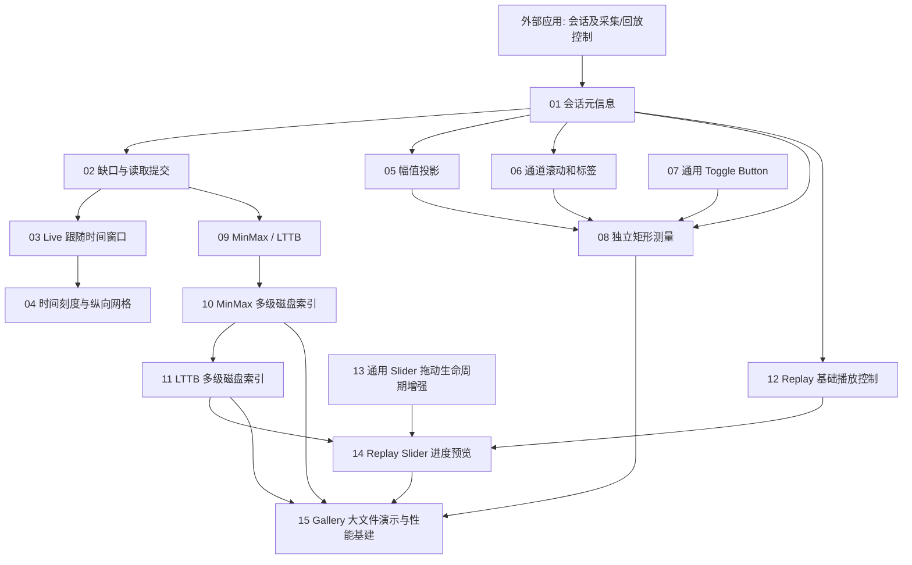

# Waveform Live / Replay 补强整体设计

## 设计全貌

Waveform 承担多通道电生理信号的时间窗口绘制、幅值/通道显示布局以及独立矩形测量。Live 与 Replay 共用核心显示和测量能力，但由**应用侧会话与 Playback Controller**决定采集、文件读取、回放时钟和数据源切换。一次会话内通道结构和采样率固定，不同会话之间允许改变；显示配置尽量保留，数据与测量结果重新开始。

实现不受旧版固定构造参数的兼容约束限制。旧版的同步、完整 `read()`、定长 Raw Ring、按通道裁剪、固定时长和仅 Min/Max 算法，都需要按新功能边界分层调整；已有主题 Palette / 配色覆盖机制继续复用。数据源将持续供给带时间与逐通道有效性的物理量样本，内部统一使用 V。外部源保有历史数据，Waveform 管理当前所需的绘图缓存、LOD 请求结果和 UI。

## 功能与责任边界

波形顶部提供时间跨度、幅值刻度、每屏通道数量及矩形测量 Toggle；下面是独立标签列和波形绘图区，绘图区再下方是时间轴。Replay 才在时间轴下方创建播放图标、进度 Slider、时间文字和倍率 ComboBox。Waveform 本体**不内置** Live/Replay 切换按钮或降采样算法选择 ComboBox，Gallery 可以另行提供。测量覆盖层使用屏幕矩形，不读取信号样本，Live 和 Replay 都不因测量暂停。

Waveform 配合数据源管理两种可视化算法：Min/Max 保留局部极值并默认启用，LTTB 选取代表点展示折线轮廓；程序化可在 Live 或 Replay 运行时切换。Replay 多级预览先建立 Min/Max 可随机访问的磁盘索引，再增加独立构建的 LTTB 分辨率层，两种预览与最终结果分别保持同一选定算法。鼠标拖动时以最新目标为准，进度持续跟手，画面和时间轴以一致快照方式提交。

已有 Slider 的 `f32` 单值模型、Pointer Capture 和拖动几何可直接复用；但其范围构造后固定，且原本未公开独立的手势开始/结束通知。因此安排独立的 **Slider 拖动生命周期增强**：直接在既有 Slider 中提供 `SliderDragStarted` / `SliderDragEnded`，结束事件包含最终值和正常/取消结果；不维护兼容分支。Replay 固定使用 `0～1` 归一化进度，再映射到外部控制器的精确会话时间，监听上述生命周期事件和现有 `ValueChange<f32>`，而不是复制 Slider 的 Pointer 处理。通用 Toggle Button 尚需作为独立增量完成，不借“换 CheckBox 的 Style”忽略交互语义。

## 唯一实施顺序

以下编号提供唯一的实施顺序。存在技术依赖的增量按先后安排；同样也有因独立提交边界而排成相邻顺序、但不互相依赖的项目。

1. [01 · 数据源会话与元信息契约](./01-数据源会话与元信息契约.md)
2. [02 · 逐通道数据缺口与读取提交](./02-逐通道数据缺口与读取提交.md)
3. [03 · Live 时间窗口与运行时选择](./03-Live时间窗口与运行时选择.md)
4. [04 · 时间标尺与主刻度网格](./04-时间标尺与主刻度网格.md)
5. [05 · 幅值刻度与跨通道裁剪](./05-幅值刻度与跨通道裁剪.md)
6. [06 · 多通道视口滚动与标签](./06-多通道视口滚动与标签.md)
7. [07 · 通用二态 Toggle Button](./07-通用二态ToggleButton.md)
8. [08 · 独立矩形测量覆盖层](./08-独立矩形测量覆盖层.md)
9. [09 · LTTB 降采样与运行时切换](./09-LTTB降采样与运行时切换.md)
10. [10 · MinMax 多级索引与真实磁盘读取](./10-MinMax多级索引与真实磁盘读取.md)
11. [11 · LTTB 多级代表点索引](./11-LTTB多级代表点索引.md)
12. [12 · Replay 基础播放控制栏](./12-Replay基础播放控制栏.md)
13. [13 · 通用 Slider 拖动生命周期通知](./13-通用Slider拖动生命周期通知.md)
14. [14 · Replay 进度 Slider 与实时预览](./14-Replay进度Slider与实时预览.md)
15. [15 · Gallery 本地大文件演示与性能基建](./15-Gallery本地大文件演示与性能基建.md)
