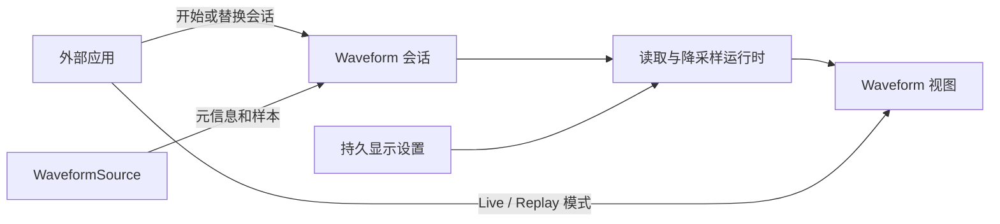
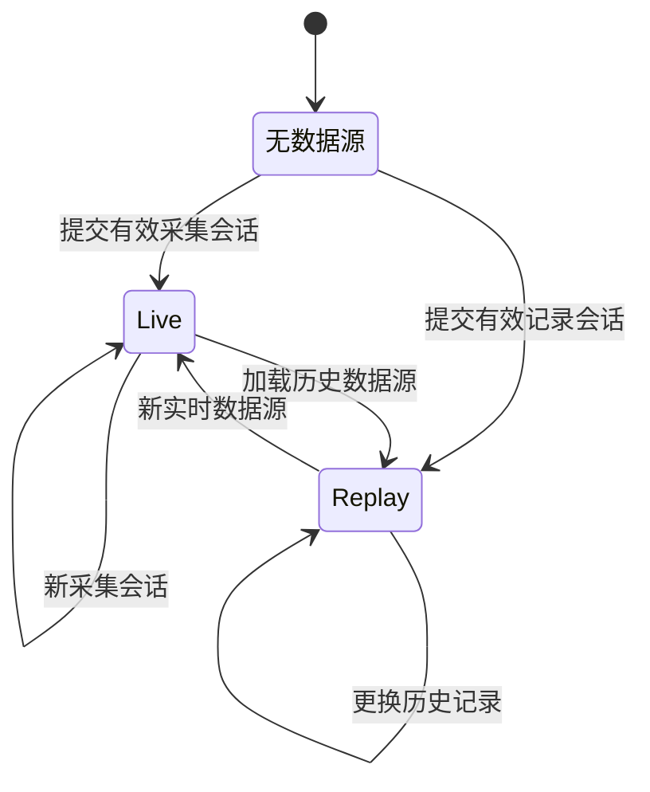

# Waveform 数据源会话与元信息契约

## 目标与设计思路

将原先在 `WaveformConfig` 构造时写死的采样率、通道幅值范围、可见时长，以及 `WaveformRuntime` 持有的固定 `WaveformSource`，调整为**显示配置与数据源会话分离**的设计。同一个 Waveform UI 实体能够由应用程序在运行时切换 Live / Replay 并更换数据源，而不必销毁控件。切换意味着重新建立数据会话，不意味着恢复全部 UI 设置。

**控制权边界**：应用决定何时开始、结束或更换采集与历史回放，负责获取数据源和外部采集/回放控制器。Waveform 管理当前会话的显示状态、通道布局与 UI。模式切换仅支持程序化入口；控件不自带 Live / Replay 切换按钮，Gallery 可为演示单独提供切换 UI。

## 会话元信息

数据源在会话建立时提供并固定以下信息：

- **通道数量与顺序**：一次 Live 采集或一次 Replay 记录内固定；不同会话可不同。32 通道 Live 切换为 64 通道 Replay，仍使用同一个 Waveform 实例，但重建相应会话资源。
- **通道标签**：每个通道必须有与其位置对应的非空、非全空白名称。标签数量严格等于通道数量；不生成 `CH1`、`CH2` 等兜底标签。Replay 从记录源取得标签，Live 从外部采集配置取得标签，替换会话时整体更新。
- **统一采样率**：单次会话所有通道使用相同采样率，在会话内保持不变；更换会话时可以从 1000 Hz 改成 2000 Hz。单通道缺口不改变采样率。
- **物理幅值单位**：数据源说明样本以 V、mV 或 µV 中哪一种为单位。外部数据源负责原始 ADC 数字到物理幅值的设备特定校准，Waveform 内部统一换算到 V。所有通道采用同一种单位；不构建通用量纲/任意物理单位系统。
- **时间基准**：使用外部可信的采样时间戳与单调采集时间，或其等效的采样序号表示；不从系统墙上时间推断采集时间。本次假定设备时间戳可靠，不扩展到时间戳乱序、漂移校正、设备同步或丢包重建。
- **Replay 总时长**：由已加载记录的元信息提供，决定进度条范围和结束位置；不由应用另行设置可能与文件矛盾的总时长。Live 不需要假装具有固定总时长。

元信息必须在会话可供显示前完整有效。更换数据源时，同步更新通道结构、时基、单位换算及回放总时长，而不是仅替换一个指针。跨会话不复用按旧通道数、采样率或索引格式构建的降采样/渲染缓存。

## 会话边界与可保留状态

- Live 正常停止：停止时间推进，保留最后一帧和最后的时间轴；不把停止等同于清空。
- 新 Live 会话：清空旧波形，时间从新会话的 0 开始；不拼接前一场采集的数据。
- 新 Replay 记录：旧回放停止，进度回到 0，默认暂停，清除旧波形，舍弃不再属于当前记录的读取结果。
- 更换会话统一清除**测量矩形和结果**；测量模式的开关配置仍属于显示设置，可按原状态继续开启、但内部矩形为空。
- 跨会话保留时间范围、幅值范围、每屏目标通道数、纵向滚动位置（必要时约束到新范围）、纵向网格开关、所选降采样算法及 Replay 倍速等设置。新会话据此重新构建有效布局和数据表示。
- 外部应用与 Waveform 自带配置控件通过同一份有效状态同步，不允许程序化设置成功但 ComboBox 仍显示旧值。只在状态确实变化时触发相应通知；具体类型/接口名称遵循当前 Widgetry 状态 API 约束。

## 与既有 API 的关系

现有 `WaveformSource::read(Range<u64>, &mut PlanarBuffer)`、`WaveformConfig { sample_rate, visible_duration_ms, channel_ranges }`、`WaveformCursor`、`WaveformRuntime::new/with_reducer` 将规格、数据源和固定容量绑定在构造时。这里允许破坏性重构，不保留仅为旧 API 服务的适配层。保留“请求半开区间”“输出密度跟随布局”“失败不覆盖已提交画面”等有效契约。数据源读取、会话元信息、程序化模式设置、可变显示设置之间须划出明确边界。

主题 Palette 与覆盖机制沿用现有 `WidgetryWaveformColorOverrides`、`ResolvedColors`，按照 `palette[channel % palette.len()]` 取色；默认使用当前主题，应用可覆盖 Palette，配色不因纵向滚动而变化。数据源切换后按新通道顺序重新应用 Palette。此次不重造单独的配色系统。

## 错误和验证

元信息不完整、标签不匹配或单位无效时报告对应 Waveform 实体的配置错误，不静默补标签，也不提交半初始化会话。实例级失败须能被外部查询/处理；全局错误传播机制留待其他控件完善后统一讨论，这里不另起通用事件框架。

验证同一 UI 实体经历 Live 32 通道 → Replay 64 通道 → 新 Replay 8 通道 → Live 的切换，核对标签、采样率、颜色、滚动位置钳制、持久设置及过期结果隔离；分别验证停止保持画面、重启清空及不接受非法元信息。相关 API 变更同步 Rustdoc、Facade 消费者、Gallery 场景和受影响测试。

**与后续方案的关系**：后续缺口处理、时间窗口、通道布局、两种降采样和回放控制，均以这里定义的会话边界和元信息为基础。
