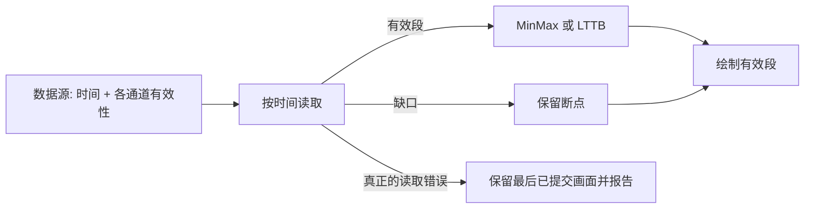

# Waveform 逐通道数据缺口与读取提交

## 目标与设计思路

使数据源可以正确表达**某些时间没有有效样本**，同时严格区分正常信号缺口与真正的读取失败。旧接口要求 `PlanarBuffer` 在每个通道上都提供完整、有限的样本序列，并把数据当成无缺口的连续帧；这种约束会导致断线后的数据错误拼接，或者让应用用零值掩盖缺口。

## 正常数据缺口

- Live 的采集时间始终由外部单调时基推进。即使某段时间没有收到样本，时间轴仍随真实采集时间向前滚动；恢复接收时，新数据按其采样时间放到正确位置，不紧贴断线前的旧数据。
- 缺口允许只影响某一个通道，例如 64 通道中仅第 7 通道在 12.5～13.2s 缺失，其他通道仍正常显示。
- 数据源可以按统一采样率和采样序号提供有效性信息，使单个样本或连续区间标记为“无数据”。真实有效的数值零和“缺失样本”必须可区分。
- 无效样本不得被均值、插值、补零或复制最后一个点来代替；折线在缺口两端断开，Min/Max 桶与 LTTB 代表点不得跨越缺口连线；有效段可按需要独立降采样。
- 缺口中的无效性属于正常数据语义，不按 `WaveformReadError` 处理，不冻结其他通道。源在可读取的时间范围内如实返回缺口即可。

这一目标需要改变读取缓冲、Reducer 输入、输出几何的共同契约，不能只在渲染阶段发现空值再去猜测断点。现有 `PlanarRing` / `PlanarBuffer::validate()`、`ReductionInput`、`ReducedChannel::Polyline/Envelope` 和 `geometry.rs` 都要适配带缺口的数据段。

## 真正的读取失败与事务性提交

- 数据源 I/O 失败、内部数据不一致或拒绝有效请求时属于读取错误，不等同于正常缺口。
- 已成功提交的数据和对应时间轴是一个一致的显示快照。读取失败后，保留最后完整快照，不把失败请求的时间轴或部分通道结果提前提交。
- **Live**：失败期间不更新已提交画面与时间轴，错误由外部处理；重试恢复后根据当前采集时刻显示最新窗口，而非把错过的历史逐帧补播。数据源自身的采集时钟不因此停止。
- **Replay**：真正的读取错误暂停播放时钟并保留最后完整画面；由外部应用决定如何处理及是否恢复。不无限自动重试，也不悄悄跳过错误数据。
- **Replay 仅暂时未准备好**：不同于读取失败，播放时钟继续，进度条照常前进；旧波形和旧时间轴保持成对一致，等新结果完成后可跳过过时画面直接更新最新位置。
- 异步请求必须带有所属会话和目标位置的身份；更换数据源、切换算法或新的跳转请求发生后，旧结果不能覆盖新会话或新位置的画面。具体任务调度手段留给实施选择，不为此建立通用 Job 系统。

## 数据契约与错误边界

保留读取范围的半开区间含义及按时间定位的能力。应明确“读取成功，包含空缺段”“读取失败”“请求尚未完成”的区别，不能用相同的异常状态代替。样本值在有效时须有限，幅值在源校准与 Waveform 内部换算后使用 V；缺口不通过任意 `NaN` 绘制成一条连续线。

错误与所属 Waveform Entity 建立关联，使应用可以定向查询/处理；遵循当前项目的 `BevyError` 路径，不新增只为重复写日志服务的事件。多实例错误汇报和统一传播机制仍是单独的后续议题，不在本方案中设计。

## 验证

覆盖单通道缺口、多通道不同缺口、缺口恰好落在桶边界/尾部、样本为零但有效、源报错后恢复以及中途替换数据源。测试包括 Reduction 的断线正确性、Renderer 不越段连线、Live 时间轴持续推进、失败前后画面不变、恢复后跳到最新采集窗口、Replay 播放时钟与错误行为、旧请求结果不得覆盖新会话。

**与前后方案的关系**：接续会话元信息契约；之后的时间窗口、算法和 Replay 异步预览都必须保持本方案的数据有效性与提交不变量。
