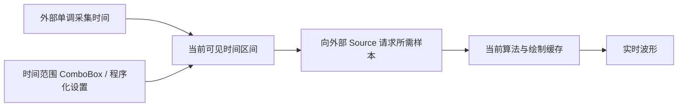

# Live 时间窗口与运行时选择

## 目标与设计思路

让 Waveform 在采集运行中持续跟随最新时间，并可通过显示区上方的**时间范围 ComboBox** 即时更改横向显示时长。该 ComboBox 的候选项由外部应用提供，例值为 1s、5s、10s、30s；应用程序也可以使用同一状态更新入口主动设置。

Live 不支持拖动波形横向回看，也不使用鼠标滚轮缩放时间。采样数据仍由外部 `WaveformSource` 管理其历史存储，Waveform 只保留当前绘制所需的暂存、缓存或降采样工作集，不额外复制一份固定最大窗口的全量原始数据。

## 窗口的确定规则

设采集开始后的单调时长为 `t`，当前可见时间跨度为 `T`：

- `t < T`：视图区间固定为 `[0, T]`，已有波形从最左边按采集时间**向右生长**，未采集的右侧保持空白，不把已采集数据右对齐。
- `t ≥ T`：视图区间为 `[t - T, t]`，连续向左滚动，右侧始终对应最新采集时间。
- 横轴显示采集开始以来的绝对累计秒数，例如 `t=35s, T=10s` 显示 `25～35s`，不是系统时钟，也不是反复标 `0～10s`。
- 采集停止时保留画面与时间；新采集会话重新从 `0s` 开始，不与上次会话拼接。

这也适用于之后的 Replay 正常播放；Replay 的暂停与主动跳转由其独立控制器实现，不意味着 Live 可随意浏览历史。

## 热切换与源能力

用户或应用把 `T` 从 10s 改到 30s，已采集时刻与采集进程保持不变，立即按照新窗口重新规划样本读取和显示密度。外部数据源负责维持足以覆盖所配置最大时间范围的历史；若它不能支持有效的显示范围，走明确的数据源错误路径，不偷偷缩短窗口或拼接不存在的样本。

改变时间范围会触发需要的读取与降采样重建，但不改变幅值刻度、通道选择、纵向滚动或采集会话时间。输出密度仍按实际绘图区像素宽度决定；不应为每个鼠标渲染帧盲目重建全部原始数据。正常空缺段遵循逐通道缺口契约。

## 控制栏与验证

顶部通用控制栏为时间范围、幅值范围、每屏通道数和矩形测量入口提供位置，Live 和 Replay 都显示；Replay 专属按钮放在横轴下方，Live 不创建也不占位。控件不内置算法切换 ComboBox，Gallery 可以独立提供。

用 8s/30s、35s/10s、采集中改变 10s→30s→1s、窗口重算时源中有缺口及暂停/重启会话等情形验证：时间轴不得闪回零点，窗口数据保持时标对应，已采样数据左起生长后转入连续滚动；缩放运行时不阻断生产端，也不引入固定最大历史环缓存。

**与前后方案的关系**：依赖已建立的数据源与有效性契约；下一份时间标尺方案仅消费这里提供的当前视图区间。
