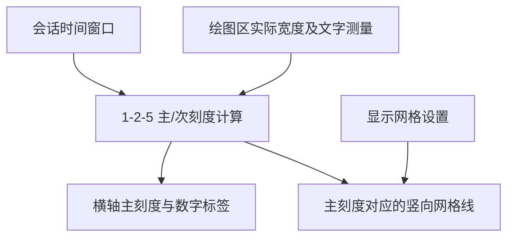

# Waveform 时间标尺与主刻度网格

## 目标与整体布局

在绘图区下方加入随 Live 和 Replay 时间窗口移动的真实时间刻度，并在绘图区内为主刻度绘制淡色竖向参考网格。时间刻度来自采集/记录的相对时间，不使用系统墙上时间。时间标尺与网格共用同一坐标变换，避免刻度、网格和数据三者之间出现像素偏移。

完整纵向 UI 次序为：**顶部通用控制栏 → 左侧标签及波形绘图区 → 横向时间标尺 → Replay 专用播放控制栏**。Live 模式不出现最后一栏，也不保留它的空白高度。

## 刻度选择与连续移动

- 主刻度间距采用“好数值” `1–2–5 × 10^n`，以约 90px 的目标主刻度间距起步，结合实际文字宽度调整，避免标签重叠。
- 次刻度不显示文字。目标像素间距至少约 20px；不足时减少或隐藏，保证缩小时不形成密集线条。
- 刻度位置锚定到采集/记录时间 `0`，而不是每一帧重新从窗口左边缘算一组整齐标签。例如可见 `25～35s`、主刻度 2s 时，可标 `26, 28, 30, 32, 34s`。
- 时间窗口连续滑动时，固定时间点的刻度和对应网格保持连续移动；窗口宽度或实际绘图区宽度变动时重新选择合理密度，不允许标签重叠或刻度突然错位。
- 上述 90px 与 20px 是初始视觉参数，允许根据 Gallery 实际阅读效果微调，不把它们作为不可变的布局常量。

## 网格配置

- 只把**主时间刻度**的竖线延伸进入绘图区；次刻度只保留在横轴上，不画满屏次网格线。
- 网格线使用主题协调的低对比度颜色；默认开启。应用可初始化配置，并通过运行时状态切换开/关。
- 开关网格不改变当前窗口、采样数据、幅值刻度或波形降采样结果。
- 此次不加入每通道的水平零幅值参考线，不顺带设计复杂背景坐标系统。

## 渲染边界与验收

绘图区可裁剪波形、网格和测量层，但刻度文字应处在自己的横轴区域；所有尺寸来自本帧一致的布局结果。窗口变化、DPI/UI 缩放或尺寸改变时，刻度、网格与绘图区要在同一有效布局快照中更新，避免错帧拉伸。

分别测试起始时间 0、窗口移动跨整秒、不同主刻度密度、Live 逐渐填满窗口、Replay 暂停/拖动/恢复、网格开关、窄宽度下标签重叠及窗口缩放。检验刻度值来自真实相对时间，刻度与网格严格对齐，切换网格无读源与时间改变。

**与前后方案的关系**：接续 Live/Replay 当前可见时间范围规则；幅值与纵向布局方案只消费绘图区的实际尺寸，不替代时间轴刻度策略。
