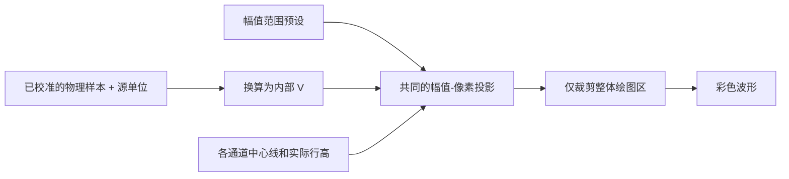

# Waveform 幅值刻度与跨通道裁剪

## 目标与设计思路

以所有通道共享的一套幅值刻度替代构造时固定的每通道 `channel_ranges`，并允许信号超出所在通道的“通道行”而继续正确绘制。顶部通用控制栏提供**幅值范围 ComboBox**；候选项由应用提供，用户或应用可在运行中修改，不中断采集/回放。

## 对称幅值刻度与单位

- 选择 `100µV` 表示单侧上限 `A=100µV`，通道中心上下分别对应 `-100µV`、`+100µV`，**不是峰峰值 100µV**。
- 所有通道使用同一个 `A`，不提供单通道自动缩放或单通道独立倍率。当前假定是相同单位的电生理多通道信号。
- 数据源元信息可以声明 V、mV 或 µV；设备校准由外部负责；Waveform 将有效采样值换算为内部 V，选择项的值也换算为内部 V。比如来源 `50µV` 与 `0.05mV` 应处于完全相同的屏幕位置。
- 预设项既有展示文字也有真实数值/单位，不能把 `100µV` 当作仅用于显示的自由字符串。预设以应用配置为准，避免产生 `1000µV` 与 `1mV` 这类等值重复选项。
- 矩形测量的幅值差使用同一比例尺，展示时采用当前幅值预设的单位，例如 75µV 和 0.075mV 可描述相同物理差值。

若某通道实际行高为 `h` 像素，采样值 `v` 的竖直偏移量按 `v / (2A) * h` 计算（符号随屏幕坐标方向调整），零幅值位于该通道中心。改变幅值预设只改变投影，不改源数据或采样率；缩放会与通道行高变化正确叠加。

## 越界时仍保持真实形状

信号幅值可以超出本通道 `[-A,+A]` 代表的竖向行区域，进入相邻通道的视觉区域；不同通道使用已有主题调色板的不同颜色加以区分。**只裁剪整个波形绘图区**，不能在每个通道的行边界上钳制 Y 值。否则溢出信号会变成误导性的水平直线，回到有效范围时也可能出现错误形状。

现有 `geometry.rs` 中的 `LaneProjection::y` 对 0～1 归一化值执行 `clamp`，`clip` 又将结果限制在各通道上下边界；此行为与新要求冲突。替换为允许超行的投影，同时在绘图区整体边缘对线段和包络作正确裁剪，不延伸到左侧标签、时间刻度或 Replay 控制栏。

## 渲染与验证

给出同一真实信号在不同输入单位、不同幅值预设和不同实际行高下的等价性测试；验证幅值 `+3A`、`-3A` 在邻道及总视图区的裁剪与重新进入，不能产生由钳制伪造的平直波形。Min/Max、LTTB 和缺口数据都按同一物理比例渲染。修改幅值时已存在的测量矩形保持屏幕位置和大小，但立即更新计算出的幅值差。

**与前后方案的关系**：依赖数据源元信息的单位契约；之后的可滚动通道行高与测量组件使用本方案统一投影公式。
