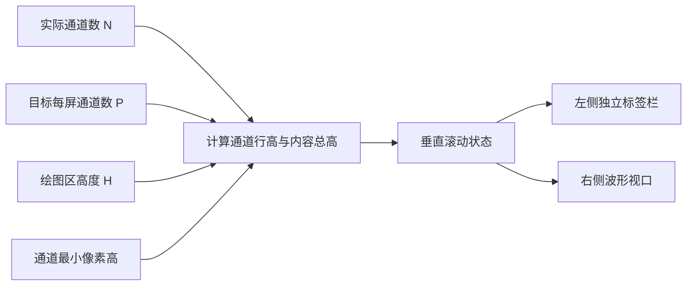

# Waveform 多通道视口滚动与同步标签

## 目标与整体布局

使几十到上百条通道在有限高度的 Waveform 中保持可读性。顶部通用工具栏提供**每屏目标通道数 ComboBox**，可以选择 8、16、32 或全部等适当预设；具体候选项由应用/Gallery 的配置决定。选中的数字表示理想布局密度，不承诺违反最小通道高度。

左侧单独保留标签列，标签沿每一行竖向居中，标签列与波形视口**共享同一滚动位置**；标签不放在波形绘图覆盖层之下，不受溢出到相邻通道的彩色波形遮挡。波形视口可以有垂直滚动条，当前只滚动全部通道，不加入通道过滤或显隐配置。

## 行高、内容与可见范围

设绘图区高度为 `H`，当前会话通道数量为 `N`，用户选择目标每屏数量为 `P`，最小通道高为 `h_min`。当 `N > 0` 且 `P > 0` 时：

\[
h = \max\left(\frac{H}{\min(P,N)}, h_{min}\right), \qquad H_{content}=N h
\]

- 实际内容高度超过可见 `H` 时支持**平滑连续纵向滚动**，允许最上、最下方是局部可见的通道，不按整数行吸附。
- 如果当前只有 6 通道，选择 16 通道/屏，则 6 条通道分配整个可用高度，而不是留下未使用空间。
- 例如 `N=64, H=600px, h_min=24px`：`P=8` 得 75px/行，`P=16` 得 37.5px/行，`P=32` 或全部则每行至少 24px，实际一屏最多约 25 行。
- `N=0` 时表现为明确的空状态，不发生除零；真正数据源会话按严格元信息校验处理没有通道的情况。

## 滚动锚点与大小变化

切换每屏数量或窗口缩放时，保留**当前顶部可见通道的索引及其行内相对位置**，换算到新的行高后重建滚动偏移。只有当新内容高度不足或滚动接近末尾时，才按合法范围裁剪偏移；不得因为调整设置每次跳回第一条通道。

布局、计算尺寸、渲染目标纹理与通道投影应使用同一帧有效尺寸，防止窗口尺寸变动时显示拉伸/错位。垂直滚动只调整通道竖向定位，不改变横向时间窗口、采样值或降采样结果。更换会话导致通道数变化时，可保留原滚动意图，再对新范围裁剪。

## 颜色、幅值及标签的关系

逐通道颜色继续使用现有主题 Palette 与可覆盖机制；第 `i` 通道按稳定索引取色。波形允许越过通道行边界，但仅在整体绘图区内裁剪；独立标签列不得被波形渲染覆盖。标签始终来自当前数据源会话的精确通道元信息，不能为空，也不自动补 `CHn`；切换数据源时可在同一个控件实例上改变数量与标签。

## 验证

覆盖 6 通道与目标 16、64 通道高度 600px/最小 24px 的组合，改变每屏数量与窗口大小、顶部正好切在某行中间、向下滚到末尾、多实例同时滚动以及切换不同通道数会话。使用 Gallery 确认左侧标签与对应信号行没有像素级跳位；大幅度信号可越入邻道但不越入标签列。稳定滚动及缩放时不应触发额外不必要的源数据读取。

**与前后方案的关系**：依赖当前会话通道元信息及幅值投影；矩形测量将使用这里计算的实际通道行高而不是固定或预设行高。
